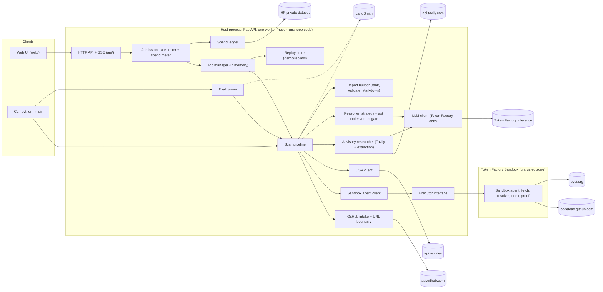
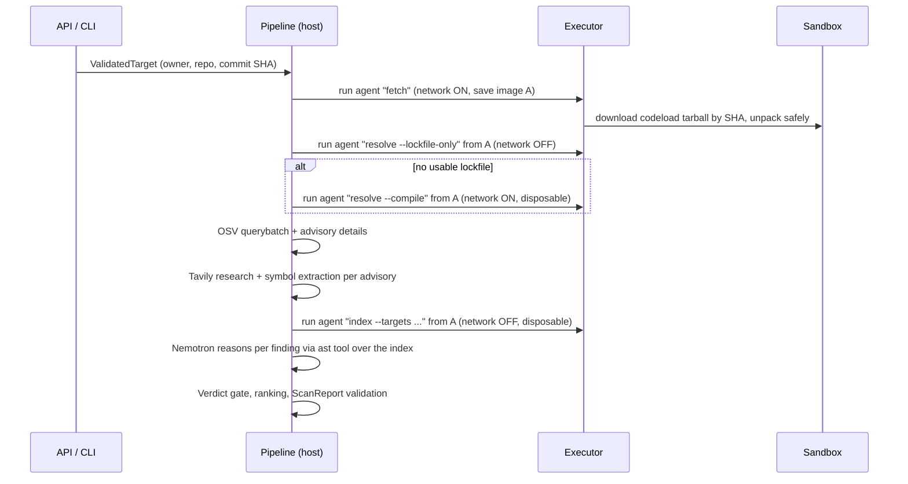

# Architecture

Status: DRAFT

The technical design of ProveItReachable: stack, components, contracts, safety boundaries, test commands and setup requirements. Requirements are in [SPEC](SPEC.md) and the [project mental model](PROJECT_MENTAL_MODEL.md); every decision with a lasting cost is recorded in [DECISIONS](DECISIONS.md). Draft written 2026-10-24; items marked **(spike)** are confirmed or replaced by the platform spike on 2026-10-25 and folded in at the freeze.

## 1. Overview

ProveItReachable is a single Python service (FastAPI) that takes a public GitHub repository URL, works out which pinned dependency versions it uses, looks up known vulnerabilities for them on OSV.dev, researches each advisory with Tavily to find the vulnerable function, builds a deterministic `ast` index of the repository **inside a Nebius Token Factory Sandbox**, and lets a Nemotron model on Nebius Token Factory decide reachability by querying that index through tool calls. A deterministic report builder validates every model answer (labels, call path, source URLs) before anything reaches the user, and ranks the findings. The same service serves the single-screen web UI, streams progress as server-sent events (SSE), replays recorded demo scans at zero cost, and enforces a per-client rate limit and a durable hard spend cap. It talks to: GitHub (repository metadata only), OSV.dev, Tavily, Token Factory (inference and Sandboxes), LangSmith (traces and the eval dataset) and a private Hugging Face dataset (spend ledger, hosted only). It is hosted on a free Hugging Face Docker Space. Decisions: [DECISIONS.md](DECISIONS.md).

## 2. Technology stack

| Layer | Choice | ADR |
|---|---|---|
| Language | Python 3.13 in the project `.venv` | [ADR-0001](DECISIONS.md#adr-0001-python-and-fastapi-service-with-typed-schemas) |
| Web framework | FastAPI + Uvicorn (one worker), SSE via `StreamingResponse` (no extra SSE library) | ADR-0001, [ADR-0011](DECISIONS.md#adr-0011-job-based-http-api-with-server-sent-events-and-a-cli) |
| Schemas and config | Pydantic v2 (strict models), pydantic-settings (`SecretStr` for keys) | ADR-0001 |
| HTTP client | httpx (async) behind an allowlisting client factory | [ADR-0005](DECISIONS.md#adr-0005-repo-intake-through-the-github-api-with-size-caps) |
| Inference | `openai` SDK pointed at `https://api.tokenfactory.nebius.com/v1/`, Nemotron model from `NEBIUS_MODEL` | [ADR-0002](DECISIONS.md#adr-0002-nemotron-on-token-factory-with-pluggable-reasoning-strategy) |
| Sandbox | `contree-sdk` 0.3.6 (async) behind the `Executor` interface | [ADR-0003](DECISIONS.md#adr-0003-run-untrusted-repo-code-only-inside-the-sandbox) |
| Advisories / research | OSV.dev REST (keyless), Tavily Search REST via httpx | [ADR-0008](DECISIONS.md#adr-0008-osvdev-as-the-advisory-source), [ADR-0009](DECISIONS.md#adr-0009-tavily-research-with-exact-source-urls) |
| Tracing and eval | `langsmith` SDK (`@traceable`, `wrap_openai`, datasets and experiments) | [ADR-0017](DECISIONS.md#adr-0017-evaluation-suite-metrics-and-precision-bar-with-langsmith) |
| Spend ledger (hosted) | `huggingface_hub` writing one JSON file to a private dataset repo | [ADR-0015](DECISIONS.md#adr-0015-durable-spend-ledger-in-a-private-hugging-face-dataset) |
| Frontend | Plain HTML + CSS + JavaScript ES modules, no framework, no build step, served by FastAPI | [ADR-0012](DECISIONS.md#adr-0012-single-screen-frontend-in-plain-html-css-and-javascript) |
| Tests | pytest, pytest-asyncio (`asyncio_mode = "auto"`), `httpx.MockTransport`, pytest-playwright (slow UI tests) | ADR-0001 |
| Lint / format | ruff (`ruff check`, `ruff format`) | ADR-0001 |
| Packaging | `pyproject.toml` (PEP 621), `pip install -e ".[dev]"` into `.venv`; exact pins set by the scaffold task | ADR-0001 |
| Hosting | Hugging Face Spaces, Docker SDK, free CPU Basic | [ADR-0013](DECISIONS.md#adr-0013-host-the-demo-on-a-free-hugging-face-docker-space) |

Runtime dependencies (minimum versions; the scaffold task pins exact versions in `pyproject.toml`): `fastapi>=0.115`, `uvicorn>=0.32`, `pydantic>=2.9`, `pydantic-settings>=2.6`, `httpx>=0.27`, `openai>=1.50`, `contree-sdk==0.3.6` **(spike: installs on 3.13)**, `langsmith>=0.2`, `huggingface_hub>=0.26`. Dev extra: `pytest>=8.3`, `pytest-asyncio>=0.24`, `pytest-playwright>=0.5`, `ruff>=0.7`. No other dependency without an ADR.

## 3. Test commands

Run from the project root with `.venv` activated (Git Bash: `source .venv/Scripts/activate`).

| Purpose | Command |
|---|---|
| **Full** | `python -m pytest -q` |
| **Fast** | `python -m pytest -q -m "not slow"` |
| **One file** | `python -m pytest -q tests/<area>/test_<module>.py` (for example `python -m pytest -q tests/unit/test_github_intake.py`) |
| **Lint** | `python -m ruff check . && python -m ruff format --check .` |
| **Eval (not part of pytest, spends credits)** | `python -m pir eval` |

Rules:

- Markers registered in `pyproject.toml` under `[tool.pytest.ini_options]`: `slow` (renders the UI in a browser, starts a server, runs Docker, runs the sandbox agent as a subprocess, or takes more than 1 second) and `live` (calls a real external service). Every `live` test is also marked `slow`. `addopts = "--strict-markers"`, `testpaths = ["tests"]`, `norecursedirs = ["fixtures", ".*", "node_modules"]` so fixture repos (including the canary) are never collected or imported.
- `tests/conftest.py` skips `live` tests unless `PIR_LIVE_TESTS=1`, so the full command needs no credentials. It also installs an autouse guard that makes any non-loopback socket connection raise in non-`live` tests: fast tests cannot reach the internet by accident.
- External services are always faked in fast tests: `httpx.MockTransport` for GitHub, OSV and Tavily; `FakeLLM` (scripted responses) for Nemotron; `FakeExecutor` for the Sandbox; `MemorySpendLedger`; a frozen clock. Expensive fixtures (fixture-repo indexes, the FastAPI app) are `scope="session"`.
- The fast suite stays under about 15 seconds.
- **Fresh scaffold:** pytest exits 5 when it collects nothing, so the scaffold task ships one non-slow smoke test (`tests/unit/test_smoke.py`, imports `pir` and checks `pir.__version__`). With that, both full and fast exit 0 on the untouched scaffold.
- Ruff excludes `tests/fixtures/repos/` and `eval/fixtures/` (deliberately vulnerable sample code).

## 4. Components



| Component | Module | Responsibility |
|---|---|---|
| HTTP API + SSE | `pir/api/` | Routes, error envelope, SSE streaming, static UI, security headers. |
| Admission | `pir/ratelimit.py`, `pir/spend.py` | Per-client and global live-scan limits; spend reservation before any paid call; fail-closed cap. |
| Job manager | `pir/jobs.py` | In-memory scan jobs (live, replay, proof) with an append-only event log per job; TTL eviction. |
| Replay store | `pir/replay.py` | Loads validated recordings; replays events with compressed pacing; records new ones. |
| Scan pipeline | `pir/pipeline.py` | Runs the six steps in order, isolates failures per item, emits progress events, enforces the scan deadline. |
| GitHub intake | `pir/github.py`, `pir/http.py` | Parses and validates the repo URL (pure), checks repo existence, size and Python markers via the GitHub API, pins the commit SHA. Owns the outbound host allowlist. |
| OSV client | `pir/osv.py` | `querybatch` per exact version, then advisory details; dedupes aliases. |
| Advisory researcher | `pir/research.py` | Tavily search per advisory plus a Nemotron extraction call that names the vulnerable symbol, grounded in the returned text, with exact source URLs. Disk cache per advisory. |
| LLM client | `pir/llm.py` | The only inference path; fixed Token Factory base URL; usage metering; retries. |
| Reasoner | `pir/reasoning/` | Strategy interface (tool calling, JSON loop), ast tool over the index, verdict gate. |
| Report builder | `pir/report_builder.py` | Turns candidates + research + reasoning into validated `Finding`s, ranks them, builds `ScanReport`, renders Markdown. |
| Sandbox agent client | `pir/agent_client.py` | Packages our stdlib-only agent, runs its commands through the executor, validates its output. |
| Executor interface | `pir/executor/` | `ContreeExecutor` (primary), `DockerExecutor` (approved fallback only), `FakeExecutor` (tests and trusted local fixtures). |
| Sandbox agent | `pir/sandbox_agent/` | Stdlib-only program that runs **inside** the sandbox: fetch and unpack the repo, parse lockfiles or run `uv pip compile`, build the `ast` index, run the proof harness. |
| Spend ledger | `pir/spend.py` | `FileSpendLedger` (local), `HfDatasetSpendLedger` (hosted), `MemorySpendLedger` (tests). |
| Eval runner | `pir/evaluation/` | Loads labeled cases, runs scans, computes metrics, syncs the LangSmith dataset and experiment. |
| Tracing | `pir/tracing.py` | LangSmith setup and secret redaction for traces and logs. |

## 5. Scan flow



1. **Admission (API only, synchronous, before a job exists):** parse URL → rate limit → spend cap → concurrency → GitHub validation (exists and public, size, Python markers, commit SHA). Any refusal returns an error and starts nothing (AC-02 to AC-06, AC-50, AC-51).
2. **`resolve`:** open the workspace (image A = pristine repo files, no repo code ever executed in it), then resolve. A malicious build backend run by `uv pip compile` executes only in a disposable branch of A, so it can never tamper with the files that the index step reads.
3. **`osv`:** one `querybatch` for all resolved dependencies, details per unique advisory ID.
4. **`research`:** per unique advisory, concurrently (`FINDING_CONCURRENCY`).
5. **`analysis`:** one index run with the top-level import names of every vulnerable package as targets.
6. **`reasoning`:** per finding with an identified vulnerable symbol, most severe first, up to `MAX_FINDINGS_REASONED`.
7. **`report`** (shown as "Verdicts" in the UI): gate, rank, validate, store, emit `done`.

Step identifiers are `resolve`, `osv`, `research`, `analysis`, `reasoning`, `report` everywhere (report, SSE, UI). UI labels: Resolve dependencies, Query OSV, Research advisories, Analyze code, Reason, Verdicts.

## 6. Data models

All models live in `pir/models/` and derive from:

```python
class Strict(BaseModel):
    model_config = ConfigDict(extra="forbid", strict=True, frozen=True)
```

Strict mode rejects instead of coercing (NFR-05). JSON input is parsed with `model_validate_json`, which accepts ISO 8601 strings for `datetime` in strict mode. The published JSON Schema `schemas/report.schema.json` is generated by `python -m pir schema`, and a fast test fails if the committed file differs from the generated one.

### 6.1 Shared literals

```python
Verdict = Literal["likely reachable", "no reachable path detected", "uncertain"]   # exact, case-sensitive
Confidence = Literal["high", "medium", "low"]
StepName = Literal["resolve", "osv", "research", "analysis", "reasoning", "report"]
StepState = Literal["pending", "running", "done", "failed", "skipped"]
Severity = Literal["critical", "high", "moderate", "low", "unknown"]
DependencySource = Literal["uv.lock", "poetry.lock", "Pipfile.lock", "requirements.txt",
                           "uv pip compile", "manifest"]   # "manifest" = declared but unresolved
ReasonCode = Literal[
    "vulnerable_function_not_identified", "tavily_failed", "nebius_failed",
    "model_output_invalid", "unsupported_reachability_claim", "contradicted_by_index",
    "osv_failed", "sandbox_timeout", "sandbox_failed", "spend_cap_reached",
    "scan_budget_reached", "scan_timeout", "finding_limit_reached",
]
```

### 6.2 Report (`pir/models/report.py`)

```python
class RepoRef(Strict):
    url: str                    # canonical "https://github.com/{owner}/{name}"
    owner: str                  # ^[A-Za-z0-9](?:[A-Za-z0-9-]{0,38})$
    name: str                   # ^[A-Za-z0-9._-]{1,100}$, not "." or ".."
    ref_requested: str | None   # as submitted, else None (default branch)
    default_branch: str
    commit_sha: str             # ^[0-9a-f]{40}$  (the exact tree analyzed)

class StepStatus(Strict):
    name: StepName
    state: StepState            # final reports contain only done | failed | skipped
    started_at: datetime | None
    finished_at: datetime | None
    message: str | None         # plain text, <= 300 chars

class Resolution(Strict):
    method: Literal["lockfile", "compiled", "failed"]
    lockfile: str | None        # repo-relative path when method == "lockfile"
    compiled_from: str | None   # e.g. "pyproject.toml" when method == "compiled"
    python_version: str | None  # compile target, e.g. "3.12"
    notes: list[str]            # includes "Versions were compiled with uv pip compile, not locked." (AC-08)

class Dependency(Strict):
    name: str                   # PEP 503 normalized
    version: str | None         # exact version; None iff resolved is False
    resolved: bool
    unresolved_reason: str | None   # required iff resolved is False (AC-09)
    source: DependencySource
    direct: bool | None         # declared in a root manifest; None if unknown
    groups: list[str]           # e.g. ["main"], ["dev"] when the lockfile records them
    osv_status: Literal["checked", "not_checked", "not_queried"]  # not_queried = unresolved, never guessed
    osv_error: str | None       # required iff not_checked (AC-26)

class Advisory(Strict):
    id: str                     # OSV ID as returned (e.g. GHSA-..., PYSEC-...)
    aliases: list[str]          # CVE and other IDs, sorted
    summary: str | None         # <= 500 chars, untrusted text
    severity: Severity          # from database_specific.severity, else "unknown"
    fixed_versions: list[str]
    published: datetime | None
    modified: datetime | None

class AdvisoryLink(Strict):
    url: str                    # EXACT string returned by OSV or Tavily; ^https?:// ; <= 2048 chars
    source: Literal["osv", "tavily"]
    title: str | None           # untrusted text, <= 200 chars

class VulnerableSymbol(Strict):
    identified: bool
    symbols: list[str]          # dotted Python paths, e.g. ["yaml.load"]; non-empty iff identified
    not_identified_reason: str | None   # "vulnerable function not identified" + detail, iff not identified
    evidence_urls: list[str]    # subset of the finding's advisory_links urls

class SourceLocation(Strict):
    file: str                   # repo-relative POSIX path; no "..", no leading "/"
    line: int                   # >= 1 and <= file line count in the index
    kind: Literal["import", "call", "reference", "definition"]
    snippet: str | None         # the source line, <= 200 chars, untrusted text

class CallPathStep(Strict):
    file: str
    line: int
    symbol: str                 # "<module>" or "pkg.mod:func" (repo) or the vulnerable symbol
    edge: Literal["entry", "call", "heuristic_call", "vulnerable_call"]

class Proof(Strict):            # M2, cuttable
    status: Literal["proven", "not_proven"]
    reason: str
    entry: str                  # "pkg.mod:func"
    target: str                 # vulnerable symbol that was stubbed
    recorded_call: str | None   # "<target> called from <file>:<line>" when proven
    ran_at: datetime

class Finding(Strict):
    finding_id: str             # sha256("{package}|{version}|{advisory_id or 'not_checked'}")[:16]
    kind: Literal["advisory", "not_checked"]
    verdict: Verdict
    confidence: Confidence
    package: str
    version: str
    advisory: Advisory | None               # required iff kind == "advisory"
    vulnerable_symbol: VulnerableSymbol | None   # required iff kind == "advisory"
    advisory_links: list[AdvisoryLink]      # >= 1 iff kind == "advisory"; [] for not_checked
    source_locations: list[SourceLocation]  # may be [] only when verdict != "likely reachable"
    call_path: list[CallPathStep] | None    # non-empty iff verdict == "likely reachable", else None
    explanation: str                        # <= 2000 chars, untrusted (model) text
    limitations: list[str]                  # min length 1; no-path includes the scope statement (AC-21)
    reason_code: ReasonCode | None          # required iff verdict == "uncertain"
    reason: str | None                      # human-readable, required iff verdict == "uncertain"
    proof: Proof | None = None
    # model validators: uncertain => confidence == "low"; the iff rules above.

class ReportSummary(Strict):
    dependencies_total: int
    dependencies_checked: int
    dependencies_unresolved: int
    dependencies_not_checked: int
    findings_total: int
    by_verdict: dict[Verdict, int]          # all three keys always present

class ScanReport(Strict):
    schema_version: Literal["1.0"]
    scan_id: str                            # uuid4 hex
    tool_version: str
    model: str                              # the NEBIUS_MODEL used
    generated_at: datetime                  # UTC
    repo: RepoRef
    outcome: Literal["findings", "clean", "incomplete"]
    steps: list[StepStatus]                 # exactly the six StepNames, in order (AC-01)
    resolution: Resolution
    dependencies: list[Dependency]          # sorted by name; includes unresolved (AC-45)
    findings: list[Finding]                 # ranked (section 9.4)
    summary: ReportSummary
    limitations: list[str]                  # scan-level scope statement
    # validators: steps order; findings ranked; unique finding_ids;
    # outcome == "clean" iff findings == [] and no unresolved and no not_checked and resolve done (AC-11);
    # outcome == "incomplete" iff findings == [] and (unresolved or failed resolve);
    # otherwise "findings".
```

Interpretations recorded for the freeze: (a) AC-19 "at least one advisory link" applies to `kind == "advisory"`; the AC-26 entries for unchecked dependencies are `kind == "not_checked"` with no advisory and no invented link. (b) AC-19 source locations may be an empty list for non-`likely reachable` findings when the package is never imported; the limitations then say "no import or call site found". (c) Unresolved dependencies (AC-09) are not findings; they are listed in `dependencies` with `resolved == False` and shown in the unresolved list.

Example finding (abridged; mock fixtures in `web/fixtures/` follow this exactly):

```json
{
  "finding_id": "3f9a1c0d2b7e4a11",
  "kind": "advisory",
  "verdict": "likely reachable",
  "confidence": "high",
  "package": "pyyaml",
  "version": "5.3.1",
  "advisory": {"id": "GHSA-8q59-q68h-6hv4", "aliases": ["CVE-2020-14343"], "summary": "...", "severity": "critical", "fixed_versions": ["5.4"], "published": null, "modified": null},
  "vulnerable_symbol": {"identified": true, "symbols": ["yaml.load"], "not_identified_reason": null, "evidence_urls": ["https://osv.dev/vulnerability/GHSA-8q59-q68h-6hv4"]},
  "advisory_links": [{"url": "https://osv.dev/vulnerability/GHSA-8q59-q68h-6hv4", "source": "osv", "title": null}],
  "source_locations": [{"file": "app/config.py", "line": 12, "kind": "call", "snippet": "cfg = y.load(fh)"}],
  "call_path": [
    {"file": "app/main.py", "line": 40, "symbol": "app.main:cli", "edge": "entry"},
    {"file": "app/main.py", "line": 44, "symbol": "app.config:read_config", "edge": "call"},
    {"file": "app/config.py", "line": 12, "symbol": "yaml.load", "edge": "vulnerable_call"}
  ],
  "explanation": "...",
  "limitations": ["Static analysis of 14 Python files ..."],
  "reason_code": null,
  "reason": null,
  "proof": null
}
```

### 6.3 Static analysis index (`pir/models/index.py`)

Produced inside the sandbox by the agent as plain JSON; validated on the host with these strict models (the agent itself is stdlib-only).

```python
class IndexedFile(Strict):
    path: str; lines: int; is_test: bool; parsed: bool; skip_reason: str | None

class ImportRecord(Strict):
    file: str; line: int
    module: str                 # absolute module (relative imports resolved within the repo)
    name: str | None            # for "from module import name"
    asname: str | None
    bound_as: str               # local name the import binds (alias-aware, AC-15)

class DefRecord(Strict):
    id: str                     # "pkg.mod:Class.func" (src/ prefix stripped)
    file: str; line: int; end_line: int
    decorators: list[str]       # dotted decorator text
    entry_kind: Literal["main_block", "route", "cli", "script", "module_level"] | None

class TargetSite(Strict):        # use of a target module from repo code
    file: str; line: int; col: int
    caller: str                 # DefRecord.id or "pkg.mod:<module>"
    target: str                 # fully qualified after alias substitution, e.g. "yaml.load"
    kind: Literal["call", "reference"]
    snippet: str                # the source line, <= 200 chars

class Edge(Strict):              # intra-repo call graph
    caller: str; callee: str; file: str; line: int
    heuristic: bool             # True for name-based method or self.* resolution

class AnalysisIndex(Strict):
    agent_protocol: Literal[1]
    commit_sha: str
    target_modules: list[str]   # top-level import names, e.g. ["yaml", "jinja2"]
    files: list[IndexedFile]
    imports: list[ImportRecord]
    defs: list[DefRecord]
    target_sites: list[TargetSite]
    edges: list[Edge]
    truncated: bool             # output limit hit; recorded as a limitation
    stats: dict[str, int]       # files_total, files_parsed, files_skipped, ...
```

Determinism (AC-14): sorted file walk, no wall-clock values, every list sorted by `(file, line, col, ...)`, no hash-order dependence. Alias rules (AC-15): `import m as a`, `from m import f as g`, `import a.b.c`, `import a.b as ab`, function-level imports, and relative imports are all bound; a call or attribute chain is resolved by substituting its first segment with its binding. Passing a function without calling it (`map(yaml.load, xs)`) is recorded as `kind="reference"`.

### 6.4 Research and reasoning (`pir/models/research.py`, `pir/models/reasoning.py`)

```python
class SearchResult(Strict):
    url: str; title: str | None; content: str   # content <= 2000 chars, untrusted

class AdvisoryResearch(Strict):
    advisory_id: str
    symbols: list[str]                 # grounded, dotted; [] if not identified
    identified: bool
    not_identified_reason: str | None
    links: list[AdvisoryLink]          # OSV references + osv.dev page + Tavily result URLs, exact
    evidence_urls: list[str]           # subset of links
    failure: ReasonCode | None         # "tavily_failed" / "nebius_failed" when research failed

class ModelVerdict(Strict):            # what Nemotron must return (submit_verdict arguments)
    verdict: Verdict
    confidence: Confidence
    call_path: list[CallPathStep] | None
    source_locations: list[SourceLocation]
    explanation: str                   # <= 2000
    limitations: list[str]             # >= 1

class ToolCallRecord(Strict):
    name: str; arguments: dict[str, str | int | list[str]]; ok: bool; result_bytes: int

class ReasoningOutcome(Strict):
    verdict: ModelVerdict | None
    tool_calls: list[ToolCallRecord]   # AC-17 evidence; also traced in LangSmith
    attempts: int
    failure: ReasonCode | None
    failure_detail: str | None
```

### 6.5 API and event models (`pir/models/api.py`)

```python
class ScanRequest(Strict):
    repo_url: str                      # <= 300 chars
    ref: str | None = None             # ^[A-Za-z0-9._/-]{1,100}$, no "..", or a 40-hex SHA

class ScanAccepted(Strict):
    scan_id: str
    mode: Literal["live", "replay", "proof"]
    status_url: str; events_url: str; report_url: str

class ScanStatusResponse(Strict):
    scan_id: str
    mode: Literal["live", "replay", "proof"]
    state: Literal["queued", "running", "completed", "failed"]
    steps: list[StepStatus]
    outcome: Literal["findings", "clean", "incomplete"] | None
    created_at: datetime; finished_at: datetime | None

ErrorCode = Literal["invalid_url", "repo_not_found", "repo_too_large", "not_python_project",
                    "rate_limited", "server_busy", "live_scans_paused", "github_unavailable",
                    "scan_not_found", "report_not_ready", "request_invalid", "internal_error"]

class ErrorBody(Strict):
    code: ErrorCode
    message: str                       # exact text from pir/messages.py; the UI shows it verbatim (AC-43)
    details: dict[str, str | int | float] = {}
    retry_after_s: int | None = None

class ErrorResponse(Strict):
    error: ErrorBody

class ProgressEvent(Strict):
    seq: int                           # 1, 2, 3 ... per job; also the SSE id
    scan_id: str
    type: Literal["step", "done", "error"]
    step: StepName | None
    state: StepState | None
    message: str | None                # plain text <= 300 chars
    at: datetime
    outcome: Literal["findings", "clean", "incomplete"] | None   # on "done"

class DemoSummary(Strict):
    slug: str; title: str; description: str
    repo_url: str; commit_sha: str; recorded_at: datetime
    by_verdict: dict[Verdict, int]

class AppConfigResponse(Strict):
    version: str
    live_scans_enabled: bool
    live_scans_paused_reason: str | None
    features: dict[Literal["progress_feed", "markdown_export", "proof"], bool]
    limits: dict[Literal["max_repo_mb", "max_repo_files"], int]

class HealthResponse(Strict):
    status: Literal["ok"]; version: str
    live_scans: Literal["enabled", "paused", "disabled"]

class ProofRequest(Strict):            # M2, cuttable
    entry: str | None = None           # must be the symbol of a step in the finding's call path
```

### 6.6 Recordings, ledger, eval

```python
class RecordedEvent(Strict):
    offset_ms: int; event: ProgressEvent

class ScanRecording(Strict):            # demo/replays/<slug>.json
    schema_version: Literal["1.0"]
    slug: str; title: str; description: str
    recorded_at: datetime; model: str
    events: list[RecordedEvent]
    report: ScanReport

class PoolState(Strict):
    spent_usd: float; reserved_usd: float

class Reservation(Strict):
    scan_id: str; created_at: datetime; amounts: dict[Literal["nebius", "tavily"], float]

class LedgerState(Strict):              # the durable spend ledger
    schema_version: Literal[1]
    pools: dict[Literal["nebius", "tavily"], PoolState]
    reservations: list[Reservation]
    updated_at: datetime

class EvalCase(Strict):                 # one [[case]] in eval/cases.toml
    id: str; repo: str                  # repo id from [[repo]]
    package: str; advisory: str         # OSV ID
    label: Verdict                      # expected verdict, exact string
    rationale: str

class EvalRepo(Strict):                 # one [[repo]] in eval/cases.toml
    id: str
    source: str                         # "local:eval/fixtures/<dir>" or "github:<owner>/<repo>@<40-hex sha>"
```

## 7. Interfaces between components

All I/O interfaces are `typing.Protocol`s in the module named, injected through `pir/deps.py` (`build_deps(settings) -> PipelineDeps`), so tests and the freeze can swap any adapter.

### 7.1 Executor (`pir/executor/base.py`)

```python
class ExecResult(Strict):
    exit_code: int; stdout: str; stderr: str
    timed_out: bool; duration_s: float; stdout_truncated: bool

class ImageRef(Strict):
    kind: Literal["sandbox", "docker", "fake"]; ref: str

class Executor(Protocol):
    kind: Literal["sandbox", "docker", "fake"]
    async def base_image(self) -> ImageRef
    async def put_file(self, image: ImageRef, path: str, data: bytes) -> ImageRef     # returns a new image
    async def run(self, image: ImageRef, argv: list[str], *, network: bool, timeout_s: float,
                  save: bool = False) -> tuple[ExecResult, ImageRef | None]          # new image iff save
    async def discard(self, image: ImageRef) -> None
# Raises ExecutorUnavailable (cannot create or reach the sandbox). Timeouts are NOT exceptions:
# they return ExecResult(timed_out=True).
```

- **`ContreeExecutor`** (primary): `base_image` → `await client.images.use(SANDBOX_BASE_IMAGE)`; `run` → `await image.run(shell=shlex.join(argv), disposable=not save, networking={"enabled": network}, timeout=timeout_s)`; `put_file` → the file upload API, or, if the spike shows upload is unsuitable, a saved `run` that writes base64 from the command line; `discard` deletes saved images if the API allows **(spike: every mapping in this bullet)**. The process environment passed to the sandbox is an explicit minimal map (`PATH`, `HOME=/tmp`, `LANG=C.UTF-8`, `PYTHONDONTWRITEBYTECODE=1`); no host variables are inherited. Concurrency is bounded by `SANDBOX_MAX_CONCURRENT_OPS`.
- **`DockerExecutor`** (fallback, ADR-0004): `docker create` + `docker cp` (a copy, not a mount) + `docker start -a` + `docker commit` for `save`. Fixed flags: `--network none --user 65534:65534 --read-only --tmpfs /tmp:rw,size=256m --tmpfs /work:rw,size=1g --cap-drop ALL --security-opt no-new-privileges --pids-limit 256 --memory 1g --memory-swap 1g --cpus 1`, no `-v`, no socket mount, no `--privileged`; a host-side timer kills and removes the container at `timeout_s`. `run(network=True)` raises `NetworkNotAllowed`, so compile and proof are unavailable in this mode. The tarball is fetched by the host as data (section 12.2) and copied in.
- **`FakeExecutor`** (tests and `--executor fake` with a trusted local fixture only): images are temp-directory copies; `run` dispatches only the agent commands `unpack`, `resolve --lockfile-only` and `index` **in-process** by calling the agent's functions (pure parsing); every other command returns a recorded `ExecResult` from the test or `exit_code=99`. It never starts a subprocess.

### 7.2 Sandbox agent protocol (`pir/sandbox_agent/`, `pir/agent_client.py`)

The agent is our own stdlib-only package, zipped at runtime into `agent.pyz` and placed at `/work/agent.pyz` with `put_file`. Invocation: `python -I -S /work/agent.pyz <command> --args-b64 <base64 JSON>`. The agent prints exactly one line `PIR-RESULT:<base64(gzip(JSON))>` on stdout; logs go to stderr. Exit codes: 0 ok, 2 bad input, 3 limit exceeded, other = failure.

| Command | Network | From image | Saves | Output model |
|---|---|---|---|---|
| `fetch --owner --repo --sha --max-bytes --max-files` | ON | base + agent | image A | `FetchResult{commit_sha, files_total, bytes_total, py_files, manifests}` |
| `unpack --max-bytes --max-files` (tarball already put at `/work/src.tar.gz`; local fixtures, Docker) | OFF | base + agent + tarball | image A | `FetchResult` |
| `resolve --lockfile-only` | OFF | A | no | `ResolveResult{method, lockfile, dependencies, notes, needs_compile}` |
| `resolve --compile --python-version` | ON | A | no | `ResolveResult` |
| `index --targets yaml,jinja2` | OFF | A | no | `AnalysisIndex` |
| `proof-install` (M2) | ON | A | image P | `{installed: [...]}` |
| `proof-run --entry --target` (M2) | OFF | P | no | `Proof` fields |

`fetch` downloads only `https://codeload.github.com/{owner}/{repo}/tar.gz/{sha}` built from validated parts, streams with a byte cap, and extracts with `tarfile` `filter="data"` (rejects absolute paths, `..`, devices, links that leave the tree) plus member-count and total-size caps. `agent_client.py` parses the result line with caps (10 MiB base64, 50 MiB decompressed via `zlib.decompressobj(max_length=...)`), validates it against the strict model, and maps a missing or invalid line to `sandbox_failed`.

```python
class SandboxAgentClient:
    def __init__(self, executor: Executor, settings: Settings): ...
    async def open_workspace(self, target: ValidatedTarget | LocalFixtureTarget) -> Workspace
    async def resolve(self, ws: Workspace) -> ResolveResult
    async def index(self, ws: Workspace, target_modules: list[str]) -> AnalysisIndex
    async def close(self, ws: Workspace) -> None
# Raise SandboxTimeout(step) or SandboxFailed(step, detail).
```

### 7.3 GitHub intake (`pir/github.py`)

```python
def parse_repo_url(url: str) -> RepoCoordinates          # pure; raises InvalidRepoUrl; no I/O (AC-02)
async def validate_repo(coords: RepoCoordinates, ref: str | None) -> ValidatedTarget
# ValidatedTarget(coords, default_branch, commit_sha, files_total, bytes_total, py_files, manifests)
# Raises RepoNotFound (404, or private == true), RepoTooLarge(caps, actual), NotPythonProject(detail),
#        GitHubUnavailable (timeouts, 5xx, rate limit 403/429).
```

Calls (all to `api.github.com`, `follow_redirects=False`; a 301 is followed manually only if its `Location` host is `api.github.com`): `GET /repos/{o}/{r}` → `GET /repos/{o}/{r}/commits/{ref or default_branch}` → `GET /repos/{o}/{r}/git/trees/{sha}?recursive=1`. Sizes come from the tree's blob sizes; `truncated: true` counts as too large.

### 7.4 OSV client (`pir/osv.py`)

```python
class OsvClient(Protocol):
    async def query(self, deps: list[Dependency]) -> dict[str, list[str] | OsvFailure]   # key "name==version"
    async def get_advisory(self, osv_id: str) -> Advisory | OsvFailure
    def links(self, osv_id: str) -> list[AdvisoryLink]   # osv.dev page + references, exact strings
```

`POST https://api.osv.dev/v1/querybatch` with `{"queries": [{"package": {"name": n, "ecosystem": "PyPI"}, "version": v}]}` (chunks of 500, `next_page_token` followed), then `GET https://api.osv.dev/v1/vulns/{id}` (cached 24 h). Aliases are deduped so one advisory yields one candidate per dependency (AC-10).

### 7.5 Search client and advisory researcher (`pir/research.py`)

```python
class SearchClient(Protocol):
    async def search(self, query: str, *, max_results: int, depth: Literal["basic", "advanced"],
                     timeout_s: float) -> list[SearchResult]       # raises SearchFailed

class AdvisoryResearcher:
    async def research(self, advisory: Advisory, package: str, osv_links: list[AdvisoryLink],
                       budget: ScanBudget) -> AdvisoryResearch      # never raises; failures in .failure
```

Tavily: `POST https://api.tavily.com/search` with `query="{package} {advisory_id} {first alias} vulnerable function"`, `search_depth=TAVILY_SEARCH_DEPTH`, `max_results=TAVILY_MAX_RESULTS` **(spike: request and response fields, credit cost)**. Then one Nemotron extraction call (JSON) over the OSV summary and details plus the Tavily snippets, returning `{identified, symbols, evidence_urls, reason}`. Host-side grounding: each symbol matches `^[A-Za-z_]\w*(\.[A-Za-z_]\w*)+$` and its last segment appears verbatim in the supplied text; `evidence_urls` must be a subset of the URLs actually returned; otherwise the symbol is dropped. No grounded symbol means `identified=False` with "vulnerable function not identified" (AC-13). Results are cached on disk per advisory ID (`DATA_DIR/cache/research/`, 30 days) so repeated advisories cost nothing.

### 7.6 LLM client (`pir/llm.py`)

```python
TOKEN_FACTORY_BASE_URL = "https://api.tokenfactory.nebius.com/v1/"   # constant, not configurable (AC-16)

class ChatResult(Strict):
    content: str | None
    tool_calls: list[ToolCall]          # ToolCall(id, name, arguments_json)
    finish_reason: str | None
    usage: Usage                        # prompt_tokens, completion_tokens, estimated: bool

class LLMClient(Protocol):
    model: str
    async def chat(self, messages: list[ChatMessage], *, tools: list[ToolSpec] | None = None,
                   tool_choice: Literal["auto", "none"] | ForcedTool | None = None,
                   json_mode: bool = False, max_tokens: int, temperature: float = 0.0,
                   timeout_s: float, budget: ScanBudget) -> ChatResult
# Raises LLMError(kind: "timeout" | "http" | "rate_limited" | "bad_response" | "budget").
```

`NebiusLLMClient` wraps `openai.AsyncOpenAI(base_url=TOKEN_FACTORY_BASE_URL, api_key=..., http_client=<allowlisted httpx client>)`, wrapped by LangSmith `wrap_openai` when tracing is on. Settings validation refuses to start if `NEBIUS_MODEL` does not contain `nemotron` (case-insensitive). Before every call it asks the budget for `estimate = ceil(chars/2.5)*in_price + max_tokens*out_price`; after the call it records actual `usage` (or the estimate if `usage` is missing). One retry on timeout or 5xx.

### 7.7 Reasoning (`pir/reasoning/`)

```python
class ReasoningStrategy(Protocol):
    name: Literal["tool_calling", "json_loop"]
    async def run(self, ctx: FindingContext, tool: AstTool, llm: LLMClient,
                  budget: ScanBudget) -> ReasoningOutcome      # never raises

class AstTool:                                   # pir/reasoning/ast_tool.py, deterministic, read-only
    def __init__(self, index: AnalysisIndex): ...
    def specs(self) -> list[ToolSpec]            # OpenAI function schemas
    def call(self, name: str, arguments: dict) -> ToolResult   # JSON, <= 8 KB, paginated (limit/offset)
    seen_locations: set[tuple[str, int]]         # every file:line returned so far (for the gate)
```

`FindingContext` = package, version, advisory (summary truncated to 1,500 chars, wrapped in `<untrusted>` delimiters), grounded symbols, target modules, whether the dependency is direct. Section 9 defines the tools and the gate.

### 7.8 Report builder (`pir/report_builder.py`)

```python
def build_finding(candidate: Candidate, research: AdvisoryResearch | None,
                  outcome: ReasoningOutcome | None, index: AnalysisIndex | None,
                  forced: tuple[ReasonCode, str] | None = None) -> Finding    # applies the verdict gate
def rank(findings: list[Finding]) -> list[Finding]
def build_report(ctx: ScanContext, findings: list[Finding]) -> ScanReport   # final strict validation
def render_markdown(report: ScanReport) -> str                               # same order as the UI
```

### 7.9 Replay store (`pir/replay.py`)

```python
class ReplayStore:
    def __init__(self, directory: Path): ...     # loads and validates every recording at startup
    def list(self) -> list[DemoSummary]
    def get(self, slug: str) -> ScanRecording     # KeyError if unknown
    async def play(self, rec: ScanRecording, emit: EventSink, *, max_seconds: float) -> ScanReport
class Recorder(EventSink):                       # wraps the live sink; captures offsets
    def to_recording(self, slug, title, description, report) -> ScanRecording
```

The replay path imports nothing from the pipeline or any client module (enforced by a fast test that inspects `pir.replay`'s imports).

### 7.10 Admission: rate limiter and spend meter (`pir/ratelimit.py`, `pir/spend.py`)

```python
class RateLimiter:
    def check_and_consume(self, client_key: str, now: datetime) -> Allowed | Limited  # Limited.retry_after_s

class SpendLedger(Protocol):
    async def load(self) -> LedgerState            # raises LedgerUnavailable
    async def save(self, state: LedgerState) -> None

class SpendMeter:
    def __init__(self, ledger: SpendLedger, caps: SpendCaps, per_scan: ScanBudgetLimits): ...
    async def reserve(self, scan_id: str) -> ScanBudget | Refused   # Refused.reason: "paused" | "ledger_unavailable"
    async def settle(self, budget: ScanBudget) -> None
    def status(self) -> Literal["enabled", "paused"]

class ScanBudget:
    def try_spend(self, pool: Literal["nebius", "tavily"], estimate_usd: float) -> SpendDenied | None
    def record(self, pool: Literal["nebius", "tavily"], actual_usd: float) -> None
```

### 7.11 Jobs and events (`pir/jobs.py`)

```python
class EventSink(Protocol):
    async def emit(self, event: ProgressEvent) -> None

class JobManager:
    def create(self, mode: Literal["live", "replay", "proof"], runner: Callable[[EventSink], Awaitable[ScanReport]]) -> Job
    def get(self, scan_id: str) -> Job                       # raises ScanNotFound
    def events(self, scan_id: str, after_seq: int) -> AsyncIterator[ProgressEvent]
```

Jobs run as `asyncio` tasks in the single worker; finished jobs are kept for `JOB_TTL_S` (default 3600) with at most `MAX_JOBS` (200), oldest evicted first.

## 8. HTTP API

Base path `/api`. JSON bodies; every error is an `ErrorResponse`. Request bodies are capped at 4 KB. No cookies, no auth, no CORS (same origin only).

| Method and path | Request | Success | Errors |
|---|---|---|---|
| `POST /api/scans` | `ScanRequest` | `202 ScanAccepted` (`mode="live"`) | `400 invalid_url`, `422 request_invalid`, `429 rate_limited` (+ `Retry-After`), `503 live_scans_paused`, `429 server_busy`, `404 repo_not_found`, `413 repo_too_large`, `422 not_python_project`, `502 github_unavailable` |
| `GET /api/scans/{scan_id}` | none | `200 ScanStatusResponse` | `404 scan_not_found` |
| `GET /api/scans/{scan_id}/events` | header `Last-Event-ID` (optional) | `200 text/event-stream` of `ProgressEvent` | `404 scan_not_found` |
| `GET /api/scans/{scan_id}/report` | `?download=1` adds `Content-Disposition: attachment; filename="proveitreachable-<repo>-<sha7>.json"` | `200 ScanReport` (same bytes with or without download, AC-61) | `404 scan_not_found`, `409 report_not_ready` |
| `GET /api/scans/{scan_id}/report.md` | `?download=1` | `200 text/markdown` | `404`, `409` (route absent when `FEATURE_MARKDOWN_EXPORT=false`, AC-64) |
| `GET /api/demos` | none | `200 list[DemoSummary]` | none |
| `POST /api/demos/{slug}/replay` | none | `202 ScanAccepted` (`mode="replay"`) | `404 scan_not_found` (unknown slug). Never rate limited or spend checked (AC-47, AC-52). |
| `POST /api/scans/{scan_id}/findings/{finding_id}/proof` (M2, cuttable) | `ProofRequest` | `202 ScanAccepted` (`mode="proof"`) | as `POST /api/scans` for limits; route not registered unless `FEATURE_PROOF=true` and `EXECUTOR=sandbox` (AC-65) |
| `GET /api/config` | none | `200 AppConfigResponse` | none |
| `GET /api/health` | none | `200 HealthResponse` | none |
| `GET /api/schema/report` | none | `200` the report JSON Schema | none |
| `GET /` and static | none | `web/` files | none |

SSE format: `id: <seq>`, `event: step|done|error`, `data: <ProgressEvent JSON>`, blank line. On connect the server first sends every stored event with `seq > Last-Event-ID`, then live events, then closes after `done` or `error`. A `: keepalive` comment is sent every 15 s. Headers: `Cache-Control: no-cache`, `X-Accel-Buffering: no`. For each step the order is `running`, then `done`, `failed` or `skipped`, and steps arrive in pipeline order (AC-41). The UI marks steps with no event yet as pending.

Error messages (exact text in `pir/messages.py`; the UI, the mock fixtures and the tests import or copy them; a fast test checks the mock fixtures match):

| Code | Message |
|---|---|
| `invalid_url` | "Enter a public GitHub repository URL like https://github.com/owner/repo." |
| `repo_not_found` | "Repository not found or not public." |
| `repo_too_large` | "Repository is over the size limit of {max_mb} MB or {max_files} files (it has {mb} MB in {files} files)." |
| `not_python_project` | "Not a Python project: {detail}." (detail: "no .py files" or "no dependency manifest at the repository root") |
| `rate_limited` | "Rate limited: you can start another live scan in {minutes} min. Demo replays still work." |
| `server_busy` | "The scanner is busy; try again in a minute. Demo replays still work." |
| `live_scans_paused` | "Live scans are paused because the spend limit was reached. Demo replays still work." |
| `github_unavailable` | "GitHub did not respond; try again later." |
| `internal_error` | "Something went wrong (error id {error_id})." (never a stack trace) |

## 9. Reasoning, the ast tool and the verdict gate

### 9.1 Tools exposed to Nemotron (AC-17)

| Tool | Arguments | Returns |
|---|---|---|
| `find_imports` | `module` | import records for that module and submodules, with `bound_as`, `file:line` |
| `find_call_sites` | `symbol`, `limit`, `offset` | `TargetSite`s whose `target` equals `symbol` or starts with `symbol + "."` |
| `find_callers` | `function_id`, `limit` | edges into that repo function, with `file:line` and the heuristic flag |
| `get_definition` | `function_id` | `DefRecord` (decorators, entry kind) |
| `list_entry_points` | `limit`, `offset` | definitions with an `entry_kind` |
| `find_paths` | `symbol`, `max_depth` (<= 8) | up to 5 shortest paths (breadth-first over `edges`) from entry points to call sites of `symbol` |
| `submit_verdict` | `ModelVerdict` | final answer (tool-calling strategy only) |

The model never sees the repository except through these tools; they are pure functions of the index, so the same index and arguments always give the same result.

### 9.2 Strategies (ADR-0002)

- **`tool_calling`** (default): OpenAI `tools` with `tool_choice="auto"` for up to `MAX_TOOL_ROUNDS` (8) rounds, then the final round forces `submit_verdict`. If the model returns several tool calls in one turn, they are executed in order. `parallel_tool_calls=False` is sent only if the spike shows it is accepted.
- **`json_loop`** (spike fallback): `json_mode=True`; the model returns `{"action": "tool", "name": ..., "arguments": {...}}` or `{"action": "final", "verdict": {...}}`; the host runs the tool and appends the result. Same tools, same limits.
- Selected by `REASONING_STRATEGY`. Invalid final output (fails `ModelVerdict` validation) is sent back with the validation error and retried up to `MAX_MODEL_RETRIES` (2); after that the finding becomes `uncertain` with `model_output_invalid` (AC-28). `temperature=0`.

### 9.3 Verdict gate (deterministic, in `build_finding`)

1. Labels outside `Verdict` cannot be represented (schema). Nothing unvalidated is emitted (AC-18).
2. `likely reachable` needs a call path where every step's `file` is in `index.files` and `1 <= line <= lines`, every step `file:line` is in `AstTool.seen_locations` (grounded in a tool result), and the last step is a `TargetSite` of a vulnerable symbol. Otherwise it is downgraded to `uncertain` with `unsupported_reachability_claim` and the failed rule (AC-20, AC-22).
3. `no reachable path detected` while a non-test `TargetSite` of the exact vulnerable symbol exists is downgraded to `uncertain` with `contradicted_by_index`.
4. Every finding gets deterministic limitations appended; a no-path finding always gets the scope statement (AC-21), for example: "Scope: 14 of 15 Python files parsed (1 skipped: syntax error); examined imports, calls and references of `yaml` in repository code. Not examined: dynamic imports, getattr or reflection, code inside other dependencies (this is a transitive dependency of `requests`), C extensions, runtime configuration."
5. Confidence caps (ADR-0010): `uncertain` is always `low`; `likely reachable` is `high` only if the path starts at an entry point and has no heuristic edge, otherwise at most `medium`; `no reachable path detected` is at most `medium` if any file was unparsed or the index was truncated, and at most `low` for a transitive (non-direct) dependency.

### 9.4 Ranking (AC-23, OQ-10)

Verdict order `likely reachable`, then `uncertain`, then `no reachable path detected`; within a verdict, confidence `high > medium > low`, then severity `critical > high > moderate > low > unknown`, then package name, then advisory ID (fully deterministic).

## 10. Failure handling

No external failure crashes a scan (NFR-06). Each becomes a visible reason on the affected items; the report always completes and validates.

| Failure | Where caught | Effect | AC |
|---|---|---|---|
| Tavily error or timeout (after 1 retry) | `AdvisoryResearcher` | That finding `uncertain`, `tavily_failed`, reason names the error; others unaffected | AC-24 |
| Nebius error or timeout in research or reasoning (after 1 retry) | `LLMClient` → strategy / researcher | That finding `uncertain`, `nebius_failed`; scan completes | AC-25 |
| OSV `querybatch` or details error or timeout (after 2 retries) | `OsvClient` | Affected deps `osv_status="not_checked"` with `osv_error`; one `kind="not_checked"` `uncertain` finding per dep (`osv_failed`); outcome never `clean` | AC-26 |
| Sandbox timeout in `index` | `SandboxAgentClient` | Every advisory finding without an earlier reason becomes `uncertain`, `sandbox_timeout`, reason "sandbox timeout"; reasoning skipped; step `analysis` failed | AC-27 |
| Sandbox timeout or failure in `fetch` / `resolve` | `SandboxAgentClient` | Step `resolve` failed; declared deps (when known) listed unresolved with the reason; no OSV queries; outcome `incomplete` | AC-09 |
| `uv pip compile` fails | agent `resolve` | All declared deps unresolved with "compile failed: <last 500 chars of stderr>"; never guessed | AC-09 |
| Model output fails validation | strategy | Retry up to 2 times, then `uncertain`, `model_output_invalid` | AC-28 |
| Model claims reachable without a valid path | verdict gate | `uncertain`, `unsupported_reachability_claim` | AC-22 |
| Vulnerable symbol not identified | researcher | `uncertain`, `vulnerable_function_not_identified`, reason "vulnerable function not identified"; no reasoning call | AC-13 |
| Global cap reached mid-scan | `ScanBudget.try_spend` | Remaining findings `uncertain`, `spend_cap_reached`, reason "spend cap reached" | AC-53 |
| Per-scan budget exhausted | `ScanBudget.try_spend` | Remaining findings `uncertain`, `scan_budget_reached` | none |
| More findings than `MAX_FINDINGS_REASONED` | pipeline | Least severe extra findings `uncertain`, `finding_limit_reached` | none |
| Scan deadline `SCAN_TIMEOUT_S` | pipeline | In-flight work cancelled; unfinished findings `uncertain`, `scan_timeout` | none |
| GitHub unavailable during admission | `validate_repo` | `502 github_unavailable`; no job | none |
| Unexpected exception in the pipeline | pipeline top level | Logged with an error ID; current step failed; the report is still built from what exists | NFR-06 |
| Unexpected exception while building the report | job runner | Job `failed`, SSE `error` with `internal_error` and the error ID; the UI shows the message | AC-43 |

Timeouts and limits (OQ-5; all configurable, section 23): GitHub 10 s per request; OSV 15 s, 2 retries; Tavily 20 s, 1 retry; Nebius 60 s per call, 1 retry, 8 tool rounds, 1,500 max completion tokens; sandbox `fetch` 120 s, `resolve --lockfile-only` 60 s, `resolve --compile` 180 s, `index` 120 s, `proof-install` 300 s, `proof-run` 60 s; whole scan 900 s.

## 11. Spend metering, cap and rate limits (ADR-0014, ADR-0015)

### 11.1 What is metered

| Pool | Unit metered | Converted to USD by | Default cap |
|---|---|---|---|
| `nebius` (Token Factory credits: inference and sandbox) | prompt and completion tokens from `usage`; sandbox operation wall-clock seconds | `NEBIUS_PRICE_INPUT_PER_MTOK`, `NEBIUS_PRICE_OUTPUT_PER_MTOK`, `SANDBOX_PRICE_PER_SECOND_USD` | `SPEND_CAP_NEBIUS_USD=25` |
| `tavily` | API credits per call (basic 1, advanced 2) | `TAVILY_PRICE_PER_CREDIT_USD=0.008` | `SPEND_CAP_TAVILY_USD=12` |
| OSV, GitHub | requests counted | free | none |

Price defaults are deliberately pessimistic placeholders until the spike and the dashboards give real prices **(spike: Nemotron per-token price, whether sandbox time is billed and at what rate, Tavily credit cost)**. Cap sizing: of $50 Token Factory and $25 Tavily, keep $20 and $10 for development, the spike, eval runs and demo recordings, give the public demo $25 and $12, and keep $5 and $3 as headroom for metering error. At deploy the platform engineer sets the caps to (remaining balance at deploy) minus headroom.

### 11.2 How the cap is enforced

1. `reserve(scan_id)` before any paid call: refuses with "paused" if either pool's `spent + reserved + SCAN_MIN_START_USD > cap`; otherwise reserves `min(per-scan budget, remaining)` per pool (`SCAN_BUDGET_NEBIUS_USD=0.75`, `SCAN_BUDGET_TAVILY_USD=0.40`) and **persists the reservation before returning** (AC-51, AC-53).
2. Every paid call first calls `try_spend(pool, estimate)` with an upper-bound estimate; a denial stops that work, and the affected findings become `uncertain` with `spend_cap_reached` when the reservation was cut short by the global cap, otherwise `scan_budget_reached`. Actual spend is recorded after the call.
3. `settle()` at the end converts actual spend to `spent`, releases the rest, and persists. So there are two ledger writes per scan.
4. **Fail closed:** if the ledger cannot be loaded or saved, live scans are paused (`live_scans_paused`) until it can. At startup, any reservation older than `2 × SCAN_TIMEOUT_S` (a crashed scan) is counted as fully spent.
5. Replays never touch the meter or the ledger (AC-47, AC-52). Kill switch: `LIVE_SCANS_ENABLED=false`.
6. The CLI and eval use the same meter with a local `FileSpendLedger`, so development spend is visible (`python -m pir check-config` prints totals, never keys).

### 11.3 Rate limits (OQ-3)

Live-scan and proof requests only (replays are not limited). The client key is the client IP: `request.client.host`, or with `TRUSTED_PROXY_HOPS=n > 0`, the n-th address from the right of `X-Forwarded-For` **(deploy check: the Hugging Face proxy hop count)**. Limits: `RATE_LIMIT_PER_CLIENT_HOUR=3`, `RATE_LIMIT_PER_CLIENT_DAY=10`, `RATE_LIMIT_GLOBAL_DAY=30` (UTC day), `MAX_CONCURRENT_SCANS=2` (then `server_busy`). The counter counts every request that passes URL parsing, which also protects the GitHub API quota. State is in memory (resets on restart); the durable spend cap is the hard backstop. Client keys are kept only in memory, and logs show a salted hash.

## 12. Repo intake and URL boundary (ADR-0005)

### 12.1 Accepted URLs (AC-02, AC-06)

`parse_repo_url` accepts only `https://github.com/{owner}/{repo}` (also `www.github.com`), with an optional `.git` suffix, an optional trailing slash, and an optional `/tree/{ref}` (which sets `ref`). It rejects: other schemes, userinfo, ports, any other host (including `api.github.com` and raw IPs), query strings, fragments, percent-encoded or non-ASCII characters, extra path segments, owner or repo names outside the regexes in `RepoRef`, and inputs over 300 characters. Parsing is pure: a rejected URL causes no network call.

### 12.2 Outbound allowlist

All host-side HTTP goes through `pir/http.py` `make_client(allowed_hosts=...)`: an httpx `event_hooks["request"]` check that refuses any host not in that client's set, `follow_redirects=False`, HTTPS only, and response bodies read in a streaming way with a byte cap (GitHub 5 MiB, OSV 5 MiB, Tavily 2 MiB). The user's input influences only the `{owner}/{repo}` path segments on `api.github.com`; it never selects a host.

| Client | Allowed hosts |
|---|---|
| GitHub intake | `api.github.com` |
| Host tarball fetch (Docker fallback only; bytes are never extracted on the host) | `codeload.github.com`, capped at `MAX_REPO_MB` |
| OSV | `api.osv.dev` |
| Tavily | `api.tavily.com` |
| LLM | `api.tokenfactory.nebius.com` |

The `contree-sdk`, `langsmith` and `huggingface_hub` libraries use their own fixed endpoints, which are not influenced by user input.

### 12.3 Caps (OQ-1)

`MAX_REPO_MB=50` (sum of blob sizes at the scanned commit) and `MAX_REPO_FILES=5000`; a truncated GitHub tree counts as over the cap. Inside the sandbox the agent enforces the same caps again while downloading and extracting, and skips any single `.py` file over `MAX_PY_FILE_BYTES=1000000` (recorded as a limitation). **Python project (AC-05):** at least one `.py` file **and** at least one manifest at the repository root (`pyproject.toml`, `setup.py`, `setup.cfg`, `requirements*.txt`, `Pipfile`, `Pipfile.lock`, `uv.lock`, `poetry.lock`).

### 12.4 Ref (OQ-7)

Default: the default branch's HEAD, resolved to a commit SHA during admission; the whole scan uses that SHA (the tarball is fetched by SHA), and the SHA is recorded in `repo.commit_sha`. An optional `ref` (branch, tag or SHA; also from `/tree/{ref}`) is resolved the same way.

## 13. Dependency resolution (ADR-0006, OQ-6)

Inside the sandbox, first match wins:

1. `uv.lock` (TOML): every package with a registry source, transitive included; `direct` from the root package's dependencies; git, path and URL sources are unresolved ("non-registry source").
2. `poetry.lock` (TOML): every `[[package]]`, transitive included; groups recorded when present; `direct` from `pyproject.toml`.
3. `Pipfile.lock` (JSON): `default` and `develop` entries with `==` versions.
4. `requirements.txt` at the root, if every requirement line (after following `-r` includes inside the repo) is `name==version` (extras, markers and hashes allowed). Only what the file lists is scanned; if it has no transitive pins, a limitation says so.
5. Otherwise `uv pip compile` (network ON, in the disposable branch) on the first of `pyproject.toml`, `requirements.in`, an unpinned `requirements.txt`, `setup.py` / `setup.cfg`, with `--python-version RESOLVE_PYTHON_VERSION` (default `3.12`, or the lowest version allowed by `requires-python` if one exists), `--no-header --no-annotate --quiet --output-file -`, index `https://pypi.org/simple`. Runtime dependencies only (no extras or dev groups; stated as a limitation); transitive dependencies included; the report states "compiled, not locked" (AC-08).
6. Otherwise, or if compile fails: every declared name is listed as unresolved with the reason; a bare `Pipfile` is unresolved ("Pipfile without Pipfile.lock is not supported").

Only root-level manifests are read (monorepo subprojects are a stated limitation). Names are PEP 503-normalized. The base image provides `uv` **(spike: whether `ghcr.io/astral-sh/uv:python3.13-bookworm-slim` can be used; otherwise the compile run first installs a pinned `uv` with network on)**.

## 14. Demo replays (ADR-0016, OQ-11)

- Recordings are produced by `python -m pir record <repo_url> --slug <slug> --title ... --description ...`, which runs a real live scan with a `Recorder` sink and writes `demo/replays/<slug>.json` (committed). `demo/replays/index.json` lists slugs in display order.
- **Set:** 3 public repositories chosen at the end of M1 from real recorded runs: one with at least one `likely reachable` finding, one mixed with a visible `uncertain`, one clean or mostly `no reachable path detected`. Each is pinned to its commit SHA, small (under 10 MB), and permissively licensed.
- **Pacing:** recorded offsets are scaled by `min(1, REPLAY_MAX_SECONDS / recorded_duration)` (`REPLAY_MAX_SECONDS=20`), with at least 300 ms between events, so the full report appears in at most about 25 s (AC-49 requires under 180 s).
- The replayed report equals the recorded `report` byte for byte when serialized (AC-48). Status and SSE carry `mode="replay"`; the report itself is unchanged, and the UI labels it "Recorded demo, recorded on <date>".
- Recordings are validated at startup; an invalid one is skipped and logged, and a fast test validates every committed recording.

## 15. Evaluation suite (ADR-0017)

### 15.1 Fixtures (OQ-13)

`eval/cases.toml` (read with `tomllib`) holds `[[repo]]` and `[[case]]` tables (`EvalRepo`, `EvalCase`). The suite has **at least 12 cases: at least 4 labeled `likely reachable`, 3 `no reachable path detected` and 3 `uncertain`** (AC-33 needs 10). Sources:

- **Local synthetic repos** (`eval/fixtures/<dir>/`, at least 5): each has a lockfile pinning a known-vulnerable version and covers a pattern: a direct call, `import m as a`, `from m import f as g`, a call reached through two repo functions from a CLI or route entry point, an import with the vulnerable function never called, a dependency declared but never imported, a dynamic `importlib.import_module` or `getattr` use (uncertain), and an advisory with no identifiable function (uncertain). They are uploaded into the sandbox (`unpack`), because the GitHub repo stays private until 2026-10-30.
- **Pinned real repos** (at least 2): `github:<owner>/<repo>@<sha>`, chosen in M1.
- **Recorded advisory data:** OSV and Tavily responses for every case are stored in `eval/recordings/` so runs are repeatable and cost no Tavily credits; `--refresh-research` re-records them. Nemotron and the sandbox always run live in a scored run.

### 15.2 Metric definitions (OQ-8, AC-35)

Positive class: `likely reachable` (LR). For N cases with label `y` and prediction `p`:

- **Precision (LR)** = TP / (TP + FP), where TP = `p == LR and y == LR`, and FP = `p == LR and y != LR` (claiming reachable on an `uncertain`-labeled case counts as wrong). Undefined (reported as `null`) when nothing is predicted LR.
- **Recall (LR)** = TP / (number of cases with `y == LR`). Reported only, no threshold (OQ-2).
- **Abstention rate** = (cases with `p == uncertain`) / N.
- Also reported: **case count** N; **correct abstentions** (`p == y == uncertain`); **no-path precision** (correct no-path / predicted no-path); **dangerous misses** (`y == LR and p == no reachable path detected`); the 3×3 confusion matrix; errored cases; a limitations statement (fixture count, synthetic share, recorded advisory data, single model, temperature 0).
- **Errored cases** (an exception in the eval harness, AC-38): recorded with the error, counted and listed, and scored as `p = uncertain` (conservative: precision unchanged, recall and abstention penalized). A case whose finding is missing from the report is scored the same way.
- `pir/evaluation/metrics.py` is a pure function `compute(pairs: list[tuple[Verdict, Verdict | None]]) -> EvalMetrics`, tested with hand-computed synthetic sets.

### 15.3 Precision bar (AC-36, OQ-2)

**Precision for `likely reachable` must be at least 0.80 on a full scored eval run**, and at least one case must be predicted `likely reachable` (if none is, the bar is not met). With 4 to 6 reachable cases this allows at most one wrong reachable claim in five. `python -m pir eval` prints PASS or FAIL against the bar and exits 0 (bar met), 1 (ran, bar not met) or 2 (could not run, for example a missing variable). A FAIL triggers the orchestrator's switch to the full per-task pipeline.

### 15.4 LangSmith (AC-37)

The runner upserts dataset `LANGSMITH_DATASET` (default `proveitreachable-eval-v1`, one example per case: inputs = repo source, package, advisory; output = label), then runs one LangSmith experiment per eval run (`eval-<UTC timestamp>-<model>`), with one root trace per case containing child runs for each pipeline step, every LLM call and every tool call. Per-case feedback `correct` (0 or 1); run-level metrics are attached as experiment metadata. Results are also written to `eval/results/<timestamp>.json` and `.md` (gitignored, except `eval/results/latest.md`, which the README quotes). `--no-langsmith` exists for offline debugging only and is never a scored run. The "41 to 3" figure appears in the README and UI only as a labeled motivating example unless `latest.md` measures it (AC-39).

## 16. Call-chain proof (M2, cuttable; ADR-0018, OQ-15)

- Gate: built only if M1 passed and the sandbox spike passed; enabled only with `FEATURE_PROOF=true` **and** `EXECUTOR=sandbox`; otherwise the route is not registered and `/api/config` reports `proof: false` (AC-65). Not available in the Docker fallback (it needs network to install).
- **Entry function:** the first step of the finding's validated call path (its `symbol`, `pkg.mod:func`); `ProofRequest.entry` may name another step of the same path, nothing else.
- Flow: from image A, `proof-install` (network ON) installs exactly the resolved pins with `uv pip install --no-deps` → image P; then `proof-run` (network OFF) runs a harness that adds the repo to `sys.path`, patches the vulnerable symbol with `unittest.mock.patch(target, side_effect=recorder)` (the recorder stores the caller's `file:line` and returns a `MagicMock`), imports the entry module and calls the entry function with `unittest.mock.sentinel` placeholders for required parameters. "proven" if the recorder fired, otherwise "not proven" with the reason (not reached, import error, entry raised before reaching, needs real arguments). A timeout gives "not proven" with "sandbox timeout" (AC-68). The verdict is never upgraded by proof, and `not_proven` never changes it either (AC-67).
- No payloads (AC-69): the only inputs are sentinels and MagicMocks created by the harness; no input text is generated by the model or stored.

## 17. Frontend (ADR-0012)

- **Stack:** one `web/index.html`, `web/css/app.css`, ES modules in `web/js/` (`app.js` state and events, `render.js` DOM building, `export.js`, `api/index.js`, `api/http.js`, `api/mock.js`), no framework, no build, no CDN. FastAPI serves `web/` at `/`; at startup it calls `mimetypes.add_type("text/javascript", ".js")` and `mimetypes.add_type("text/css", ".css")` (the Windows registry can map `.js` to `text/plain`).
- **Single screen (AC-59):** URL form, demo picker, progress feed, results (summary, unresolved list, ranked finding cards, clean state), export buttons and an error banner, all in one document, with no navigation.
- **Adapter interface** (`web/js/api/index.js` returns `createApi()`, which picks `mock` when the page URL has `?api=mock`, otherwise `http`):

```js
/** @typedef {{ code: string, message: string, details?: object, retryAfterS?: number }} ApiError */
export interface Api {          // JSDoc-typed; both adapters implement exactly this
  getConfig(): Promise<AppConfigResponse>
  listDemos(): Promise<DemoSummary[]>
  startScan(repoUrl: string): Promise<ScanAccepted>       // rejects with ApiError
  startReplay(slug: string): Promise<ScanAccepted>
  subscribe(scanId: string, onEvent: (e: ProgressEvent) => void): () => void   // EventSource; mock uses timers
  getStatus(scanId: string): Promise<ScanStatusResponse>  // polling when progress_feed is off (AC-42)
  getReport(scanId: string): Promise<ScanReport>
  exportUrl(scanId: string, format: "json" | "md"): string  // http: /api/.../report?download=1; mock: blob: URL
}
```

- **Mock adapter:** `web/fixtures/` holds `config.json`, `demos.json`, `reports/<scenario>.json` (valid `ScanReport`s, checked by a fast test), `events/<scenario>.json`, `errors.json` (exact messages from section 8) and `reports/<scenario>.md`. Scenarios via `?api=mock&scenario=<name>`: `reachable` (default, mixed verdicts), `clean`, `incomplete` (unresolved), `partial-failure` (Tavily, Nebius, OSV and sandbox reasons), `error-invalid-url`, `error-not-found`, `error-too-large`, `error-not-python`, `rate-limited`, `paused`. `&jump=report` skips the feed animation (for screenshots).
- **Feature flags** from `/api/config`: `progress_feed=false` shows a single busy state and polls `getStatus` (AC-42); `markdown_export=false` offers JSON only (AC-64); `proof=false` hides proof controls (AC-65).
- **Untrusted text (AC-60, AC-57):** all report text is set with `textContent` or created with `document.createElement`; `innerHTML`, `outerHTML`, `insertAdjacentHTML`, `document.write`, `eval` and `new Function` are banned (a fast test scans `web/js/**/*.js`). Links are created only if `new URL(u).protocol` is `http:` or `https:`, with `href` set to the exact report string, `target="_blank"`, `rel="noopener noreferrer"`. `uncertain` cards carry `data-verdict="uncertain"`, a distinct class and the visible text `uncertain` (AC-56). Card order in the DOM: evidence (call path, advisory links, vulnerable function), then confidence, limitations, explanation (AC-55).
- **Preview command (prototype, no backend):** `npx --yes http-server web -p 5173 -c-1`, then open `http://localhost:5173/?api=mock`.
- **Preview command (real backend, once the API exists):** `python -m pir serve --port 8000`, then open `http://127.0.0.1:8000/` (replays work without any keys when `LIVE_SCANS_ENABLED=false`).
- **Screenshot command:** `npx playwright screenshot --viewport-size=1280,900 --full-page --wait-for-timeout=1500 "http://localhost:5173/?api=mock&scenario=reachable&jump=report" .ui-review/report.png` (swap `scenario` for other states).

## 18. Hosting and deployment (ADR-0013)

- **Target:** a Hugging Face Space with the Docker SDK on free CPU Basic (2 vCPU, 16 GB RAM, no GPU). **Cost: $0.** One container serves the API and the UI on port 7860 with `uvicorn pir.api.app:app --host 0.0.0.0 --port 7860 --workers 1`. The image is `python:3.13-slim`, runs as non-root uid 1000, has no Docker (so the Docker fallback cannot run there), and gets its secrets from Space secrets.
- **Visibility:** the Space is created **private** for testing and made public together with the GitHub repo after the user confirms (2026-10-30), because a public Space exposes its source files.
- **Stays up until 2026-12-15:** free Spaces sleep after about 48 h without traffic. A GitHub Actions scheduled workflow (`.github/workflows/keepalive.yml`, every 6 h) calls `GET /api/health`, keeps the Space awake, and fails visibly (email) if the check fails, which is the NFR-01 monitor. GitHub disables scheduled workflows after 60 days without repository activity; 2026-10-30 to 2026-12-15 is 46 days.
- **State:** jobs, reports and rate-limit counters are in memory (lost on restart, acceptable); the research cache is on ephemeral disk (losing it only costs credits); the spend ledger is durable in a private Hugging Face dataset (ADR-0015).
- **If the sandbox spike fails** and the Docker fallback is approved: the hosted demo runs replays only (`LIVE_SCANS_ENABLED=false`) and live scans are local only.
- **Paid alternatives (not chosen; each needs the user's approval):** Hugging Face persistent storage (small tier, about $5 per month) to keep the ledger on disk; a Hugging Face CPU upgrade (about $0.03 per hour, about $22 per month) if free CPU is too slow; Fly.io (about $2 to $5 per month with a volume, card required).
- `docs/DEPLOYMENT.md` (platform engineer, M2) holds the exact push steps, the Space README front matter (`sdk: docker`, `app_port: 7860`) and the health check.

## 19. Directory layout

```
ProveItReachable/
  pyproject.toml              # deps, [project.scripts] pir, ruff + pytest config (markers slow, live)
  Dockerfile  .dockerignore   # Hugging Face Space image
  README.md  LICENSE          # MIT
  .env.example                # created by the orchestrator from section 23
  .github/workflows/keepalive.yml
  schemas/report.schema.json  # generated; checked by a fast test
  src/pir/
    __init__.py  __main__.py  cli.py  config.py  messages.py  deps.py
    models/       report.py index.py research.py reasoning.py api.py recording.py ledger.py eval.py
    api/          app.py routes.py sse.py errors.py security_headers.py
    http.py  github.py  osv.py  research.py  llm.py  tracing.py
    reasoning/    strategy.py tool_calling.py json_loop.py ast_tool.py prompts.py
    executor/     base.py contree.py docker.py fake.py
    agent_client.py
    sandbox_agent/  __main__.py fetch.py resolve.py index.py proof.py protocol.py   # stdlib only
    pipeline.py  report_builder.py  markdown.py  jobs.py  replay.py  ratelimit.py  spend.py
    evaluation/   cases.py metrics.py runner.py
  web/
    index.html  css/app.css  js/{app,render,export}.js  js/api/{index,http,mock}.js
    fixtures/                 # mock adapter data
  demo/replays/               # index.json + <slug>.json recordings (committed)
  eval/
    cases.toml  fixtures/<repo>/  recordings/{osv,tavily}/  results/ (gitignored except latest.md)
  tests/
    conftest.py               # live skip, socket guard, shared fakes
    fakes/                    # FakeLLM, FakeExecutor wiring, MockTransport handlers, MemorySpendLedger
    fixtures/repos/           # synthetic repos incl. canary/ (never collected or imported)
    fixtures/http/            # recorded GitHub/OSV/Tavily responses
    unit/                     # test_<module>.py per module
    integration/              # pipeline + API with fakes (fast)
    e2e/                      # Playwright UI tests (slow)
    live/                     # real services, opt-in (slow + live)
  data/                       # runtime cache and local ledger (gitignored)
```

The orchestrator adds `data/`, `eval/results/*` (with `!eval/results/latest.md`), `.venv/` and `__pycache__/` to `.gitignore`.

## 20. CLI (OQ-14)

`python -m pir <command>` (also `pir` after `pip install -e .`), using argparse:

| Command | Purpose |
|---|---|
| `scan <repo_url> [--ref R] [--out FILE] [--format json\|md] [--executor sandbox\|docker\|fake]` | Run a scan and print or write the report (J1, J4). Exit 0 when a report was produced; 2 on an admission error (message from section 8). `--executor fake` is only allowed with `--local PATH`. |
| `scan --local eval/fixtures/<dir>` | Scan a trusted local fixture (uploaded to the executor; never for untrusted code on the host). |
| `eval [--cases eval/cases.toml] [--refresh-research] [--no-langsmith]` | Run the evaluation suite (J5). |
| `record <repo_url> --slug S --title T --description D` | Record a demo replay. |
| `serve [--host 127.0.0.1] [--port 8000]` | Run the API and UI locally. |
| `schema` | Print the report JSON Schema. |
| `check-config [--for scan\|eval\|serve]` | Name any missing variables and print metered spend totals; never prints a value. |

## 21. Security and data

The project handles only public repositories and has `sensitive-data: no`, but the sandbox, URL-fetch boundary and spend cap get a security design review, so this section is written for that review.

### 21.1 Trust zones

| Zone | Trust | Contents |
|---|---|---|
| Host process | trusted code; untrusted **data** only | our code, secrets in memory, GitHub metadata, OSV and Tavily JSON, model text, sandbox output JSON |
| Sandbox (Token Factory, or the approved Docker fallback) | untrusted | the analyzed repo's files, its build backends and `setup.py` (compile), its code (proof), our agent |
| Browser | untrusted rendering of untrusted text | report JSON |

### 21.2 Execution boundary (AC-29, AC-30, AC-70, NFR-02)

- Repo code is never imported, executed or installed on the host. The host never extracts a repo tarball and never runs `pip`, `uv`, `python setup.py` or any subprocess on repo content; resolution (including `uv pip compile`, which can run build backends), indexing and proof run only through `Executor`.
- **Pristine image:** image A is created by our agent's fetch and extraction only. Steps that may run repo code (`resolve --compile`, `proof-*`) run in disposable branches of A or in image P; the index runs from A with network OFF, so code executed during compile cannot tamper with the analysis inputs or the agent.
- **No secrets in the sandbox:** the minimal explicit environment (section 7.1); `NEBIUS_API_KEY` is used only by the host-side SDK client for the control API. Network is ON only for `fetch`, `resolve --compile` and `proof-install`.
- **Sandbox output is untrusted:** one marker line, size and decompression caps, strict schema validation, path checks (relative, no `..`, file must exist in the index), and text length caps. An attacker-controlled repo can at most falsify its own report; it cannot reach the host.
- **Executor selection is explicit:** `EXECUTOR=sandbox` by default; `docker` also requires `DOCKER_FALLBACK_APPROVED=yes` (ADR-0004); `fake` refuses GitHub targets. No automatic failover between executors at runtime.
- **Tests:** the canary fixture (`tests/fixtures/repos/canary/`, whose package `__init__.py` and `setup.py` write a marker file at import or execution) is run through the full pipeline with `FakeExecutor`, while an autouse guard patches `subprocess.Popen`, `asyncio.create_subprocess_exec`, `os.system` and `importlib.import_module` for fixture paths to raise. The test asserts the marker file never appears and the guards never fire (AC-29). An executor test asserts that analysis goes through `Executor.run` (AC-30).

### 21.3 URL and fetch boundary (AC-02, AC-03, AC-06)

As in section 12: pure parsing with strict regexes before any I/O; only fixed hosts per client; no redirects except `api.github.com` to `api.github.com`; HTTPS only; response byte caps; the tarball URL is built from validated `owner`, `repo` and a 40-hex SHA, never from user text, and is passed through `shlex.quote`. No user input reaches DNS resolution for any other host, so internal addresses are unreachable by construction. Tests cover `http://`, `https://github.com.evil.com/...`, `https://user@github.com/...`, `https://github.com:8443/...`, `https://127.0.0.1/...`, `https://api.github.com/repos/...`, percent-encoding, and a 301 to a foreign host.

### 21.4 Untrusted text and prompt injection

- Advisory text, Tavily content, repo snippets and model output are untrusted. The UI renders them only as text (section 17), with CSP `default-src 'self'; script-src 'self'; style-src 'self'; img-src 'self' data:; connect-src 'self'; object-src 'none'; base-uri 'none'; frame-ancestors 'self' https://huggingface.co`, plus `X-Content-Type-Options: nosniff` and `Referrer-Policy: no-referrer`.
- Markdown export escapes Markdown and HTML metacharacters in untrusted text, puts snippets in code spans with backticks removed, and writes links only as `<https://...>` autolinks of URLs that passed the scheme check.
- Prompts wrap untrusted text in delimiters with an instruction to treat it as data. The model's tools are read-only queries over the index; there are no network, file or execution tools. Model output is accepted only after schema validation and the verdict gate; URLs must come from the returned sets, symbols must match a regex and be grounded. A prompt-injecting repo can at most mislabel its own findings, and an unsupported `likely reachable` is downgraded.

### 21.5 Secrets (AC-31, NFR-03)

- Read only from environment variables (pydantic-settings, `.env` loaded locally by the app; `.env` is gitignored and agents never read it). Keys are `SecretStr`.
- `require(settings, names)` raises `ConfigError("Missing required environment variable: NAME")` naming only the variable, at app start for `serve` (live scans enabled) and at the start of `scan` and `eval`.
- A logging filter and the LangSmith client's `hide_inputs` / `hide_outputs` hooks replace any configured secret value and any `Authorization` or `Bearer` header with `[REDACTED]`. A fast test runs a scan with fake secrets and asserts they appear in no log record, report, recording or trace payload.
- `GITHUB_TOKEN` (optional) is a fine-grained token with public read-only access and is sent only to `api.github.com`. `HF_TOKEN` is a fine-grained token with write access to the ledger dataset only.

### 21.6 Spend and abuse controls

These are the durable per-pool hard caps with reserve-before-spend and fail-closed ledger (section 11), per-client and global rate limits, `MAX_CONCURRENT_SCANS`, the per-scan budget, `MAX_FINDINGS_REASONED`, size caps and timeouts, the 4 KB request body cap, and the `LIVE_SCANS_ENABLED` kill switch. Replays cost nothing and stay available when live scans are paused. `/api/health` and `/api/config` disclose no amounts, keys or internal hosts.

### 21.7 Data handled and retention

| Data | Stored where | Retention | Sent to |
|---|---|---|---|
| Public repo files | sandbox images only | discarded after the scan (spike: image deletion) | Token Factory Sandbox |
| Repo snippets, advisory text, prompts, verdicts | in memory; LangSmith traces | jobs for 1 h; traces per the LangSmith plan | Token Factory inference, LangSmith |
| Advisory research cache | `DATA_DIR/cache` | 30 days, ephemeral on the host | none |
| Client IP | memory only (rate limiter); logs hold a salted hash | until restart | nobody |
| Spend ledger (amounts only) | private HF dataset or local file | until 2026-12-15 | Hugging Face |
| Secrets | process memory | process lifetime | only their own service |

No accounts and no personal data beyond the transient IP. CSRF does not apply (no cookies or sessions); CORS is not enabled.

### 21.8 Supply chain

Exact pins in `pyproject.toml`; the Docker image installs from those pins; `contree-sdk` is pinned to the documented 0.3.6; no CDN or third-party script in the UI.

## 22. Testing strategy

| Layer | Marker | What it covers (main ACs) |
|---|---|---|
| Unit: URL parsing, GitHub intake with MockTransport | fast | AC-02 to AC-06 |
| Unit: agent resolve parsers on fixture lockfiles; compile path with a recorded `ExecResult` | fast | AC-07 to AC-09 |
| Unit: agent index on fixture repos (called in-process, pure `ast`) | fast | AC-14 (two runs identical), AC-15 |
| Unit: OSV client, researcher (grounding, exact URLs, failures) | fast | AC-10 to AC-13, AC-24, AC-26 |
| Unit: LLM client (allowlist, model-name check, usage metering) | fast | AC-16, AC-25 |
| Unit: strategies with `FakeLLM` scripts (tool rounds, retries, malformed output) | fast | AC-17, AC-25, AC-28 |
| Unit: verdict gate, confidence caps, ranking, report validation, schema file | fast | AC-18 to AC-23, AC-32 |
| Unit: metrics on synthetic sets | fast | AC-35 |
| Unit: spend meter, ledgers (memory, file), rate limiter | fast | AC-50 to AC-53 |
| Unit: replay store (no client imports; byte-equal report) | fast | AC-47, AC-48 |
| Unit: config and secret redaction | fast | AC-31 |
| Unit: Markdown export order and escaping; JS ban list; fixture schema check | fast | AC-57, AC-60, AC-62 |
| Integration: full pipeline with all fakes, including the canary | fast | AC-01, AC-11, AC-27, AC-29, AC-30 |
| Integration: API via `httpx.ASGITransport` (errors, SSE order, Last-Event-ID, exports, replay during cap) | fast | AC-32, AC-41, AC-43, AC-47, AC-50 to AC-53, AC-61, AC-63 |
| Integration: eval runner with a fake pipeline (case isolation, output fields, LangSmith client faked) | fast | AC-33, AC-34, AC-37, AC-38 |
| E2E: Playwright against `create_app()` with fakes and replays | slow | AC-40 to AC-46, AC-49, AC-54 to AC-64 |
| Docker adapter flags and timeout (skipped if Docker is absent) | slow | AC-29 (fallback) |
| Live: Token Factory chat and tool call, ContRee round trip, Tavily, OSV, LangSmith | slow + live | the spike, repeatable |
| Proof harness on fixtures via the sandbox | slow + live | AC-66 to AC-70 |

`create_app(deps: PipelineDeps | None = None, settings: Settings | None = None)` is the only app factory, so tests inject fakes without environment tricks.

## 23. Setup requirements

### Tools

| Tool | Minimum version | Check command | Needed for |
|---|---|---|---|
| Python | 3.13 | `python --version` | everything (M1) |
| Project venv with dev extras | n/a | `.venv/Scripts/python -m pytest --version` | tests (M1) |
| ruff (dev extra) | 0.7 | `.venv/Scripts/python -m ruff --version` | lint (M1) |
| Git | 2.40 | `git --version` | M1 |
| Node.js with npx | 20 (user has 24) | `node --version` and `npx --version` | prototype preview and screenshots (design studio, M2) |
| Playwright Chromium (Python, for e2e tests) | pytest-playwright 0.5 | `.venv/Scripts/python -m playwright install chromium` then `.venv/Scripts/python -m playwright --version` | slow UI tests (M2) |
| Playwright Chromium (npx, for screenshots) | 1.48 | `npx playwright --version` (install with `npx playwright install chromium`) | screenshots (design studio) |
| Impeccable (optional) | n/a | the orchestrator's launcher check | UI review (M2, optional) |
| Docker (only if the fallback is approved) | 24 | `docker --version` | fallback executor (M1, conditional) |
| Hugging Face CLI (optional) | huggingface_hub 0.26 | `hf --help` (older releases: `huggingface-cli --help`) | deploy (M2) |

`uv` is not needed on the host; it runs only inside the sandbox.

### Accounts and credentials

| Service | Environment variable | First milestone | Where to get it | Cost | How tests run without it |
|---|---|---|---|---|---|
| Nebius Token Factory (inference and Sandboxes) | `NEBIUS_API_KEY`, `NEBIUS_PROJECT_ID` | M1 (spike) | Token Factory console: API keys and project settings | hackathon credits $25 + $25; spend capped | `FakeLLM` and `FakeExecutor`; live tests opt-in |
| Tavily | `TAVILY_API_KEY` | M1 (spike) | app.tavily.com | $25 credits (plus any free monthly credits); capped | MockTransport and recorded responses |
| LangSmith | `LANGSMITH_API_KEY` | M1 (spike, eval) | smith.langchain.com, Settings, API keys | $100 credits; tracing optional outside eval | tracing off; LangSmith client faked |
| OSV.dev | none | M1 | keyless | free | MockTransport and recorded responses |
| GitHub (optional token) | `GITHUB_TOKEN` | M2 (hosted; raises the 60 requests per hour limit) | github.com, Settings, fine-grained token, public repositories read-only | free | MockTransport |
| Hugging Face (Space and ledger dataset) | `HF_TOKEN`, `SPEND_LEDGER_HF_REPO` | M2 (deploy) | huggingface.co, Settings, Access tokens (fine-grained: write to the ledger dataset only) | free | `MemorySpendLedger` and `FileSpendLedger` |

### Local services

None. Docker only if the fallback is approved (ADR-0004).

### Configuration: environment variables

All variables, for `.env.example`. They are loaded by `pir/config.py` (`Settings`, pydantic-settings, `.env` read by the app locally; Space secrets and variables when hosted), and invalid values stop startup with a message naming the variable. "Secret" variables are never logged or printed.

| Variable | Default | Purpose | First milestone |
|---|---|---|---|
| `NEBIUS_API_KEY` | none (secret, required for live scans) | Token Factory inference and Sandbox auth | M1 |
| `NEBIUS_PROJECT_ID` | none (required for `EXECUTOR=sandbox`) | Sandbox project | M1 |
| `NEBIUS_MODEL` | `nvidia/nemotron-3-super-120b-a12b` (spike) | Nemotron model ID; must contain "nemotron" | M1 |
| `REASONING_STRATEGY` | `tool_calling` | `tool_calling` or `json_loop` | M1 |
| `NEBIUS_PRICE_INPUT_PER_MTOK` | `0.60` (placeholder) | USD per million prompt tokens, for metering | M1 |
| `NEBIUS_PRICE_OUTPUT_PER_MTOK` | `2.40` (placeholder) | USD per million completion tokens | M1 |
| `EXECUTOR` | `sandbox` | `sandbox`, `docker` (approved fallback) or `fake` (local fixtures only) | M1 |
| `DOCKER_FALLBACK_APPROVED` | unset | Must be `yes` for `EXECUTOR=docker` | M1 (conditional) |
| `SANDBOX_BASE_IMAGE` | `ghcr.io/astral-sh/uv:python3.13-bookworm-slim` (spike) | Base image for agent runs | M1 |
| `SANDBOX_PRICE_PER_SECOND_USD` | `0.0005` (placeholder) | Metering for sandbox time | M1 |
| `SANDBOX_MAX_CONCURRENT_OPS` | `4` | Concurrent sandbox operations (beta limit 50) | M1 |
| `TAVILY_API_KEY` | none (secret, required for live scans) | Tavily search | M1 |
| `TAVILY_SEARCH_DEPTH` | `basic` | `basic` (1 credit) or `advanced` (2 credits) | M1 |
| `TAVILY_MAX_RESULTS` | `5` | Results per search | M1 |
| `TAVILY_PRICE_PER_CREDIT_USD` | `0.008` | Metering | M1 |
| `LANGSMITH_API_KEY` | none (secret; required for `eval`) | LangSmith traces and datasets | M1 |
| `LANGSMITH_TRACING` | `false` (set `true` for eval and hosted) | Turns tracing on | M1 |
| `LANGSMITH_PROJECT` | `proveitreachable` | Trace project name | M1 |
| `LANGSMITH_ENDPOINT` | `https://api.smith.langchain.com` | Region endpoint (EU accounts differ) | M1 |
| `LANGSMITH_DATASET` | `proveitreachable-eval-v1` | Eval dataset name | M1 |
| `GITHUB_TOKEN` | unset (secret, optional) | Higher GitHub API rate limit | M2 |
| `MAX_REPO_MB` | `50` | Size cap (AC-04) | M1 |
| `MAX_REPO_FILES` | `5000` | File-count cap (AC-04) | M1 |
| `MAX_PY_FILE_BYTES` | `1000000` | Per-file parse limit | M1 |
| `RESOLVE_PYTHON_VERSION` | `3.12` | `uv pip compile` target | M1 |
| `MAX_FINDINGS_REASONED` | `20` | Per-scan reasoning limit | M1 |
| `FINDING_CONCURRENCY` | `4` | Parallel research and reasoning | M1 |
| `MAX_TOOL_ROUNDS` | `8` | Tool rounds per finding | M1 |
| `MAX_MODEL_RETRIES` | `2` | Retries on invalid output (AC-28) | M1 |
| `MAX_COMPLETION_TOKENS` | `1500` | Per call | M1 |
| `TIMEOUT_GITHUB_S` / `TIMEOUT_OSV_S` / `TIMEOUT_TAVILY_S` / `TIMEOUT_NEBIUS_S` | `10` / `15` / `20` / `60` | External call timeouts | M1 |
| `TIMEOUT_SANDBOX_FETCH_S` / `TIMEOUT_SANDBOX_RESOLVE_S` / `TIMEOUT_SANDBOX_COMPILE_S` / `TIMEOUT_SANDBOX_INDEX_S` | `120` / `60` / `180` / `120` | Sandbox step timeouts (AC-27) | M1 |
| `TIMEOUT_PROOF_INSTALL_S` / `TIMEOUT_PROOF_RUN_S` | `300` / `60` | Proof timeouts (AC-68) | M2 |
| `SCAN_TIMEOUT_S` | `900` | Whole-scan deadline | M1 |
| `SPEND_CAP_NEBIUS_USD` | `25` | Hard cap, Token Factory pool (AC-51) | M1 (local), M2 (hosted) |
| `SPEND_CAP_TAVILY_USD` | `12` | Hard cap, Tavily pool | M1 (local), M2 (hosted) |
| `SCAN_BUDGET_NEBIUS_USD` / `SCAN_BUDGET_TAVILY_USD` | `0.75` / `0.40` | Per-scan reservation | M1 |
| `SCAN_MIN_START_USD` | `0.05` | Below this remaining amount, live scans are paused | M2 |
| `SPEND_LEDGER_BACKEND` | `file` | `file` or `hf_dataset` | M1 (file), M2 (hf_dataset) |
| `SPEND_LEDGER_PATH` | `./data/spend_ledger.json` | File ledger location | M1 |
| `SPEND_LEDGER_HF_REPO` | unset | `<user>/pir-spend-ledger` private dataset | M2 |
| `HF_TOKEN` | unset (secret) | Writes the ledger dataset | M2 |
| `LIVE_SCANS_ENABLED` | `true` | Kill switch; `false` = replays only, no keys needed | M2 |
| `RATE_LIMIT_PER_CLIENT_HOUR` / `RATE_LIMIT_PER_CLIENT_DAY` / `RATE_LIMIT_GLOBAL_DAY` | `3` / `10` / `30` | Live-scan limits (AC-50) | M2 |
| `MAX_CONCURRENT_SCANS` | `2` | Concurrent live scans | M2 |
| `TRUSTED_PROXY_HOPS` | `0` (set at deploy, likely `1`) | Which `X-Forwarded-For` entry is the client | M2 |
| `FEATURE_PROGRESS_FEED` / `FEATURE_MARKDOWN_EXPORT` / `FEATURE_PROOF` | `true` / `true` / `false` | Cut switches (AC-42, AC-64, AC-65) | M2 |
| `REPLAY_DIR` | `./demo/replays` | Recordings | M2 |
| `REPLAY_MAX_SECONDS` | `20` | Replay pacing (AC-49) | M2 |
| `DATA_DIR` | `./data` | Caches and local ledger | M1 |
| `JOB_TTL_S` / `MAX_JOBS` | `3600` / `200` | Job retention | M1 |
| `PORT` | `8000` (Space: `7860`) | Listen port for `serve` | M1 |
| `LOG_LEVEL` | `INFO` | Logging | M1 |
| `PIR_LIVE_TESTS` | unset | `1` enables `live` tests | M1 |

Required sets: `scan` and `eval` need `NEBIUS_API_KEY`, `NEBIUS_PROJECT_ID` (sandbox executor), `TAVILY_API_KEY` (unless research is recorded), plus `LANGSMITH_API_KEY` for `eval`; `serve` with `LIVE_SCANS_ENABLED=true` needs the scan set, and with `SPEND_LEDGER_BACKEND=hf_dataset` also `HF_TOKEN` and `SPEND_LEDGER_HF_REPO`; `serve` with `LIVE_SCANS_ENABLED=false` needs nothing.

## 24. Answers to the open questions

| OQ | Decision | Where |
|---|---|---|
| OQ-1 Size cap | 50 MB of files at the commit and 5,000 files (GitHub tree; a truncated tree counts as over); re-enforced in the sandbox; configurable; both values in the message | 12.3, ADR-0005 |
| OQ-2 Bar | LR precision ≥ 0.80 with at least one LR prediction; recall reported only | 15.3, ADR-0017 |
| OQ-3 Rate limit | Per client IP (trusted proxy hops): 3 per hour, 10 per day; global 30 per day; 2 concurrent; replays unlimited | 11.3, ADR-0014 |
| OQ-4 Spend cap | Two durable hard caps in USD-equivalent: Token Factory (tokens and sandbox seconds) $25, Tavily (credits) $12; reserve before spend; fail closed | 11, ADR-0014, ADR-0015 |
| OQ-5 Timeouts | GitHub 10 s, OSV 15 s, Tavily 20 s, Nebius 60 s; sandbox 60 to 180 s per step; proof 300 s / 60 s; scan 900 s | 10, ADR-0019 |
| OQ-6 Sources | uv.lock, poetry.lock, Pipfile.lock, pinned requirements.txt, then compile of pyproject / requirements.in / requirements.txt / setup.py; transitive included; runtime groups only on compile; root manifests only | 13, ADR-0006 |
| OQ-7 Ref | Default-branch HEAD (or an optional ref) pinned to a SHA at admission; SHA recorded | 12.4, ADR-0005 |
| OQ-8 Metrics | LR-positive precision and recall; abstention = uncertain / N; errored = uncertain; extras reported | 15.2, ADR-0017 |
| OQ-9 Unidentified | `uncertain`, "vulnerable function not identified"; symbols must be grounded in the returned text | 7.5, ADR-0009 |
| OQ-10 Ranking | LR, then uncertain, then no-path; then confidence, severity, package, ID | 9.4, ADR-0010 |
| OQ-11 Demos | 3 repos recorded from M1 runs (reachable, mixed, clean or no-path); replay compressed to ≤ 20 s | 14, ADR-0016 |
| OQ-12 Confidence | Categorical high / medium / low with deterministic caps; uncertain is always low | 9.3, ADR-0010 |
| OQ-13 Fixtures | Both: ≥ 5 local synthetic repos and ≥ 2 pinned real repos; ≥ 12 cases; OSV and Tavily recorded | 15.1, ADR-0017 |
| OQ-14 CLI/API | `python -m pir` with `scan`, `eval`, `record`, `serve`, `schema`, `check-config`; job-based API with SSE | 8, 20, ADR-0011 |
| OQ-15 Entry | The first step of the validated call path; an override is limited to steps of that path; sentinel arguments | 16, ADR-0018 |
| OQ-16 Fallback | Only if the spike shows the Sandbox unusable, and the user and the security reviewer approve; explicit `EXECUTOR=docker` + `DOCKER_FALLBACK_APPROVED=yes`; never automatic; local only; no compile or proof | 7.1, ADR-0004 |

## 25. Unverified until spike (2026-10-25)

Each item sits behind the interface named, so the freeze can swap the detail without touching callers.

1. **Nemotron model IDs and default** (`NEBIUS_MODEL`): whether `nvidia/nemotron-3-super-120b-a12b` exists on Token Factory; fallbacks `nvidia/NVIDIA-Nemotron-3-Nano-30B-A3B`, `nvidia/Nemotron-Nano-V2-12b`. Per-token prices. Whether `usage` is returned. Behaviour at `temperature=0`, and any reasoning on/off switch. (LLM client)
2. **Tool calling:** `tools` + `tool_choice` round trip, forcing a named function, handling of several tool calls per turn, and `parallel_tool_calls`. If this fails, `REASONING_STRATEGY=json_loop`: the JSON mode request shape (`json_object` versus a schema), to be confirmed. (ReasoningStrategy)
3. **Sandbox (`contree-sdk` 0.3.6):** installs on Python 3.13; auth with key + project ID; which images `images.use` accepts (a public registry image such as the uv image); exact `run` signature (`shell`, `disposable`, `networking`, `timeout`) and the timeout result shape; saving a result as an image and running from it; that network-ON runs can reach `codeload.github.com` and `pypi.org` and that network-OFF really blocks; the file upload API and its size limit (or inline base64 instead); configurable stdout limit; deleting saved images; latency per operation; whether and how sandbox time is billed. (Executor, ContreeExecutor)
4. **Tavily:** search request and response fields (`url`, `title`, `content`), credits per basic and advanced call, error codes. (SearchClient)
5. **OSV:** `querybatch` and `vulns/{id}` shapes for PyPI, pagination, where `database_specific.severity` lives. (OsvClient)
6. **LangSmith:** a trace appears for a Token Factory call through `wrap_openai`; dataset and experiment creation; `hide_inputs` / `hide_outputs` redaction hooks; the account's region endpoint. (tracing, eval runner)

Verified later, at the M2 deploy task (not in the spike): SSE streaming through the Hugging Face proxy, the `X-Forwarded-For` hop count, the Hugging Face dataset commit rate for the ledger, that the keepalive prevents sleep, and `frame-ancestors` for the Space embed.

## 26. Expensive to change

| Item | Why it is expensive |
|---|---|
| **Report schema v1, verdict labels, confidence format** | The UI, Markdown export, mock fixtures, eval scoring, the published JSON Schema and every recorded demo replay depend on it. Changing it means re-recording replays (credits) and reworking the UI and tests. |
| **Sandbox boundary: executor interface and agent protocol** | It carries the hard safety guarantee (AC-29). The security review signs off on it, so any change re-opens that review and the canary tests. |
| **Index-once static analysis and the ast tool contract** | Prompts, the verdict gate and the measured eval precision are tuned to these tools and the index fields; changing them invalidates the eval results. |
| **HTTP API contract (job + SSE, endpoints, error codes and messages)** | The UI, the mock adapter, the e2e tests and the replay mechanism all use it. |
| **External services: Token Factory with Nemotron, Tavily, OSV, LangSmith** | The first is a hackathon requirement; Tavily is a prize target; LangSmith holds the dataset and experiment history; switching any of them means new clients, metering and recorded fixtures. |
| **Hosting: free Hugging Face Space, one process, in-memory jobs, no auth** | Moving hosts changes deploy, secrets, the keepalive and the ledger. Scaling beyond one worker needs a shared job store. Adding accounts would be a new design (a non-goal). |
| **Durable spend ledger in a private Hugging Face dataset** | It is the state behind the hard cap; migrating carelessly would reset recorded spend and void the cap. |
| **Eval case format, metric definitions and the 0.80 precision bar** | Changing them breaks comparison with earlier runs and the LangSmith dataset, and the bar drives the orchestrator's pipeline switch. |
| **Recorded replay format** | Recordings come from real scans; a format change means re-recording (credits, time) close to the deadline. |

## 27. References

- Token Factory documentation index: https://docs.tokenfactory.nebius.com/llms.txt
- OSV API: https://google.github.io/osv.dev/api/
- Tavily API: https://docs.tavily.com/
- LangSmith: https://docs.smith.langchain.com/
- Hugging Face Docker Spaces: https://huggingface.co/docs/hub/spaces-sdks-docker
