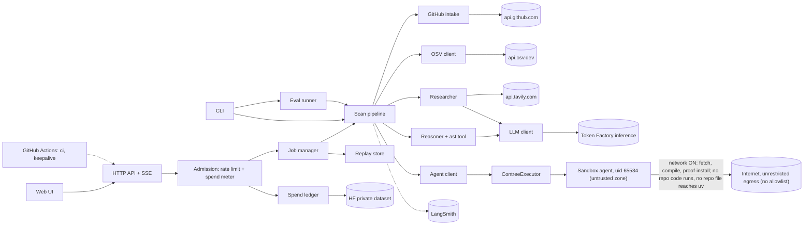

# Architecture

Status: FROZEN (2026-10-25)
Amended 2026-10-25 after security review rounds 1–2 (ADR-0027 to ADR-0032), Sandbox platform/fingerprint checks (ADR-0033, ADR-0034); 2026-10-26 after the first acceptance round (ADR-0037, ADR-0038), Cloud Run move (ADR-0040), offline sdist build (ADR-0041), edge verification/eval growth/proof replays (ADR-0042); 2026-10-27 per ADR-0043 (fix-commit fallback) and ADR-0044 (remediation, SVG call-path view, proof authenticity nonce, judging-window budget profile); 2026-10-29 per ADR-0045 (per-scan usage in the report, optional public trace link).

The technical design of ProveItReachable: stack, components, contracts, safety boundaries, operations, test commands and setup requirements. Requirements: [SPEC](SPEC.md); lasting decisions: [DECISIONS](DECISIONS.md). Drafted 2026-10-24; frozen 2026-10-25 after the prototype review ([FEEDBACK](FEEDBACK.md)) and the platform spike ([PLATFORM_FEEDBACK](PLATFORM_FEEDBACK.md)); it now changes only through a change request with a superseding ADR. Open questions OQ-1 to OQ-16 are answered in the sections tagged with their IDs (OQ-16: there is no fallback executor, ADR-0032).

## 1. Overview

ProveItReachable is a single Python service (FastAPI) that takes a public GitHub repository URL, works out which pinned dependency versions it uses, looks up known vulnerabilities on OSV.dev, researches each advisory with Tavily to find the vulnerable function, builds a deterministic `ast` index of the repository **inside a Nebius Token Factory Sandbox**, and lets a Nemotron model on Token Factory decide reachability by querying that index through tool calls. A deterministic report builder validates every model answer (labels, call path, source URLs) and ranks the findings. The same service serves the single-screen web UI, streams progress as server-sent events (SSE), replays recorded demo scans at zero cost, and enforces per-client rate limits and a durable hard spend cap. It talks to GitHub (metadata only), OSV.dev, Tavily, Token Factory (inference and Sandboxes), LangSmith (traces, eval dataset) and a private Hugging Face dataset (spend ledger). It runs on Google Cloud Run (one instance at most, scaled to zero when idle, ADR-0040), writes JSON log lines, and is watched by GitHub Actions (CI and a keepalive spend alert). Decisions: [DECISIONS.md](DECISIONS.md).

## 2. Technology stack

| Layer | Choice | ADR |
|---|---|---|
| Language, packaging | Python 3.13 in `.venv`; `pyproject.toml` (PEP 621), `pip install -e ".[dev]"`; exact pins set by the scaffold | ADR-0001 |
| Web, schemas, HTTP | FastAPI + Uvicorn (one worker), SSE via `StreamingResponse`; Pydantic v2 strict models; pydantic-settings (`SecretStr`); httpx behind an allowlisting factory | ADR-0001, ADR-0005, ADR-0011 |
| Inference | `openai` SDK at `https://api.tokenfactory.nebius.com/v1/`, `nvidia/nemotron-3-super-120b-a12b`, native tool calling | ADR-0023 |
| Sandbox | `contree-sdk` 0.3.6 (image import, trusted prepare, untag) + Sandboxes REST via httpx (every agent run) | ADR-0032 |
| Advisories, research | OSV.dev REST (keyless); Tavily Search REST | ADR-0008, ADR-0031 |
| Tracing, eval, logs | `langsmith` (`@traceable`, `wrap_openai`, datasets, experiments, `client.runs.query()`); stdlib `logging` with a JSON formatter | ADR-0017, ADR-0024 |
| Spend ledger | `huggingface_hub`, one JSON file in a private dataset, used by every spender after deploy; a local file before deploy | ADR-0029 |
| Frontend | Plain HTML + CSS + ES modules, no framework, no build; self-hosted Geist fonts | ADR-0012, ADR-0026 |
| Tests, lint, CI | pytest, pytest-asyncio (`asyncio_mode = "auto"`), `httpx.MockTransport`, pytest-playwright (slow); ruff check + format (no type checker: strict models at every boundary); GitHub Actions | ADR-0001, ADR-0024 |
| Hosting | Google Cloud Run (`us-central1`, max 1 instance, request-based billing), image built by Cloud Build from the `Dockerfile`, secrets in Secret Manager; both images pinned by `@sha256:` digest; hash-checked installs | ADR-0040, ADR-0030 |

Runtime dependencies (minimums): `fastapi>=0.115`, `uvicorn>=0.32`, `pydantic>=2.9`, `pydantic-settings>=2.6`, `httpx>=0.27`, `openai>=1.50`, `contree-sdk==0.3.6`, `langsmith` (the spike-verified version, which has `client.runs.query()`), `huggingface_hub>=0.26`. Dev extra: `pytest>=8.3`, `pytest-asyncio>=0.24`, `pytest-playwright>=0.5`, `ruff>=0.7`, `pyyaml>=6` (workflow test, AC-71), `uv>=0.5` (only to generate the hashed `requirements.lock`, ADR-0030). No other dependency without an ADR.

## 3. Test commands

| Purpose (run from the project root with `.venv` active; Git Bash: `source .venv/Scripts/activate`) | Command |
|---|---|
| **Full** | `python -m pytest -q` |
| **Fast** (also run by CI) | `python -m ruff check. && python -m ruff format --check. && python -m pytest -q -m "not slow"` |
| **One file** | `python -m pytest -q tests/<area>/test_<module>.py` (e.g. `tests/unit/test_github_intake.py`) |
| **Eval** (not pytest; spends credits) | `python -m pir eval` |

- `[tool.pytest.ini_options]`: markers `slow` (browser, server, agent subprocess, or over 1 s) and `live` (real external service; always also `slow`); `addopts = "--strict-markers"`, `testpaths = ["tests"]`, `norecursedirs = ["fixtures", ".*", "node_modules"]` so fixture repos (including the canary) are never collected. Ruff excludes `tests/fixtures/repos/` and `eval/fixtures/`.
- `tests/conftest.py` skips `live` unless `PIR_LIVE_TESTS=1`; an autouse guard makes any non-loopback socket connection raise in other tests. Fast tests fake everything external: `httpx.MockTransport` (GitHub, OSV, Tavily, Sandboxes REST), a fake `contree-sdk` client, `FakeLLM`, `FakeExecutor`, `MemorySpendLedger`, a fake LangSmith client, a frozen clock. Expensive fixtures are `scope="session"`; the fast suite stays under about 15 s. The scaffold ships `tests/unit/test_smoke.py` (imports `pir`, checks `pir.__version__`) so both commands exit 0 on the untouched scaffold (pytest exits 5 on zero tests).

## 4. Components



| Component | Module | Responsibility |
|---|---|---|
| HTTP API + SSE | `pir/api/` | Routes, error envelope, SSE, static UI, security headers. |
| Admission | `pir/ratelimit.py`, `pir/spend.py` | Rate limits; reservation before any paid call; fail-closed cap; budget fractions; ledgers (`File`, `HfDataset`, `Memory`). |
| Jobs, replays | `pir/jobs.py`, `pir/replay.py` | In-memory jobs with an append-only event log and the scan log context; recorded replays. |
| Scan pipeline | `pir/pipeline.py` | Six steps in order, per-item failure isolation, events, stage-end log lines, scan deadline. |
| GitHub intake | `pir/github.py`, `pir/http.py` | Pure URL parsing; existence, size and Python checks; SHA pinning. `http.py` owns the host allowlist. |
| OSV client, researcher | `pir/osv.py`, `pir/research.py` | `querybatch` per exact version and details; Tavily search + one grounded Nemotron extraction per advisory; caches. |
| LLM client, reasoner | `pir/llm.py`, `pir/reasoning/` | The only inference path (fixed base URL, strip, metering); tool-calling strategy, ast tool, prompts. |
| Report builder | `pir/report_builder.py`, `pir/markdown.py` | Verdict gate, ranking, `ScanReport` validation, Markdown. |
| Agent client, executor | `pir/agent_client.py`, `pir/executor/` | Runs the agent's commands; `ContreeExecutor` (the only real executor), `FakeExecutor` (tests, trusted fixtures). |
| Sandbox agent | `pir/sandbox_agent/` | Stdlib-only program run **inside** the Sandbox: fetch, unpack, resolve, index, proof. Every other component runs in one host process, which never runs repo code. |
| Eval runner | `pir/evaluation/` | Cases, scans, metrics, LangSmith dataset and experiment, `latest.json`. |
| Logging, tracing, keepalive | `pir/logs.py`, `pir/tracing.py`, `pir/keepalive.py` | JSON logs with scan context and redaction; LangSmith with `scan_id` metadata; stdlib-only health and budget check. |

## 5. Scan flow

1. **Admission** (API only, before a job exists): parse URL → rate limit → spend cap → concurrency → GitHub validation (public, size, Python markers, commit SHA). A refusal returns an error and starts nothing (AC-02 to AC-06, AC-50, AC-51).
2. **`resolve`:** `prepare` the agent image (cached), `fetch` (network ON, saves image A = pristine repo files, no repo code ever run in it), `resolve --lockfile-only` from A (OFF), and if needed `resolve --compile` in a disposable branch of A (ON: uv from an empty working directory on agent-sanitized input with `--no-build`, so no repo code runs and no repo file reaches uv, section 7.2).
3. **`osv`:** one `querybatch` for all resolved dependencies; details per unique advisory ID. **`research`:** per unique advisory, `FINDING_CONCURRENCY` at a time.
4. **`analysis`:** one `index` run from A (network OFF, disposable) with the top-level import names of every vulnerable package. **`reasoning`:** per finding with an identified symbol, most severe first, up to `MAX_FINDINGS_REASONED`.
5. **`report`** (UI: "Verdicts"): gate, rank, validate, store, emit `done`; saved images are discarded. These six step identifiers are used everywhere (report, SSE, logs, UI).

## 6. Data models

All models live in `pir/models/` and derive from `Strict(BaseModel)` with `ConfigDict(extra="forbid", strict=True, frozen=True)`: invalid data is rejected, not coerced (NFR-05). JSON is parsed with `model_validate_json` (ISO 8601 strings accepted for `datetime` and `date`). `schemas/report.schema.json` is generated by `python -m pir schema`; a fast test fails if the committed file differs. In the blocks below, `#` comments are validation rules.

### 6.1 Shared literals

```python
Verdict = Literal["likely reachable", "no reachable path detected", "uncertain"]   # exact, case-sensitive
Confidence = Literal["high", "medium", "low"];  Mode = Literal["live", "replay", "proof"];  Pool = Literal["nebius", "tavily"]
StepName = Literal["resolve", "osv", "research", "analysis", "reasoning", "report"];  Outcome = Literal["findings", "clean", "incomplete"]
StepState = Literal["pending", "running", "done", "failed", "skipped"];  Severity = Literal["critical", "high", "moderate", "low", "unknown"]
ToolName = Literal["lockfile", "uv", "sandbox", "osv", "tavily", "nemotron", "ast", "verdict_gate"]
DependencySource = Literal["uv.lock", "poetry.lock", "Pipfile.lock", "requirements.txt", "uv pip compile", "manifest"]  # manifest = declared, unresolved
ReasonCode = Literal["vulnerable_function_not_identified", "tavily_failed", "nebius_failed", "model_output_invalid",
    "unsupported_reachability_claim", "contradicted_by_index", "osv_failed", "sandbox_timeout", "sandbox_failed",
    "spend_cap_reached", "scan_budget_reached", "scan_timeout", "finding_limit_reached"]
```

### 6.2 Report (`pir/models/report.py`)

```python
class RepoRef(Strict):
    url: str; owner: str; name: str; ref_requested: str | None; default_branch: str; commit_sha: str
    # canonical url; owner ^[A-Za-z0-9](?:[A-Za-z0-9-]{0,38})$; name ^[A-Za-z0-9._-]{1,100}$, not "." or ".."; sha ^[0-9a-f]{40}$
class StepStatus(Strict):
    name: StepName; state: StepState; tools: list[ToolName]; started_at: datetime | None; finished_at: datetime | None; message: str | None
class Resolution(Strict):
    method: Literal["lockfile", "compiled", "failed"]; python_version: str | None; lockfile: str | None; compiled_from: str | None; notes: list[str]
class Dependency(Strict):
    name: str; source: DependencySource; groups: list[str]; version: str | None; resolved: bool; unresolved_reason: str | None
    direct: bool | None; osv_status: Literal["checked", "not_checked", "not_queried"]; osv_error: str | None
class Advisory(Strict):
    id: str; aliases: list[str]; summary: str | None; severity: Severity; fixed_versions: list[str]; published: datetime | None; modified: datetime | None
class AdvisoryLink(Strict): url: str; source: Literal["osv", "tavily"]; title: str | None
class VulnerableSymbol(Strict): identified: bool; symbols: list[str]; not_identified_reason: str | None; evidence_urls: list[str]
class SourceLocation(Strict):
    file: str; line: int; kind: Literal["import", "call", "reference", "definition"]; snippet: str | None
class CallPathStep(Strict):
    file: str; line: int; edge: Literal["entry", "call", "heuristic_call", "vulnerable_call"]; symbol: str
class Proof(Strict):
    status: Literal["proven", "not_proven"]; reason: str; ran_at: datetime; entry: str; target: str; recorded_call: str | None
class Remediation(Strict):  # ADR-0044: deterministic upgrade guidance from OSV ranges or fix-commit advice
    target_version: str | None; package: str; guidance: str
class Finding(Strict):
    finding_id: str; kind: Literal["advisory", "not_checked"]; verdict: Verdict; confidence: Confidence; package: str; version: str
    advisory: Advisory | None; vulnerable_symbol: VulnerableSymbol | None; advisory_links: list[AdvisoryLink]
    source_locations: list[SourceLocation]; call_path: list[CallPathStep] | None; explanation: str; limitations: list[str]
    reason_code: ReasonCode | None; reason: str | None; proof: Proof | None = None; remediation: Remediation | None = None
class ReportSummary(Strict):
    dependencies_total: int; dependencies_checked: int; dependencies_unresolved: int; dependencies_not_checked: int
    findings_total: int; by_verdict: dict[Verdict, int]
class NemotronUsage(Strict): calls: int; input_tokens: int; output_tokens: int; usd: float  # ADR-0045: every int and usd ge=0; usd = round(x, 4)
class TavilyUsage(Strict): searches: int; usd: float
class SandboxUsage(Strict): operations: int
class OsvUsage(Strict): queries: int
class ScanUsage(Strict): nemotron: NemotronUsage; tavily: TavilyUsage; sandbox: SandboxUsage; osv: OsvUsage; trace_url: str | None = None
class ScanReport(Strict):
    schema_version: Literal["1.0"]; scan_id: str; tool_version: str; model: str; generated_at: datetime; repo: RepoRef
    outcome: Outcome; resolution: Resolution; steps: list[StepStatus]; dependencies: list[Dependency]; findings: list[Finding]
    summary: ReportSummary; limitations: list[str]; usage: ScanUsage | None = None
    # outcome: "clean" iff findings == [] and no unresolved, no not_checked, resolve done (AC-11); "incomplete" iff findings == [] and (unresolved or failed resolve); else "findings"
```

**Step tools rule:** `StepStatus.tools` lists, in this order, the tools whose results the step used (cached research counts): `resolve` → `sandbox` (a Sandbox operation returned, including a timeout) and `lockfile` or `uv`; `osv` → `osv`; `research` → `tavily`, `nemotron`; `analysis` → `sandbox` (only `ContreeExecutor`), `ast`; `reasoning` → `nemotron`, `ast`; `report` → `verdict_gate`; skipped steps `[]`. `FakeExecutor` never yields `sandbox`, so the UI claims "Sandbox" only when one ran. **Interpretations:** (a) AC-19's "at least one advisory link" applies to `kind == "advisory"`; AC-26 entries are `kind == "not_checked"` with no advisory and no invented link. (b) `source_locations` may be `[]` for a non-`likely reachable` finding whose package is never imported; its limitations say "no import or call site found". (c) Unresolved dependencies (AC-09) are not findings; they appear in `dependencies` with `resolved == False`. Worked examples: `web/fixtures/reports/*.json`, validated against `ScanReport` by a fast test. **Usage (ADR-0045):** `usage` is optional and additive; `schemas/report.schema.json` mirrors it with no extra keys, and `schema_version` stays `"1.0"`. When `usage` is present, all four services are present, with zeros for an unused one. The figures come only from the scan's own `ScanBudget` and the client-seam counters, never from vendor billing APIs or balances. `nemotron.calls` counts the requests `pir/llm.py` sent, retries and failures included; `input_tokens` and `output_tokens` sum the `usage` the responses returned. `tavily.searches` counts the requests `pir/research.py` sent, excluding cache hits. `sandbox.operations` counts the commands the live executor ran, timeouts included (`FakeExecutor`: 0); there is no Sandbox `usd`, because that cost stays in the `nebius` pool. `osv.queries` counts the package-version queries passed to the OSV client, cached or not. `usd` is what `ScanBudget.record()` booked per service (section 11.2, rule 3): metered, not invoiced, and without a call-chain proof's own reservation. `trace_url` follows section 19.2. The UI adds one footer line to "How this report was made" (`pipelineStrip()` in `web/js/render.js`) and the Markdown export adds one line, both only when `usage` is present. Both label the dollar figure as metered model and search spend, not a total. Recorded demo replays hold no `usage`.

### 6.3 Static analysis index (`pir/models/index.py`)

```python
class IndexedFile(Strict): path: str; lines: int; is_test: bool; parsed: bool; skip_reason: str | None
class ImportRecord(Strict):   # module absolute (relative imports resolved in-repo); name for "from module import name"
    file: str; line: int; module: str; name: str | None; asname: str | None
    bound_as: str                               # local name the import binds (alias-aware, AC-15)
class DefRecord(Strict):      # id "pkg.mod:Class.func" (src/ prefix stripped)
    id: str; file: str; line: int; end_line: int; decorators: list[str]
    entry_kind: Literal["main_block", "route", "cli", "script", "module_level"] | None
class TargetSite(Strict):     # a use of a target module from repo code; caller = DefRecord.id or "pkg.mod:<module>"
    file: str; line: int; col: int; caller: str; kind: Literal["call", "reference"]; snippet: str   # snippet <= 200
    target: str                                 # fully qualified after alias substitution, e.g. "yaml.load"
    args: int | None = None                     # kind="call": positional argument count; None for a reference or a *args call (ADR-0037)
    keywords: list[str] | None = None           # kind="call": keyword names, sorted; None for a reference or a **kwargs call (ADR-0037)
class Edge(Strict): caller: str; callee: str; file: str; line: int; heuristic: bool  # heuristic: name-based, self.*, or a source-root import (ADR-0037)
class AnalysisIndex(Strict):  # truncated: the agent's own size limit was hit (a limitation)
    agent_protocol: Literal[1]; commit_sha: str; target_modules: list[str]   # top-level import names, e.g. ["yaml"]
    files: list[IndexedFile]; imports: list[ImportRecord]; defs: list[DefRecord]
    target_sites: list[TargetSite]; edges: list[Edge]; truncated: bool; stats: dict[str, int]   # files_total, ...
```

The agent produces the index inside the Sandbox as plain JSON; the host validates it. Hostile input: `ast.parse` runs per file; `SyntaxError`, `ValueError` (null bytes), `RecursionError` and `MemoryError` skip that file with a `skip_reason` and the index completes. Determinism (AC-14): sorted file walk, no wall-clock values, every list sorted by `(file, line, col, ...)`. Aliases (AC-15): `import m as a`, `from m import f as g`, `import a.b.c`, `import a.b as ab`, function-level and relative imports are bound; a call or attribute chain is resolved by substituting its first segment with its binding. A function passed without a call (`map(yaml.load, xs)`) is `kind="reference"`.

**Entry points (unchanged by ADR-0037, now stated):** every file has a def `pkg.mod:<module>` covering all module-scope code, including the bodies of module-level `if`, `with`, `try` and loops, so a call anywhere in a module-level `if __name__ == "__main__":` block (nested `with`/`try` included) is an edge or site of `<module>`. Its `entry_kind` is `main_block` when the file has a top-level `__name__ == "__main__"` guard, else `script` for a `__main__.py`, else `module_level` when module scope makes any call, else `None`. Functions are entries only through decorators: `cli` (a decorator attribute `command` or `group`, as in click and typer) and `route` (a decorator attribute `route`, or `get`, `post`, `put`, `delete`, `patch`, `head`, `options`, `websocket`, `api_route` called with arguments). Console scripts declared in `pyproject.toml`, `setup.cfg` or `setup.py` are not entry points (ADR-0037, deferred).

**Source roots (ADR-0037):** an absolute import that matches no repo module resolves to the unique repo module whose dotted name ends with `"." + <import>` (for example `core.config` → `lib.core.config` when `run/_init_paths.py` puts `lib/` on `sys.path`), only if all hold: the repo's non-test code calls `sys.path.insert`, `sys.path.append` or `site.addsitedir`; exactly one repo module has that suffix; the import's first segment is neither a repo top-level module nor in `target_modules`. Edges resolved this way have `heuristic=True`.

### 6.4 Research and reasoning (`pir/models/research.py`, `pir/models/reasoning.py`)

```python
class SearchResult(Strict): url: str; title: str | None; content: str   # content <= 2000 chars, untrusted
class AdvisoryResearch(Strict):   # symbols grounded, dotted ([] if not identified); links exact: OSV refs + osv.dev page + Tavily URLs
    advisory_id: str; identified: bool; not_identified_reason: str | None; from_cache: bool; symbols: list[str]; links: list[AdvisoryLink]; evidence_urls: list[str]; failure: ReasonCode | None
class ModelVerdict(Strict):       # submit_verdict arguments; explanation <= 2000; limitations >= 1
    verdict: Verdict; confidence: Confidence; call_path: list[CallPathStep] | None; source_locations: list[SourceLocation]; explanation: str; limitations: list[str]
class ToolCallRecord(Strict): name: str; arguments: dict[str, str | int | list[str]]; ok: bool; result_bytes: int
class ReasoningOutcome(Strict):   # tool_calls: AC-17 evidence, also traced
    verdict: ModelVerdict | None; tool_calls: list[ToolCallRecord]; attempts: int; failure: ReasonCode | None; failure_detail: str | None
```

### 6.5 API and event models (`pir/models/api.py`)

```python
class ScanRequest(Strict):
    repo_url: str; ref: str | None = None   # url <= 300 chars; ref ^[A-Za-z0-9._/-]{1,100}$, "/"-separated segments non-empty and not starting with "."
class ScanAccepted(Strict): scan_id: str; mode: Mode; status_url: str; events_url: str; report_url: str
class ScanStatusResponse(Strict):
    scan_id: str; mode: Mode; state: Literal["queued", "running", "completed", "failed"]
    steps: list[StepStatus]; outcome: Outcome | None; created_at: datetime; finished_at: datetime | None
ErrorCode = Literal["invalid_url", "repo_not_found", "repo_too_large", "not_python_project",
    "rate_limited", "server_busy", "too_many_requests", "live_scans_paused", "github_unavailable", "scan_not_found",
    "report_not_ready", "demo_not_found", "finding_not_found", "request_invalid", "internal_error"]
class ErrorBody(Strict): code: ErrorCode; message: str; details: dict[str, str | int | float] = {}; retry_after_s: int | None = None
class ErrorResponse(Strict): error: ErrorBody
class ProgressEvent(Strict):
    seq: int; scan_id: str; type: Literal["step", "done", "error"]; step: StepName | None; state: StepState | None
    message: str | None; at: datetime; outcome: Outcome | None; tools: list[ToolName]
class DemoSummary(Strict): slug: str; title: str; description: str; repo_url: str; commit_sha: str; recorded_at: datetime; by_verdict: dict[Verdict, int]
class EvalFigure(Strict): precision: float; n: int; run_date: date; model: str
class AppConfigResponse(Strict):
    version: str; live_scans_enabled: bool; live_scans_paused_reason: str | None
    features: dict[Literal["progress_feed", "markdown_export", "proof"], bool]
    limits: dict[Literal["max_repo_mb", "max_repo_files", "live_scans_per_client_hour", "live_scans_per_client_day"], int]
    eval: EvalFigure | None
class HealthResponse(Strict): status: Literal["ok"]; version: str; live_scans: Literal["enabled", "paused", "disabled"]; budget_remaining: dict[Pool, float] | None
class ProofRequest(Strict): entry: str | None = None   # M2; must be the symbol of a step in the call path
```

### 6.6 Recordings, ledger, eval

```python
class RecordedEvent(Strict): offset_ms: int; event: ProgressEvent
class ScanRecording(Strict):
    schema_version: Literal["1.0"]; slug: str; title: str; description: str; recorded_at: datetime; model: str; events: list[RecordedEvent]; report: ScanReport
Spender = Literal["hosted", "local"]   # serve = hosted; scan, eval, record = local (section 11.2)
class PoolState(Strict): spent_usd: float; reserved_usd: float
class DayState(Strict): day: date; start_spent_usd: dict[Pool, float]
class SpenderState(Strict): allowance_usd: dict[Pool, float]; pools: dict[Pool, PoolState]; day: DayState | None
class Reservation(Strict): scan_id: str; spender: Spender; created_at: datetime; amounts: dict[Pool, float]
class CasCheck(Strict): verified_at: datetime; hub_version: str
class LedgerState(Strict):
    schema_version: Literal[2]; caps_usd: dict[Pool, float]; spenders: dict[Spender, SpenderState]; reservations: list[Reservation]; cas_verified: CasCheck | None; updated_at: datetime
class EvalCase(Strict): id: str; repo: str; package: str; advisory: str; label: Verdict; rationale: str
class EvalRepo(Strict): id: str; source: str
class EvalRunSummary(Strict):
    scored: bool; run_date: date; model: str; experiment: str | None; n: int; errored: int; precision: float | None; recall: float | None; abstention_rate: float; bar: float; bar_met: bool
```

## 7. Interfaces between components

All I/O interfaces are `typing.Protocol`s injected through `pir/deps.py` (`build_deps(settings) -> PipelineDeps`).

### 7.1 Executor (`pir/executor/`)

Amended 2026-10-25 by ADR-0034 (spend denial, `prepare` call, output cap) and ADR-0033 (base-image import by version tag, fingerprint check).

```python
class ImageRef(Strict): kind: Literal["sandbox", "fake"]; ref: str   # sandbox: image UUID; fake: temp dir
class ExecResult(Strict):
    exit_code: int; stdout: str; stderr: str; timed_out: bool; truncated: bool; duration_s: float; cost_usd: float; image: ImageRef | None
class Executor(Protocol):
    kind: Literal["sandbox", "fake"]
    async def prepare(self, files: dict[str, bytes]) -> ImageRef          # base image + trusted files
    async def run(self, image: ImageRef, argv: list[str], *, network: bool, timeout_s: float, save: bool = False, budget: ScanBudget | None = None) -> ExecResult
    async def discard(self, image: ImageRef) -> None                       # best effort; never raises
class ExecutorSpendDenied(Exception): denied: SpendDenied   # pool and reason unchanged from section 7.8
```

**`ContreeExecutor`** (`executor/contree.py`; each fact verified by the spike, PLATFORM_FEEDBACK check c):

| Method | Platform call | Rules |
|---|---|---|
| base image (internal) | SDK `await client.images.oci(<SANDBOX_BASE_IMAGE before "@">, tag="pir-base/sha256-<hex>")` | `SANDBOX_BASE_IMAGE` is `<version tag>@sha256:<64 hex>` (settings refuse a ref without a digest; ADR-0030). The executor imports only the part before `@` (the version tag), always with `tag="pir-base/sha256-<hex>"`, `<hex>` being the 64 hex digits of the digest (ADR-0033): contree-sdk 0.3.6 `images.oci` returns `HTTP 404` for every `@sha256:` reference, and without `tag=` it derives a local tag containing `@` that fails with 400 (live check 2026-10-25). The digest is enforced by the base-image check (section 7.2), not by the importer. Imports on first use (about 12.5 s), reuses after (about 2 s); cached per process. `images.pull` (deprecated) is not used. |
| `prepare(files)` | SDK `result = await image.run(shell=PREPARE_CMD, files=files, disposable=False)`: in the async SDK the call is awaited directly and returns the saved result image (no `op.wait()`; live check 2026-10-25, ADR-0034) | Trusted input only: our agent zip, and for local fixtures a trusted tarball; files land root-owned 0644 under `/opt/pir/`. `PREPARE_CMD` is the constant `mkdir -p /work && chown 65534:65534 /work`. The only SDK `run()` call: the SDK runs as root without network control, so it never touches repo content. Cached per process by the sha256 of `files`. If the SDK cannot save a `files=` run, `prepare` uses the REST equivalent; the interface is unchanged. |
| `run(...)` | REST `POST /sandboxes/v1/instances`, then poll `GET /sandboxes/v1/operations/{id}` (0.5 s doubling to 2 s) until terminal | Body: source image UUID; command `env -i PATH=/usr/local/bin:/usr/bin:/bin HOME=/tmp LANG=C.UTF-8 PYTHONDONTWRITEBYTECODE=1 UV_CACHE_DIR=/tmp/uv UV_NO_BUILD=1 UV_NO_CONFIG=1 UV_PYTHON_DOWNLOADS=never` + argv (`shlex.join`); nothing else is set, so `VIRTUAL_ENV`, `CONDA_PREFIX`, other `PYTHON*` and proxy variables stay unset (ADR-0032); `networking.enabled = network`; `uid = gid = 65534`; `disposable = not save`; platform timeout `ceil(timeout_s)`; `truncate_output_at = SANDBOX_MAX_OUTPUT_BYTES` (constant, 10 MiB = 10485760, the platform maximum: 11534336 is rejected with 400; ADR-0034). |
| `discard(image)` | untag the saved image | Called for every saved image at scan end; failures are logged, not raised. |

Result mapping, in this order: (1) status `SUCCESS` with `state.timed_out == true` (signal 9, exit code -1) → `timed_out=True`, so a timeout always becomes `sandbox_timeout`, never success or `sandbox_failed`; (2) `SUCCESS` → `exit_code`, `stdout`, `stderr`, `truncated`, and `image` from `result_image_uuid` when `save`; (3) any other terminal status, HTTP error or malformed body → `ExecutorUnavailable`. An operation not terminal at `timeout_s + 30` s is cancelled and returned as `timed_out=True`. REST calls use the SDK's base URL and `NEBIUS_API_KEY` / `NEBIUS_PROJECT_ID` auth through the allowlisting factory (section 12); exact JSON field names are pinned by recorded responses in `tests/fixtures/http/contree/` and the live test. A semaphore of `SANDBOX_MAX_CONCURRENT_OPS` bounds concurrency (platform: 50 concurrent, 3,600 s maximum timeout). **Metering:** before each `run`, `budget.try_spend("nebius", ceil(timeout_s) × SANDBOX_USD_PER_SECOND)`; a `SpendDenied` result (a frozen dataclass value, not an exception) is raised as `ExecutorSpendDenied(denied)` and no request is sent; afterwards the hold becomes the operation's reported cost (`metadata.result.resources.cost`), else `duration × SANDBOX_USD_PER_SECOND`; `consumed_cpu` and `consumed_memory` are logged.

**`FakeExecutor`** (tests; `--executor fake` with a trusted local fixture only): images are temp-directory copies; `run` handles only `unpack`, `resolve --lockfile-only` and `index`, **in-process** through the agent's pure functions; other commands return a recorded `ExecResult` or `exit_code=99`; never a subprocess; `cost_usd=0`. There is no other executor: `EXECUTOR=sandbox|fake`, and `fake` refuses GitHub targets.

### 7.2 Sandbox agent protocol (`pir/sandbox_agent/`, `pir/agent_client.py`)

Amended 2026-10-25 by ADR-0034 (result-line cap, compile output file, spend denial) and ADR-0033 (`selfcheck`).

Our stdlib-only agent is zipped at runtime into `agent.pyz`, placed at `/opt/pir/agent.pyz` by `prepare`, and run as uid 65534: `/usr/local/bin/python3.13 -I -S /opt/pir/agent.pyz <command> --args-b64 <base64 JSON>` (absolute interpreter; the agent's first action is `os.chdir("/")` and it uses only absolute paths: the repo is at `/work/repo`). It prints exactly one stdout line `PIR-RESULT:<base64(gzip(JSON))>`; logs go to stderr. **Output caps (ADR-0034):** the base64 body of the result line is at most `MAX_RESULT_B64_BYTES` = 8 MiB (8388608), the same constant in `sandbox_agent/protocol.py` and `agent_client.py`; the agent checks it before printing and, if over, prints no result line and exits 3 (limit exceeded); the agent writes at most 1 MiB to stderr (later log lines are dropped). Both stay below the platform's 10 MiB `truncate_output_at` (section 7.1), so a valid result is never truncated whether the platform counts stdout and stderr separately or together. Exit codes: 0 ok, 2 bad input, 3 limit exceeded, other = failure.

| Command | Network | From | Saves | Output |
|---|---|---|---|---|
| `selfcheck` (no arguments: `--args-b64 e30=`) | OFF | agent image | no | `SelfcheckResult{python_version, uv_version, files, stdlib_tree_sha256}` (see "Base-image check") |
| `fetch --owner --repo --sha --max-bytes --max-files` | ON | agent image | A | `FetchResult{commit_sha, files_total, bytes_total, py_files, manifests}` |
| `unpack --max-bytes --max-files` (local fixtures; tarball at `/opt/pir/src.tar.gz`) | OFF | agent image + tarball | A | `FetchResult` |
| `resolve --lockfile-only` | OFF | A | no | `ResolveResult{method, lockfile, dependencies, notes, needs_compile}` |
| `resolve --compile --python-version` | ON | A | no | `ResolveResult` |
| `index --targets yaml,jinja2` | OFF | A | no | `AnalysisIndex` |
| `proof-install --pins-b64` (M2; ADR-0041) | ON | A | P | `{installed: [...], no_wheel: [...], sdists: [{spec, file, sha256}], unfetched: [{spec, reason}]}` (section 16) |
| `proof-build --builds-b64` (M2; ADR-0041) | OFF | P | P′ | `{built: [...], failed: [{spec, reason}]}` (section 16) |
| `proof-run --entry --target [--site] [--nonce]` (M2; ADR-0039, ADR-0044) | OFF | P′ when `proof-build` ran, else P | no | `Proof` fields |

**Network ON is unrestricted egress (ADR-0032, superseding ADR-0027).** `networking.enabled` is a plain on/off switch with no allowlist (spike check c): an ON run can reach any internet host. ON is therefore allowed only for the three commands above, each under its timeout cap (section 10: 120 s, 180 s, 300 s), and only under this **invariant: while networking is on, nothing from the repo or from a downloaded source package executes, and no repo-controlled file influences any tool run.** A second rule (ADR-0041): **no network-ON command ever runs from an image that a build or repo code has touched** (P′, or any image derived from it); the chain is A → `proof-install` (ON) → P → `proof-build` (OFF) → P′ → `proof-run` (OFF), and P and P′ are discarded at the end of the proof. No path under `/work/repo` is ever a working directory, configuration, interpreter, environment source or tool input; the agent reads repo files only as data, in its own Python code. How each ON step meets it (audit in ADR-0032):

- `fetch` runs only our agent (stdlib HTTP download and `tarfile` extraction). Python started by absolute path with `-I -S` reads no environment variable, `site` or `.pth` file, or working-directory file, and the repo does not exist until fetch writes it.
- **Every `uv` call** (compile and proof-install) is spawned by the agent with `cwd=/tmp/uvwd`, created fresh by `os.mkdir` (which fails if it exists, so it is always empty and outside the repo); `env=` the fixed environment of section 7.1, never `os.environ`; and the common flags `--python /usr/local/bin/python3.13` (no discovery of `VIRTUAL_ENV`, `CONDA_PREFIX`, `.venv`, `.python-version` or `PATH`; no download), `--no-config` (no `uv.toml`, `[tool.uv]`, user or system config), `--no-build` (no PEP 517 backend, `setup.py` or sdist build), `--no-sources` (no `[tool.uv.sources]`) and `--index-url https://pypi.org/simple`. `HOME` (so `~/.netrc`) and `UV_CACHE_DIR` are under `/tmp`, which the repo cannot reach: extraction is confined to `/work/repo`.
- `resolve --compile`: the agent writes a sanitized requirements file to `/tmp/pirin/requirements.in` (directory also created fresh by `os.mkdir`; section 13, rule 5) and passes that absolute path; uv writes its result to `/tmp/pirin/requirements.txt` (`--output-file`, an absolute path in that fresh directory, so no earlier file can act as version preferences; ADR-0034); uv never opens a repo file. `proof-install`: `uv pip install --no-deps --only-binary :all: --target /work/deps` + common flags + `-- <name==version>`, one pin per call; wheels are unpacked, never executed. For a pin uv refuses for lack of a wheel, the agent itself (stdlib HTTP, no uv or pip) reads `https://pypi.org/pypi/<name>/<version>/json`, takes the source package's URL and sha256 from it and downloads the file to `/work/sdists/` without opening or extracting it, and downloads the two hash-pinned build-tool wheels to `/work/buildwheels/` (section 16, ADR-0041); no metadata step, `setup.py` or build backend runs while the network is on.
- `proof-build` is network OFF and is the only step that runs a dependency's build code (section 16). Its uv call drops `--no-build` and `--index-url` from the common flags and adds `--offline --no-index --find-links /work/buildwheels --build-constraints <file>`, so build isolation is fed only from the local hash-checked wheels.

The only command that runs repo code, `proof-run`, is OFF with an authenticity nonce (ADR-0044), and so is the only command that runs a dependency's build code, `proof-build`. `fetch` downloads only `https://codeload.github.com/{owner}/{repo}/tar.gz/{sha}` built from validated parts, streams with a byte cap, and extracts with `tarfile` `filter="data"` (no links leaving the destination, absolute paths or devices) plus member-count and uncompressed-size caps (`MAX_REPO_FILES`, `MAX_REPO_MB`). `proof-install` pins come from validated `Dependency` models (section 6.2 regexes, re-checked by the agent) and the agent builds each `name==version` itself after `--` (live check, section 22.1). The client maps `timed_out` to `SandboxTimeout(step)`, and `truncated`, a missing or invalid result line, or a non-zero exit to `SandboxFailed(step, detail)`; it parses with caps (8 MiB base64, 50 MiB decompressed via `zlib.decompressobj(max_length=...)`) and validates strictly. `ExecutorSpendDenied` from the executor passes through unchanged; the pipeline maps `.denied.reason` to `spend_cap_reached` or `scan_budget_reached` (section 10).

```python
class SandboxAgentClient:   # __init__(executor, settings); raises SandboxTimeout, SandboxFailed or ExecutorSpendDenied
    async def open_workspace(self, target: ValidatedTarget | LocalFixtureTarget, budget: ScanBudget) -> Workspace
    async def resolve(self, ws: Workspace) -> ResolveResult
    async def index(self, ws: Workspace, target_modules: list[str]) -> AnalysisIndex
    async def close(self, ws: Workspace) -> None          # discards saved images
```

#### Base-image check (`selfcheck`, ADR-0033)

**Output.** `python_version`: `platform.python_version()` (e.g. `"3.13.11"`). `uv_version`: stdout of `/usr/local/bin/uv --version`, stripped (e.g. `"uv 0.9.30"`; spawned with the fixed environment of section 7.1). `files`: an object mapping each of `/usr/local/bin/python3.13`, `/usr/local/lib/libpython3.13.so.1.0`, `/usr/local/bin/uv`, `/usr/local/bin/uvx`, `/lib64/ld-linux-x86-64.so.2` and `/lib/x86_64-linux-gnu/libc.so.6` to the lowercase sha256 hex of its content (links followed), or `"missing"`. `stdlib_tree_sha256`: lowercase sha256 hex over the UTF-8 lines `<relative path>\t<entry>\n`, sorted by relative path, one per regular file and symlink under `/usr/local/lib/python3.13` (walked without following links; directories add nothing), where `<entry>` is the file's content sha256, `link:<target>` for a symlink, or `unreadable`. **Fingerprint file** `src/pir/executor/base_image_fingerprint.json` (package data, committed, reviewed): `{"format": 1, "base_image": "<SANDBOX_BASE_IMAGE, tag@sha256:<64 hex>>", "measured_on": "YYYY-MM-DD", "selfcheck": <SelfcheckResult JSON>}`. **When.** `SandboxAgentClient` runs `selfcheck` once per process, right after `prepare` and before the first `fetch` or `unpack`, network OFF, `save=False`, timeout `SELFCHECK_TIMEOUT_S` = 60 (constant), metered against the current scan's budget. It passes only if the decoded result equals the file's `selfcheck` object exactly and the file's `base_image` equals `SANDBOX_BASE_IMAGE` (so its digest matches); anything else, including a missing or malformed file, raises `SandboxFailed("selfcheck", "base image does not match the reviewed fingerprint")`, and no other command runs (fail closed). Only a pass is cached (with the prepared image); a failure or `SandboxTimeout("selfcheck")` is retried by the next scan. `FakeExecutor` skips it (`executor.kind == "fake"`). **Measuring** (ADR-0033 as amended 2026-10-25; on a GitHub Actions runner, never on the host, which needs no Docker; repeated whenever the image or `selfcheck.py` changes): the developer runs `gh workflow run fingerprint.yml` (or "Run workflow" in the Actions tab), then `gh run download <run-id> -n base-image-fingerprint -D <temp dir>`, reviews the file (`base_image` equals the `Settings` default, `python_version` and `uv_version` are the expected ones, no unexpected `"missing"`) and commits it unchanged as `src/pir/executor/base_image_fingerprint.json`. The workflow (section 19.1) confirms the tag's digest, runs `selfcheck` under Docker on the digest-pinned image and uploads the file; it never commits or pushes. The live test `test_base_image_fingerprint_matches` runs the same check in the Sandbox.

### 7.3 GitHub intake and OSV client (`pir/github.py`, `pir/osv.py`)

```python
def parse_repo_url(url: str) -> RepoCoordinates          # pure; raises InvalidRepoUrl; no I/O (AC-02)
async def validate_repo(coords: RepoCoordinates, ref: str | None) -> ValidatedTarget
# ValidatedTarget(coords, default_branch, commit_sha, files_total, bytes_total, py_files, manifests); raises RepoNotFound (404 or private), RepoTooLarge(caps, actual), NotPythonProject(detail), GitHubUnavailable.
class OsvClient(Protocol):
    async def query(self, deps: list[Dependency]) -> dict[str, list[str] | OsvFailure]   # key "name==version"
    async def get_advisory(self, osv_id: str) -> Advisory | OsvFailure
    def links(self, osv_id: str) -> list[AdvisoryLink]   # osv.dev page + references, exact strings
```

GitHub (only `api.github.com`; a 301 is followed manually only if `Location` stays on that host): `GET /repos/{o}/{r}` → `GET /repos/{o}/{r}/commits/{ref or default_branch}` → `GET /repos/{o}/{r}/git/trees/{sha}?recursive=1`. Sizes come from blob sizes; `truncated: true` counts as too large; timeouts, 5xx and 403/429 rate limits raise `GitHubUnavailable`. OSV: `POST https://api.osv.dev/v1/querybatch` with `{"queries": [{"package": {"name": n, "ecosystem": "PyPI"}, "version": v}]}` (chunks of 500, `next_page_token` followed; results carry IDs only), then `GET /v1/vulns/{id}` (cached 24 h in `DATA_DIR/cache/osv/<id>.json`). OSV and research cache filenames, and the `{id}` path segment, use only IDs matching `^[A-Za-z0-9][A-Za-z0-9._-]{0,99}$`; any other ID is neither fetched nor cached, and its dependency gets a `not_checked` finding (`osv_failed`). Severity comes from `database_specific.severity`; the CVSS vectors in `severity` are not parsed. Aliases are deduped: one candidate per advisory per dependency (AC-10).

### 7.4 Search client and researcher (`pir/research.py`)

```python
class SearchClient(Protocol):
    async def search(self, query: str, *, max_results: int, depth: Literal["basic", "advanced"], timeout_s: float) -> list[SearchResult]  # raises SearchFailed
class AdvisoryResearcher:
    async def research(self, advisory: Advisory, package: str, osv_links: list[AdvisoryLink], budget: ScanBudget) -> AdvisoryResearch  # never raises; failures in .failure
```

Tavily: `POST https://api.tavily.com/search` with `Authorization: Bearer <key>`, `query="{package} {advisory_id} {first alias} vulnerable function"`, `search_depth`, `max_results`; only `results[].url`, `title`, `content` are read. Then one Nemotron JSON-mode extraction over the OSV summary and details plus the snippets, returning `{identified, symbols, evidence_urls, reason}`. **Qualifying names first:** the model often names a function as the advisory text does, without the module the code imports it by, so before grounding the researcher prefixes the package's import name (`_IMPORT_NAMES` in `research.py`, e.g. `pyyaml` → `yaml`, `pillow` → `PIL`, `scikit-learn` → `sklearn`; any other package by its PEP 503 name with `-` written as `_`) onto an unqualified name (`full_load` → `yaml.full_load`) or a class-qualified name whose first segment starts with a capital letter (`FullLoader.full_load` → `yaml.FullLoader.full_load`); a lower-case dotted name is a module path and stays as written. For a grounded `<import>.<Class>.<method>` it also emits `<import>.<method>`, listed first, because that module-level call is what repository code writes (`yaml.FullLoader.full_load` also gives `yaml.full_load`), except when `<import>.<method>` is a call in the default-argument equivalence table (section 9.1, ADR-0037; e.g. `yaml.load`), whose bare name would also match its safe calls. Host grounding: each resulting symbol matches `^[A-Za-z_]\w*(\.[A-Za-z_]\w*)+$` and its last segment appears verbatim in the supplied text, and `evidence_urls` must be a subset of the returned URLs; otherwise the symbol is dropped. **Fix-commit fallback (ADR-0043):** when Tavily search and LLM extraction yield no dotted symbols, `_fallback_fix_commit` inspects GitHub fix commits from OSV references (`commit_refs`). It fetches the diff (cached), drops test files, parses hunk headers and `def`/`class` in non-test `.py` files (`changed_functions`), qualifies candidate names with the package import root, caps at 10 symbols, and records the commit URL as an `AdvisoryLink` (`source="osv"`, `title="Fix commit"`) and evidence, with zero extra search spend. No grounded symbol and no fix-commit symbol → `identified=False`, "vulnerable function not identified" (AC-13). Results are cached per advisory ID in `DATA_DIR/cache/research/` for 7 days (ADR-0031: bounds how long a poisoned search result is served to every visitor; the source links stay visible on each finding).

### 7.5 LLM client (`pir/llm.py`)

```python
TOKEN_FACTORY_BASE_URL = "https://api.tokenfactory.nebius.com/v1/"   # constant, not configurable (AC-16)
class ChatResult(Strict):
    content: str | None; finish_reason: str | None; tool_calls: list[ToolCall]; usage: Usage
class LLMClient(Protocol):   # raises LLMError(kind: "timeout" | "http" | "rate_limited" | "bad_response" | "budget")
    model: str
    async def chat(self, messages: list[ChatMessage], *, tools: list[ToolSpec] | None = None, tool_choice: Literal["auto", "none"] | ForcedTool | None = None,
                   json_mode: bool = False, max_tokens: int, temperature: float = 0.0, timeout_s: float, budget: ScanBudget) -> ChatResult
```

`NebiusLLMClient` wraps `openai.AsyncOpenAI(base_url=TOKEN_FACTORY_BASE_URL, http_client=<allowlisted httpx>)`, wrapped by `wrap_openai` when tracing is on. Settings refuse to start unless `NEBIUS_MODEL` contains `nemotron` (case-insensitive). Nemotron replies start with blank lines, so `content` is stripped before it is returned or parsed (`json_mode` sends `response_format={"type": "json_object"}`). **Output bound and hold (ADR-0029):** the client sends `max_completion_tokens=max_tokens`, which in the OpenAI API bounds visible plus reasoning tokens, and holds `(ceil(chars / CHARS_PER_TOKEN) + PROMPT_OVERHEAD_TOKENS) × in_price + max_tokens × out_price`, with module constants `CHARS_PER_TOKEN = 2.5` and `PROMPT_OVERHEAD_TOKENS = 64` in `pir/llm.py` (not settings; covers the about 20 tokens the chat template adds per call, ADR-0035). If Token Factory rejects or ignores `max_completion_tokens` (to verify in the first LLM-client task: a call with a small limit must report `completion_tokens` plus any separate reasoning tokens within it), the client sends `max_tokens` and holds the worst case: the same prompt term, overhead included, with `LLM_HOLD_COMPLETION_TOKENS` instead of `max_tokens`. Afterwards it records `prompt_tokens × in_price + completion_tokens × out_price` (reasoning tokens added if reported separately), or the hold if `usage` is missing. **Overrun:** if the actual cost exceeds the hold, `ScanBudget.record` stores the actual and marks the scan overrun; every later `try_spend` of that scan is denied (`scan_budget_reached`). One retry on timeout or 5xx.

### 7.6 Reasoning (`pir/reasoning/`)

```python
class ReasoningStrategy(Protocol):   # name: Literal["tool_calling"]
    async def run(self, ctx: FindingContext, tool: AstTool, llm: LLMClient, budget: ScanBudget) -> ReasoningOutcome  # never raises
class AstTool:                                   # __init__(index: AnalysisIndex, *, package: str | None = None, version: str | None = None), one per finding; None applies no equivalence (ADR-0037); deterministic, read-only
    def specs(self) -> list[ToolSpec]            # OpenAI function schemas
    def call(self, name: str, arguments: dict) -> ToolResult   # JSON, <= 8 KB, paginated
    seen_locations: set[tuple[str, int]]         # every file:line returned so far (for the gate)
```

`FindingContext` = package, version, advisory (summary truncated to 1,500 chars inside `<untrusted>` delimiters), grounded symbols, target modules, whether the dependency is direct. `wrap_untrusted(text)` (`reasoning/prompts.py`, also used by the researcher) first replaces every match of `(?i)<\s*/?\s*untrusted` with `[tag removed]`, so untrusted text cannot close or open a delimiter.

### 7.7 Report builder, replay store, jobs

```python
def build_finding(candidate: Candidate, research: AdvisoryResearch | None, outcome: ReasoningOutcome | None, index: AnalysisIndex | None, forced: tuple[ReasonCode, str] | None = None) -> Finding  # gate
def rank(findings: list[Finding]) -> list[Finding]
def build_report(ctx: ScanContext, findings: list[Finding]) -> ScanReport   # final strict validation
def render_markdown(report: ScanReport) -> str                               # same order as the UI
class ReplayStore:      # __init__(directory: Path) loads and validates every recording; get raises DemoNotFound
    def list(self) -> list[DemoSummary];  def get(self, slug: str) -> ScanRecording
    async def play(self, rec: ScanRecording, emit: EventSink, *, max_seconds: float) -> ScanReport
class Recorder(EventSink): def to_recording(self, slug, title, description, report) -> ScanRecording   # wraps the live sink
class EventSink(Protocol): async def emit(self, event: ProgressEvent) -> None
class JobManager:       # get raises ScanNotFound
    def create(self, mode: Mode, runner: Callable[[EventSink], Awaitable[ScanReport]]) -> Job
    def get(self, scan_id: str) -> Job;  def events(self, scan_id: str, after_seq: int) -> AsyncIterator[ProgressEvent]
```

The replay path imports nothing from the pipeline or any client module (a fast test inspects `pir.replay`'s imports). `ReplayStore.get` accepts only slugs matching `^[a-z0-9-]{1,40}$` that are keys of the loaded set (a dict lookup, never a path join); anything else, such as `../x`, raises `DemoNotFound` without touching the filesystem. Jobs run as `asyncio` tasks in the single worker; each task first binds the scan log context (section 19). `build_finding` computes `remediation` deterministically from OSV fixed/introduced versions or fix-commit advice (ADR-0044). **Eviction:** queued and running jobs are never evicted; finished jobs are kept for `JOB_TTL_S`, at most `MAX_JOBS` finished, oldest finished evicted first. Running jobs are bounded by the concurrency caps of section 8.

### 7.8 Admission (`pir/ratelimit.py`, `pir/spend.py`)

```python
class RateLimiter: def check_and_consume(self, client_key: str, now: datetime) -> Allowed | Limited  # Limited.retry_after_s
class SpendLedger(Protocol):   # load raises LedgerUnavailable; save raises LedgerConflict (stale parent) or LedgerUnavailable
    async def load(self) -> tuple[LedgerState, str];  async def save(self, state: LedgerState, parent: str) -> str  # str = revision
class SpendMeter:              # __init__(ledger, spender: Spender, per_scan: ScanBudgetLimits, clock); one asyncio.Lock
    async def reserve(self, scan_id: str) -> ScanBudget | Refused   # Refused.reason: "paused" | "daily_limit" | "ledger_unavailable"
    async def settle(self, budget: ScanBudget) -> None;  def status(self) -> Literal["enabled", "paused"]
    def remaining_fractions(self) -> dict[Pool, float] | None       # in-memory state, no I/O
class ScanBudget:
    def try_spend(self, pool: Pool, estimate_usd: float) -> SpendHold | SpendDenied   # holds the estimate
    def record(self, hold: SpendHold, actual_usd: float) -> None   # replaces the hold with the actual
```

A hold counts against the reservation until `record`, so concurrent calls cannot overshoot it. `reserve()` and `settle()` run under the meter's `asyncio.Lock` (ledger I/O via `asyncio.to_thread`); each is a pure mutation of `LedgerState` applied as load → mutate → `save(parent=revision)`, and on `LedgerConflict` reloaded and re-applied, at most 3 attempts with jitter, then fail closed. `HfDatasetSpendLedger`: revision = the dataset head commit (`repo_info().sha`, file read at that revision); `save` = `create_commit(..., parent_commit=revision)`, a stale parent is a conflict. **Stale-parent gate (not fail-safe, so enforced):** the whole cap depends on the Hub rejecting a commit on a stale parent. `ledger set-caps` therefore first proves it on the ledger dataset: read head H, commit `cas_probe.json` on parent H, commit it again on parent H; the second commit must raise. Only then does it write caps and `cas_verified` (time, installed `huggingface_hub` version); if the stale commit succeeds it exits 1 and writes nothing. The HF ledger refuses every spend (live scans `paused`, CLI spending stopped) while `cas_verified` is missing or its `hub_version` differs from the installed one, so the hosted ledger stays off until the check passes. `FileSpendLedger`: revision = a counter in the file, write to a temp file then `os.replace`. `MemorySpendLedger` (tests) can inject conflicts and failures.

## 8. HTTP API

Base path `/api`. JSON bodies; every error is an `ErrorResponse`; request bodies capped at 4 KB, counted on the bytes received (chunked bodies without `Content-Length` included) by ASGI middleware; no cookies, no auth, no CORS (same origin). A middleware sets the section "Security and data" headers on every response, including errors, 404s, SSE and exports. **Replay and stream caps (finding 5):** at most `MAX_CONCURRENT_REPLAYS` (10) replays running and `MAX_SSE_STREAMS` (40) open SSE streams in total, and per client (key as in section 11) 2 running replays, 4 open streams and `RATE_LIMIT_REPLAYS_PER_CLIENT_HOUR` (30) replay starts per hour; over any of these → `429 too_many_requests` with `Retry-After`. These counters are separate from the live-scan limits, so a client limited for live scans can still replay (AC-50, AC-52). The UI's `http` adapter falls back to `getStatus` polling when the stream is refused.

| Method and path | Request | Success | Errors |
|---|---|---|---|
| `POST /api/scans` | `ScanRequest` | `202 ScanAccepted` (`live`) | `invalid_url`, `request_invalid`, `rate_limited` (+ `Retry-After`), `live_scans_paused`, `server_busy`, `repo_not_found`, `repo_too_large`, `not_python_project`, `github_unavailable` |
| `GET /api/scans/{scan_id}` | none | `200 ScanStatusResponse` | `scan_not_found` |
| `GET /api/scans/{scan_id}/events` | `Last-Event-ID` header (optional) | `200 text/event-stream` of `ProgressEvent` | `scan_not_found`, `too_many_requests` |
| `GET /api/scans/{scan_id}/report` | `?download=1` adds `Content-Disposition: attachment; filename="proveitreachable-<repo>-<sha7>.json"` | `200 ScanReport` (same bytes either way, AC-61) | `scan_not_found`, `report_not_ready` |
| `GET /api/scans/{scan_id}/report.md` | `?download=1` | `200 text/markdown` | as above; route absent when `FEATURE_MARKDOWN_EXPORT=false` (AC-64) |
| `GET /api/demos` | none | `200 list[DemoSummary]` | none |
| `POST /api/demos/{slug}/replay` | none | `202 ScanAccepted` (`replay`) | `demo_not_found`, `too_many_requests` (replay caps above only); never live-scan rate limited or spend checked (AC-47, AC-52) |
| `POST /api/scans/{scan_id}/findings/{finding_id}/proof` (M2, cuttable) | `ProofRequest` | `202 ScanAccepted` (`proof`) | `scan_not_found`, `finding_not_found`, `request_invalid` (not `likely reachable`, or bad `entry`), plus the limits of `POST /api/scans`; registered only if `FEATURE_PROOF=true` and `EXECUTOR=sandbox` (AC-65) |
| `GET /api/config`, `GET /api/health`, `GET /api/schema/report` | none | `200 AppConfigResponse`, `200 HealthResponse`, `200` report JSON Schema | none |
| `GET /` and static | none | `web/` files | none |

SSE: `id: <seq>`, `event: step|done|error`, `data: <ProgressEvent JSON>`, blank line. On connect the server sends every stored event with `seq > Last-Event-ID`, then live events, and closes after `done` or `error`; `: keepalive` every 15 s; headers `Cache-Control: no-cache`, `X-Accel-Buffering: no`. Per step: `running`, then `done`, `failed` or `skipped`, in pipeline order (AC-41). Error codes, statuses and exact messages (`pir/messages.py`; the UI shows them verbatim; a fast test checks `web/fixtures/errors.json` against them):

| Code | Status | Message |
|---|---|---|
| `invalid_url` | 400 | "Enter a public GitHub repository URL like https://github.com/owner/repo." |
| `repo_not_found` | 404 | "Repository not found or not public." |
| `repo_too_large` | 413 | "Repository is over the size limit of {max_mb} MB or {max_files} files (it has {mb} MB in {files} files)." |
| `not_python_project` | 422 | "Not a Python project: {detail}." (detail: "no .py files" or "no dependency manifest at the repository root") |
| `rate_limited` | 429 | "Rate limited: you can start another live scan in {minutes} min. Demo replays still work." |
| `server_busy` | 429 | "The scanner is busy; try again in a minute. Demo replays still work." |
| `too_many_requests` | 429 | "Too many requests right now; try again in {minutes} min." |
| `live_scans_paused` | 503 | "Live scans are paused because the spend limit was reached. Demo replays still work." |
| `github_unavailable` | 502 | "GitHub did not respond; try again later." |
| `scan_not_found` | 404 | "That scan does not exist or has expired." |
| `report_not_ready` | 409 | "The report is not ready yet; it appears when the scan finishes." |
| `demo_not_found` | 404 | "That demo does not exist." |
| `finding_not_found` | 404 | "That finding does not exist in this scan." |
| `request_invalid` | 422 | "The request is not valid: {detail}." (detail names the field; never echoes input) |
| `internal_error` | 500 | "Something went wrong (error id {error_id})." (never a stack trace) |

## 9. Reasoning, the ast tool and the verdict gate

### 9.1 Tools exposed to Nemotron (AC-17)

| Tool | Arguments | Returns |
|---|---|---|
| `find_imports` | `module` | import records for the module and its submodules, with `bound_as`, `file:line` |
| `find_call_sites` | `symbol`, `limit`, `offset` | `TargetSite`s that match `symbol`: `target` equals `symbol` or starts with `symbol + "."`, or `symbol` is implied by the site through a default-argument equivalence (the item then carries `implied_by`, ADR-0037) |
| `find_callers` | `function_id`, `limit` | edges into that repo function, with `file:line` and the heuristic flag |
| `get_definition` | `function_id` | `DefRecord` (decorators, entry kind) |
| `list_entry_points` | `limit`, `offset` | definitions with an `entry_kind` |
| `find_paths` | `symbol`, `max_depth` (<= 8) | up to 5 shortest paths (BFS over `edges`) from entry points to sites that match `symbol` as in `find_call_sites` |
| `submit_verdict` | `ModelVerdict` | final answer |

**Default-argument equivalences (ADR-0037):** `pir/reasoning/equivalences.py` holds a reviewed constant table; `implied_symbols(site, package, version) -> frozenset[str]` is pure and used by the tool and the gate alike. A row applies only to a `kind="call"` site whose `args` and `keywords` are not `None`, whose `target` equals the row's call, which passes neither the keyword nor enough positional arguments to fill the parameter, and whose pinned package and version (leading numeric release segments; unparsable means no row applies) are in the row's range. Rows: PyYAML `>=5.1,<6.0`: `yaml.load` without `Loader` (keyword absent, fewer than 2 positional arguments) implies `yaml.full_load` and `yaml.FullLoader`; `yaml.load_all` without `Loader` implies `yaml.full_load_all` and `yaml.FullLoader`. A row is added only with a test and a source link for the library's default.

The model sees the repository only through these tools, which are pure functions of the index. **Strategy (ADR-0023):** `tool_calling` only: `tools` with `tool_choice="auto"` for up to `MAX_TOOL_ROUNDS` rounds, then a final round forcing `submit_verdict` (forced choice verified). Several calls in one turn run in order; `parallel_tool_calls` is not sent. A final answer failing `ModelVerdict` is returned with the validation error and retried up to `MAX_MODEL_RETRIES`, then the finding is `uncertain`, `model_output_invalid` (AC-28). `temperature=0`. The strategy interface stays so a JSON-mode loop could be added without touching callers.

**Caller-callee resolution and edge verification (ADR-0042):** To ensure paths generated via AST tools and validated by the gate follow consistent graph connectivity rules, `AstTool` and `report_builder` share caller→callee map resolution. While `find_paths` explores shortest paths across `index.edges`, the verdict gate deterministically enforces that each hop in a proposed `likely reachable` path corresponds to an exact Edge in `index.edges` and that the final target site is called by the preceding step's symbol.

### 9.2 Verdict gate and ranking (deterministic, in `build_finding` and `rank`)

1. Labels outside `Verdict` cannot be represented; nothing unvalidated is emitted (AC-18).
2. `likely reachable` needs a call path meeting all of: (a) every step `file` is in `index.files` with `1 <= line <= lines`; (b) every step `file:line` is in `AstTool.seen_locations`; (c) for each consecutive pair `(path[i], path[i+1])` with `i+1 < len(path) - 1`, an `Edge` exists in `index.edges` where `caller == path[i].symbol`, `callee == path[i+1].symbol`, `(file, line) == (path[i+1].file, path[i+1].line)`, and `edge.heuristic` matches `path[i+1].edge == "heuristic_call"`; (d) the penultimate step calls the last step: `TargetSite.caller == path[-2].symbol` (or `path[0].symbol` for a 2-step path); (e) the last step is a `TargetSite` of a vulnerable symbol (its `target` is one of the symbols, or `implied_symbols` of the site intersects them, ADR-0037); otherwise `uncertain`, `unsupported_reachability_claim` via `downgrade()`, naming the failed rule (e.g. "rule 2: step <i> does not call step <i+1>") (AC-20, AC-22, ADR-0042).
3. `no reachable path detected` while a non-test `TargetSite` of the exact vulnerable symbol, or one implying it (ADR-0037), exists → `uncertain`, `contradicted_by_index`.
4. Deterministic limitations are appended; no-path always gets the scope statement (AC-21), e.g. "Scope: 14 of 15 Python files parsed (1 skipped: syntax error); examined imports, calls and references of `yaml` in repository code. Not examined: dynamic imports, getattr or reflection, code inside other dependencies (this is a transitive dependency of `requests`), C extensions, runtime configuration."
5. Confidence caps (ADR-0010): `uncertain` always `low`; `likely reachable` `high` only if the path starts at an entry point with no heuristic edge, else at most `medium`; no-path at most `medium` if any file was unparsed or the index truncated, at most `low` for a transitive dependency.
6. Ranking (AC-23, OQ-10): `likely reachable`, then `uncertain`, then `no reachable path detected`; within a verdict, confidence `high > medium > low`, then severity `critical > high > moderate > low > unknown`, then package name, then advisory ID.

## 10. Failure handling

No external failure crashes a scan (NFR-06, ADR-0019); each becomes a visible reason, and the report always completes and validates. Timeouts (OQ-5; configurable): GitHub 10 s; OSV 15 s, 2 retries; Tavily 20 s, 1 retry; Nebius 60 s per call, 1 retry, 8 tool rounds, 1,500 completion tokens; Sandbox `fetch` 120 s, `resolve --lockfile-only` 60 s, `resolve --compile` 180 s, `index` 120 s, `proof-install` 300 s, `proof-build` 300 s (ADR-0041), `proof-run` 60 s; scan 900 s. Recorded demo replays bypass sandbox timeouts and run failures by serving pre-recorded proofs with 0s latency (ADR-0042).

| Failure | Caught in | Effect | AC |
|---|---|---|---|
| Tavily error or timeout (after 1 retry) | researcher | That finding `uncertain`, `tavily_failed`; others unaffected | AC-24 |
| Nebius error or timeout (after 1 retry) | LLM client | That finding `uncertain`, `nebius_failed` | AC-25 |
| OSV error or timeout (after 2 retries) | OSV client | Deps `not_checked` with `osv_error`; one `kind="not_checked"` `uncertain` finding each (`osv_failed`); never `clean` | AC-26 |
| Sandbox timeout in `index` (`timed_out=True`); other `index` failure (bad exit, truncated or invalid output, `ExecutorUnavailable`) | agent client | `analysis` failed; reasoning skipped; every advisory finding without an earlier reason → `uncertain`, `sandbox_timeout`, "sandbox timeout" (without an index no verdict can be grounded); other failures the same with `sandbox_failed` | AC-27, NFR-06 |
| Sandbox timeout or failure in `fetch` / `resolve` | agent client | `resolve` failed; declared deps (when known) unresolved with the reason; no OSV queries; outcome `incomplete` | AC-09 |
| Compile input needs a build (section 13, rule 5), or `uv pip compile` fails | agent | Declared deps unresolved with "dynamic metadata needs a build; not run", else "compile failed: <last 500 chars of stderr>" | AC-09 |
| Model output invalid / reachable claim without a valid path (including unverified edge or broken call chain, ADR-0042) | strategy / gate | Retry up to 2 times for invalid schema; gate downgrades unverified or disconnected paths to `uncertain`, `unsupported_reachability_claim` ("rule 2: step <i> does not call step <i+1>") | AC-28, AC-22 |
| Vulnerable symbol not identified | researcher | `uncertain`, `vulnerable_function_not_identified`; no reasoning call | AC-13 |
| Global cap reached mid-scan (any paid call, incl. Sandbox runs) | `try_spend` | Remaining findings `uncertain`, `spend_cap_reached`, "spend cap reached" | AC-53 |
| Per-scan budget exhausted (incl. a hold overrun, section 7.5) / over `MAX_FINDINGS_REASONED` | `try_spend` / pipeline | Remaining or least severe findings `uncertain`, `scan_budget_reached` / `finding_limit_reached` | none |
| Deadline `SCAN_TIMEOUT_S` | pipeline | In-flight work cancelled; unfinished findings `uncertain`, `scan_timeout` | none |
| GitHub unavailable at admission | `validate_repo` | `502 github_unavailable`; no job | none |
| Unexpected exception in the pipeline | pipeline | Logged with an error ID; current step failed; report built from what exists | NFR-06 |
| Unexpected exception building the report | job runner | Job `failed`; SSE `error` with `internal_error` and the error ID | AC-43 |

## 11. Spend metering, cap and rate limits (ADR-0029)

### 11.1 What is metered (OQ-4)

| Pool | Metered from | Converted by | Cap default |
|---|---|---|---|
| `nebius` (inference and Sandboxes) | `usage` tokens per call (hold: prompt `ceil(chars / 2.5) + 64` tokens, section 7.5); each Sandbox operation's reported `cost` (else `duration`) | `NEBIUS_PRICE_INPUT_PER_MTOK`, `NEBIUS_PRICE_OUTPUT_PER_MTOK`; `cost` as reported; `SANDBOX_USD_PER_SECOND` only for the pre-call estimate and the no-cost fallback | `SPEND_CAP_NEBIUS_USD=10` |
| `tavily` | credits per call (basic 1, advanced 2) | `TAVILY_PRICE_PER_CREDIT_USD` | `SPEND_CAP_TAVILY_USD=5` |

OSV and GitHub are free and only counted. `SANDBOX_USD_PER_SECOND=0.001` is twice the highest cost per second the spike saw (about $0.00025 for a 0.5 s operation); Sandboxes are free in the beta but metered anyway, so the cap holds if billing starts. Token prices stay pessimistic defaults until set from the Token Factory pricing page at deploy. **Caps (finding 2):** caps and allowances live in the ledger state, not in each process. **Before deploy** every spender is `local` on `FileSpendLedger`, created from the build caps `SPEND_CAP_*_USD` (Token Factory $10, Tavily $5 for development, eval runs and recordings). **At deploy** `python -m pir ledger set-caps --nebius-balance B --tavily-balance T` runs the stale-parent gate (section 7.8), then writes the HF ledger's caps and the `local` allowance (defaults $5 and $2, for later eval runs and recordings); `hosted` gets the rest. **Headroom (round 2, finding 3):** a cap may be at most recorded spend + real balance − headroom, with headroom at least **$5 Token Factory and $3 Tavily** (code constants; a larger headroom may be passed, a smaller one is refused), and that maximum is the default (expected about $25 and $12). One call that overruns its hold (section 7.5) can push `spent` past an allowance by that call's overrun; the headroom keeps such an overrun below the real balance. From then on **every spender, local CLI, eval and record included, uses that one HF ledger**: settings refuse `SPEND_LEDGER_BACKEND=file` while `SPEND_LEDGER_HF_REPO` is set, and the HF ledger refuses spending until `set-caps` has run and recorded `cas_verified`.

### 11.2 Enforcement

1. `reserve(scan_id)` before any paid call, for the process's spender (`serve` = `hosted`; `scan`, `eval`, `record` = `local`): refuses with "paused" if, in either pool, the spender's `spent + reserved + SCAN_MIN_START_USD > allowance`; otherwise reserves `min(per-scan budget, allowance remaining, daily remaining)` per pool and **persists it (compare-and-swap, section 7.8) before returning** (AC-51, AC-53). Allowances sum to the caps, so no spender can push total spend past them.
2. **Daily ceiling (`hosted` only, finding 3):** at the first reserve of each UTC day the meter stores `DayState` (the hosted spent per pool). Per pool, `ceiling = (allowance − start_spent) / days_left` with `days_left = max(1, (SPEND_END_DATE − today).days + 1)` (2026-12-15 inclusive), so unspent budget rolls forward. If today's `spent + reserved − start_spent + SCAN_MIN_START_USD > ceiling` in either pool, `reserve` refuses with "daily_limit" → `429 rate_limited`, `Retry-After` = seconds to the next UTC midnight. A reservation cut short by the ceiling gives `scan_budget_reached`, not `spend_cap_reached`.
3. Every paid call (LLM, Tavily, Sandbox run) first calls `try_spend(pool, upper-bound estimate)`; on denial that work stops and affected findings become `uncertain` with `spend_cap_reached` when the spender's allowance cut the reservation short, else `scan_budget_reached`. `record` swaps the hold for the actual amount, tagged with its service (`nemotron`, `tavily`, `sandbox`), so the budget also keeps per-service totals for the report's `usage` (ADR-0045); pool totals and caps are unaffected. `settle()` moves actual spend to `spent`, releases the rest, and persists (two ledger writes per scan).
4. **Fail closed:** if the ledger cannot be loaded or saved (including 3 lost compare-and-swap attempts), or the HF ledger lacks a current `cas_verified` (section 7.8), live scans pause (`live_scans_paused`) and CLI spending stops. At every load, a reservation of any spender older than `2 × SCAN_TIMEOUT_S` counts as fully spent.
5. Replays never touch the meter or ledger (AC-47, AC-52). Replays serving recorded proofs (ADR-0042) execute entirely offline without Sandbox or LLM calls, ensuring $0 demo cost. Kill switch: `LIVE_SCANS_ENABLED=false`. CLI, eval and record print spend used and remaining allowance per pool to stderr at the end.
6. `remaining_fractions()` feeds `HealthResponse.budget_remaining`: per pool `clamp((cap - total spent_usd) / cap, 0, 1)` over settled spend of all spenders as of the last load or save (open reservations excluded so the alert does not flap mid-scan; a cap of 0 gives 0.0).
7. **Warm ping zero-spend (ADR-0042):** The 10-minute judging warm ping queries `/api/health`, which is keyless, reads in-memory metrics, and bypasses the spend meter. Its ~4,320 requests/month consume no API tokens and fit easily within Cloud Run's 2,000,000 free-tier request quota at $0.
8. **Judging-window budget profile (ADR-0044):** Reshapes budget caps to allocate remaining ~$8 Nebius promo credits through 2026-12-15: retains $0.75 per-scan reservation for live judge scans while enforcing a tight daily ceiling and high-signal judge allowance pool.

**Rate limits (OQ-3):** live-scan and proof requests (replay and stream caps: section 8). Client key: `request.client.host`; with `TRUSTED_PROXY_HOPS=n > 0`, the n-th address from the right of `X-Forwarded-For` only if the header has at least n entries, otherwise (fewer entries, missing or malformed) the connection address, never the leftmost entry (finding 8; the hop count is verified at deploy, section 18). Limits: 3 per client per hour, 10 per client per day, 10 globally per UTC day (lowered from 30; the daily spend ceiling is the binding control), 2 concurrent (then `server_busy`). Every request that passes URL parsing counts (protecting the GitHub quota too). Counters are in memory; the durable cap is the backstop. Logs hold only a salted hash of the key. The per-client values are published in `AppConfigResponse.limits`.

## 12. Repo intake and URL boundary (ADR-0005, OQ-1, OQ-7)

- **Accepted URLs (AC-02, AC-06):** `parse_repo_url` accepts only `https://github.com/{owner}/{repo}` (also `www.github.com`), with optional `.git`, trailing slash and `/tree/{ref}` (sets `ref`). It rejects other schemes, userinfo, ports, other hosts (including `api.github.com` and raw IPs), query strings, fragments, percent-encoded or non-ASCII characters, extra path segments, names outside the `RepoRef` regexes, and inputs over 300 characters. A rejected URL causes no network call.
- **Outbound allowlist:** all host-side HTTP goes through `pir/http.py` `make_client(allowed_hosts=...)`: a request hook refuses hosts outside the client's set; `follow_redirects=False`; HTTPS only; bodies streamed with a byte cap. User input only fills `{owner}/{repo}` path segments on `api.github.com`. Hosts and caps: `api.github.com` 5 MiB; `api.osv.dev` 5 MiB; `api.tavily.com` 2 MiB; `api.tokenfactory.nebius.com` 5 MiB; Sandboxes REST: the `contree-sdk` client's API host (read at startup, must be HTTPS) 12 MiB. `contree-sdk`, `langsmith` and `huggingface_hub` use fixed endpoints that user input cannot influence. The host never downloads a repo tarball.
- **Caps:** `MAX_REPO_MB=50` (sum of blob sizes at the commit) and `MAX_REPO_FILES=5000`; a truncated tree counts as over. The agent re-enforces both while downloading and extracting, and skips any `.py` file over `MAX_PY_FILE_BYTES` (a limitation). **Python project (AC-05):** at least one `.py` file **and** a root manifest (`pyproject.toml`, `setup.py`, `setup.cfg`, `requirements*.txt`, `Pipfile`, `Pipfile.lock`, `uv.lock`, `poetry.lock`).
- **Ref:** the default-branch HEAD, or an optional branch, tag or SHA (validated by the `ScanRequest` ref rule, which `/tree/{ref}` also passes through, so `.`, `a/./b`, `%2e%2e`, a trailing `/` and a 41-hex string are rejected before any I/O), is resolved to a SHA at admission; the scan uses that SHA and records it in `repo.commit_sha`.

## 13. Dependency resolution (ADR-0028, OQ-6)

Amended 2026-10-25 by ADR-0034 (compile output file; which uv error text is authoritative) and ADR-0033 (base-image tag).

Inside the Sandbox, root manifests only (monorepos are a limitation), names PEP 503-normalized; `uv` comes from the base image `ghcr.io/astral-sh/uv:0.9.30-python3.13-bookworm-slim` (Python 3.13.11 and uv 0.9.30, verified live 2026-10-25), imported by version tag and checked against the reviewed fingerprint of its digest (sections 7.1, 7.2; ADR-0030, ADR-0033). First match wins:

1. `uv.lock`: every registry package, transitive included; `direct` from the root package; git, path and URL sources unresolved ("non-registry source").
2. `poetry.lock`: every `[[package]]`, transitive included; groups recorded; `direct` from `pyproject.toml`.
3. `Pipfile.lock`: `default` and `develop` entries with `==` versions.
4. Root `requirements.txt` if every requirement (following `-r` includes inside the repo) is `name==version` (extras, markers, hashes allowed); a limitation notes missing transitive pins.
5. Else compile (network ON, unrestricted egress, disposable; no repo code runs and no repo file reaches uv; ADR-0028, ADR-0032) the first of `pyproject.toml` with a static `[project]` table (`dependencies` not listed in `dynamic`), `requirements.in`, an unpinned `requirements.txt`. **Sanitized input:** the agent reads that manifest itself (`tomllib`, or line parsing with `-r` includes inside the repo followed as in rule 4, depth at most 5) and writes to `/tmp/pirin/requirements.in` only plain registry requirements (`name[extras] specifiers; marker`, matched by an anchored allowlist regex). It drops every option line (`--index-url`, `--extra-index-url`, `--find-links`, `--trusted-host`, `-e`, `-r`, `-c` and any other line starting with `-`; recorded in `notes` as "ignored option <flag>", constraint files included) and every URL, path or VCS requirement (`name @ <url>`, `git+`/`hg+`/`svn+`/`bzr+`, `file:`, archive URLs, `./` or `/` paths, `-e <target>`), which is unresolved "non-registry source" (the rule 1 reason) under its name, or a note when no name can be read. Then `uv pip compile /tmp/pirin/requirements.in` with the section 7.2 common flags from `/tmp/uvwd`, `--python-version RESOLVE_PYTHON_VERSION` (or the lowest `requires-python` allows) and `--no-header --no-annotate --quiet --output-file /tmp/pirin/requirements.txt`. Full argv: `/usr/local/bin/uv pip compile /tmp/pirin/requirements.in` + common flags + `--python-version <v> --no-header --no-annotate --quiet --output-file /tmp/pirin/requirements.txt`. (`--output-file -` does not mean stdout in uv 0.9.30 or 0.13.5: stdout stays empty and a file named `-` is written; ADR-0034.) After exit 0 the agent reads only that file, capped at `MAX_COMPILE_OUTPUT_BYTES`; stdout is ignored; a missing or oversized file is "compile failed: no output"; there is no fallback to stdout or to a file named `-`. Runtime dependencies only (a limitation), transitive included, "compiled, not locked" (AC-08). The agent checks statically first: a `pyproject.toml` with dynamic dependencies or no `[project]` table, or a repo with only `setup.py` / `setup.cfg`, is not compiled at all; and if uv fails because a build would be needed (a dependency with no wheel and no static metadata), compile output is discarded. **Error text (ADR-0034):** the authoritative text is the one from the uv in the pinned Sandbox image (uv 0.9.30), pinned in `tests/fixtures/http/contree/uv_no_build_sdist.sandbox.stderr.txt` and matched exactly by the live test; the dev-uv text (uv 0.13.5) in `tests/fixtures/repos/locks/uv_no_build_sdist.stderr.txt` stays as a second fixture. The two differ in layout but share the cause and hint sentences; the agent's build-needed detector (`BUILD_NEEDED_RE`) keys only on those shared sentences and a unit test runs it against both fixtures. A base-image change re-records the Sandbox fixture. In both cases every declared name (when known) is unresolved with "dynamic metadata needs a build; not run".
6. Else, or if compile fails: every declared name unresolved with the reason ("compile failed: ..."); a bare `Pipfile` is unresolved ("Pipfile without Pipfile.lock is not supported").

## 14. Demo replays (ADR-0016, OQ-11)

- `python -m pir record <repo_url> --slug S --title T --description D [--proof]` runs a real scan with a `Recorder` sink and writes `demo/replays/<slug>.json` (committed); `demo/replays/index.json` lists display order. With `--proof`, it runs the Sandbox proof pipeline (ADR-0039, ADR-0041) for each `likely reachable` finding and stores the verified `Proof` model in `Finding.proof` (ADR-0042). Replay serves it unchanged at zero runtime cost without invoking live proof execution. **Set:** 3 public repos (PyRL re-recorded with `--proof` to hold a proven execution, plus 2 others re-recorded after edge verification lands), each pinned to its SHA, under 10 MB, permissively licensed; they replace the prototype's `placeholder-*` demos.
- **Pacing:** offsets scaled by `min(1, REPLAY_MAX_SECONDS / recorded_duration)`, at least 300 ms apart: the report appears within about 25 s (AC-49 needs under 180 s). The replayed report equals the recorded one byte for byte (AC-48); status and SSE carry `mode="replay"`; the UI labels it "Recorded demo, recorded on <date>". Recordings are validated at startup (an invalid one is skipped and logged) and by a fast test.

## 15. Evaluation suite (ADR-0017)

- **Fixtures (OQ-13, ADR-0042):** `eval/cases.toml` (`tomllib`) holds `[[repo]]` and `[[case]]` tables: **grown to ~30 cases (at least 28 cases), with ~45% `likely reachable`, ~30% `no reachable path detected`, ~25% `uncertain`** (AC-33). Adds ~13 synthetic cases covering multi-hop chains, class methods, decorator-wrapped calls, `__init__` re-exports, conditional imports, test-only usage, string references, dead code behind `if False`, and diverse OSV advisories beyond PyYAML/requests, plus 2–3 pinned real repos (`github:<owner>/<repo>@<sha>`). OSV and Tavily responses are recorded in `eval/recordings/` (`--refresh-research` re-records); Nemotron and the Sandbox always run live in a scored run. **Anti-tuning rule (ADR-0042):** every case ground truth label and rationale is committed before the live scored run and never edited afterwards to fit results; research is refreshed once, followed by a single live run.
- **Metrics (OQ-8, AC-35):** positive class `likely reachable` (LR). Precision = TP / (TP + FP) with TP = `p == LR and y == LR`, FP = `p == LR and y != LR`, `null` when nothing is predicted LR. Recall = TP / count(`y == LR`), reported only (OQ-2). Abstention rate = count(`p == uncertain`) / N. Also reported: N, correct abstentions (`p == y == uncertain`), no-path precision, dangerous misses (`y == LR and p == no-path`), the 3×3 confusion matrix, errored cases, and a limitations statement (fixture count, synthetic share, recorded advisory data, single model, temperature 0). Errored cases (AC-38) and cases whose finding is missing are listed and scored as `p = uncertain`. `pir/evaluation/metrics.py`: pure `compute(pairs: list[tuple[Verdict, Verdict | None]]) -> EvalMetrics`, tested on hand-computed sets.
- **Precision bar (AC-36, OQ-2):** **LR precision at least 0.80 on a full scored run, with at least one LR prediction.** `python -m pir eval` prints PASS or FAIL and the run's spend, and exits 0 (met), 1 (not met) or 2 (could not run). A FAIL triggers a switch to the full per-task pipeline. Budget: about 5 full runs over the project.
- **LangSmith (AC-37):** the runner upserts dataset `LANGSMITH_DATASET` (one example per case: inputs repo source, package, advisory; output label) and runs one experiment per eval run (`eval-<UTC timestamp>-<model>`): one root trace `pir.eval_case` per case whose `pir.scan` child has the run tree of section 19.2 (one run per step, per researched advisory, per reasoned finding, per LLM call and per tool call; ADR-0038), per-case feedback `correct`, run metrics as experiment metadata. Runs are read back with `client.runs.query()`; the deprecated `list_runs` is banned by a ruff `banned-api` rule. **Published results (AC-39):** each run writes `eval/results/<timestamp>.json` and `.md` (gitignored) and `eval/results/latest.md` and `latest.json` (`EvalRunSummary`, committed). `AppConfigResponse.eval` is published only when `latest.json` validates, `scored` is true and `precision` is not null; otherwise `null` and the UI shows no figure. The "41 to 3" figure appears only as a labeled motivating example unless `latest.json` measures it. `--no-langsmith` is for offline debugging and writes `scored: false`.

## 16. Call-chain proof (M2, cuttable; ADR-0018, ADR-0039, ADR-0041, OQ-15)

- Built only if M1 passed (the Sandbox spike passed 2026-10-25); enabled only with `FEATURE_PROOF=true` **and** `EXECUTOR=sandbox`; otherwise the route is not registered and `/api/config` reports `proof: false` (AC-65). **Entry:** the first step of the validated call path (`pkg.mod:func` or `pkg.mod:<module>`); `ProofRequest.entry` may name another step of that path, nothing else. **Recorded demo proof (ADR-0042):** `pir record --proof` runs this Sandbox proof pipeline after a live scan for each `likely reachable` finding and embeds the verified `Proof` in `Finding.proof` inside the recording. Replay clients inspect the authentic Token Factory Sandbox proof immediately with zero latency and zero live Sandbox calls.
- From image A, `proof-install` (ON) installs the resolved pins that have a wheel **from wheels only** (`uv pip install --no-deps --only-binary :all: --target /work/deps` + the section 7.2 common flags + `-- <name==version>`, run from the fresh empty `/tmp/uvwd` with `--python /usr/local/bin/python3.13`; nothing from the repo or any sdist runs, and no repo file influences uv, while the network is on; ADR-0032), and only **downloads** the source package of each pin without a wheel (next bullet) → image P. The agent installs one pin per uv call so a missing wheel is attributed: such a pin is listed in `no_wheel`. If any pin without a wheel is not then built from source (it is in `unfetched` or `proof-build` failed for it), the proof is `not_proven` with an `uncertain` reason (below; AC-68 pairs `uncertain` with "not proven") and `proof-run` is skipped. `proof-run` (OFF) puts the repo and `/work/deps` on `sys.path`, sets `sys.argv = [<entry file path>]` and an empty `sys.stdin`, captures the entry's stdout and stderr in 64 KiB buffers (the result line goes to the harness's saved stdout), and patches the **stubbed target** with `unittest.mock.patch(target, side_effect=recorder)` before the entry is imported or run. The stubbed target (`--target`, `Proof.target`) is the `target` of the last call-path step's `TargetSite`, the name repository code calls (`yaml.load` for PyRL); when that site matched only through a default-argument equivalence (ADR-0037), the host also passes `--site <file>:<line>` and the recorder counts only calls whose nearest repository frame is that line, returning a `MagicMock` to any other caller (ADR-0039). On a counted call the recorder records the nearest repository frame's `file:line` and stops the run by raising a private `BaseException` subclass. A function entry: import the entry module and call the entry with `unittest.mock.sentinel` placeholders; a `<module>` entry: next bullet. A watchdog thread at 55 s (the `proof-run` timeout minus 5 s) reports from the recorder state and ends the process. **Proof authenticity (ADR-0044):** The host generates a random per-run `proof_nonce` passed to the sandbox execution environment; the runner stub emits this expected nonce token in its result line / exit verification, verified by the host before accepting a `proven` verdict, preventing repository code under test from forging proof results. "proven" if the recorder fired (also when repo code swallowed the stop), else "not proven" with the reason; a timeout with nothing recorded gives "not proven", "sandbox timeout" (AC-68). Proof never changes the verdict (AC-67). No payloads (AC-69): only harness-made sentinels and MagicMocks; no invented arguments, environment values or input.
- **Source packages, phase 1: download only, inside `proof-install` (network ON; ADR-0041).** Nothing from a source package runs and no tool opens it. For each `no_wheel` spec, in order, at most `MAX_SDISTS` = 10: the agent's own stdlib code (the `fetch` module's HTTPS opener that refuses redirects, 30 s per request) GETs `https://pypi.org/pypi/<name>/<version>/json` (name and version re-validated, path segments quoted; body cap `MAX_PYPI_JSON_BYTES` = 5 MiB). From `urls[]` it takes the entries with `packagetype == "sdist"`, preferring a filename ending `.tar.gz`, else `.zip`. The filename must match `^[A-Za-z0-9][A-Za-z0-9._+-]{0,200}\.(tar\.gz|zip)$`; the URL must be `https://files.pythonhosted.org/packages/...` with no userinfo, port, query or fragment; `digests.sha256` must be 64 lowercase hex; `size` must be at most `MAX_SDIST_BYTES` = 20 MiB. The file streams with that cap, and a running total of at most `MAX_SDIST_TOTAL_BYTES` = 50 MiB, to `/work/sdists/<filename>`. The directory is created fresh by `os.mkdir`, the file is opened with `O_CREAT | O_EXCL | O_NOFOLLOW` and hashed while written, and a hash mismatch deletes it. If at least one source package was saved, the agent also downloads the two build-tool wheels `setuptools-75.8.0-py3-none-any.whl` and `wheel-0.45.1-py3-none-any.whl` the same way (JSON API entry with that exact filename) into a fresh `/work/buildwheels/`. Each must equal both the API's sha256 and the constant committed in `sandbox_agent/proof.py` (`BUILD_BACKEND_WHEELS`); if either fails, every saved source package moves to `unfetched` with `backend_unavailable`. Downloads share `proof-install`'s 270 s budget. Result additions: `sdists: [{spec, file, sha256}]` and `unfetched: [{spec, reason}]`, reason one of `no_sdist` (no `urls[]` entry passes the filename, URL and sha256 rules), `too_large`, `hash_mismatch`, `pypi_error` (status not 200, a redirect, timeout, invalid JSON), `limit` (over 10 or over the total), `time_limit`, `backend_unavailable`. Every `no_wheel` spec appears in exactly one of the two lists, and the host checks this as it checks `installed + no_wheel`. Any `unfetched` spec → `not_proven`, "uncertain: no wheel for <name>==<version>; its source package could not be downloaded" (specs joined with ", ").
- **Source packages, phase 2: `proof-build` (network OFF; ADR-0041).** Runs only when `sdists` is non-empty and `unfetched` is empty, from image P with `save=True` → image P′, platform timeout `TIMEOUT_PROOF_BUILD_S` = 300 (agent budget `BUILD_BUDGET_S` = 270, at most `BUILD_TIMEOUT_S` = 120 per package). **Args:** `{"builds": [{"name", "version", "file", "sha256"}]}`, 1 to 10 items copied from `sdists`. The agent re-checks each (pin rules; `file` is `/work/sdists/<filename>` with the filename rule; `os.lstat` shows a regular file of at most 20 MiB; its sha256 recomputed equals `sha256`), and checks that `/work/buildwheels/` holds exactly the two pinned wheels with their pinned hashes; any mismatch is exit 2 (`SandboxFailed`). It writes `/tmp/pirbuild/build-constraints.txt` (fresh directory) with `setuptools==75.8.0` and `wheel==0.45.1`. **Per package, in order:** a fresh empty working directory `/tmp/uvbuild-<i>` (`os.mkdir`); `env` = the section 7.1 fixed environment without `UV_NO_BUILD`, plus `UV_OFFLINE=1`; stdin, stdout and stderr all `DEVNULL` (build output is untrusted and never read or logged); argv `/usr/local/bin/uv pip install --no-deps --target /work/deps --python /usr/local/bin/python3.13 --no-config --no-sources --offline --no-index --find-links /work/buildwheels --build-constraints /tmp/pirbuild/build-constraints.txt -- /work/sdists/<filename>`. Build isolation stays on: uv builds in a temporary environment made only from the two local wheels, and a build requirement not among them fails the build. **Output:** `{built: [spec], failed: [{spec, reason}]}`, reason `build_failed` (non-zero exit) or `build_timeout` (killed at its timeout, or the budget ran out before it started). Every requested spec appears in exactly one list, and the command exits 0. **Host mapping:** any `failed` → `not_proven`, "uncertain: could not build <name> <version> from source" (packages joined with ", "), and `proof-run` is skipped. A platform timeout → "sandbox timeout"; any other failure → "the Sandbox could not complete the proof (proof-build)"; a spend denial → "not run: the spend limit was reached". The verdict never changes (AC-67). Otherwise `proof-run` runs from P′. P and P′ are both discarded at the end. **Trust:** the build runs third-party code under exactly `proof-run`'s conditions (network OFF, uid 65534, `env -i`, no secrets), in an image no network-ON step ever uses, so a hostile source package can at most falsify this proof, as a hostile repo can. **Time and spend:** worst case for one proof is `selfcheck` 60 s (first use per process) + `fetch` 120 + `index` 120 + `proof-install` 300 + `proof-build` 300 + `proof-run` 60 = 960 s. That is inside Cloud Run's 1,200 s request limit (section 18) and the platform's 3,600 s maximum, and the 55 s watchdog stays inside `proof-run`'s 60 s. The largest single spend hold is 300 s × $0.001 = $0.30, inside the $0.75 per-scan budget, and each hold is settled after its operation.
- **`<module>` entries (ADR-0039):** the agent reads the entry file's `entry_kind` with the index's own guard check (`ast` only, nothing runs). `main_block`: the harness inserts the file's directory at `sys.path[0]`, sets the working directory to the repo root and calls `runpy.run_path(<repo>/<file>, run_name="__main__")` with `sys.argv == [<repo>/<file>]`, as `python <file>` would, so the `if __name__ == "__main__":` body runs. Any other `<module>` kind is imported (module scope runs on import). Same `proof-run` step: image P, network OFF, `env -i`, the 60 s timeout, the same stub and recorder. Outcomes before the recorder fired, each "not proven": `SystemExit` ends the run (never the harness) → "entry exited with code <code> before reaching <target>"; code 2 with captured stderr starting `usage:` (an `argparse` failure, e.g. a missing required argument) → "entry needs command-line arguments; the proof supplies none (exit code 2 before reaching <target>)"; any other exception → "entry raised <class name, at most 100 chars> before reaching <target>"; the process ends without a result line (e.g. `os._exit`) → "entry ended the process before the harness reported". Captured output is never copied into a reason (untrusted). The harness catches `BaseException` around the run, writes exactly one result line (a lock shared with the watchdog), then leaves with `os._exit(0)` so repo threads and `atexit` handlers cannot change it; the host maps any `proof-run` failure to `not_proven`, so a proof never fails the scan or the job (NFR-06).

## 17. Frontend (ADR-0012, ADR-0026)

Plain HTML, CSS and ES modules; no framework, build, CDN, third-party script or remote stylesheet. FastAPI serves `web/` at `/` after `mimetypes.add_type` for `.js` (`text/javascript`), `.css` (`text/css`) and `.woff2` (`font/woff2`), because the Windows registry can map `.js` to `text/plain`. Visual direction: "The Clean Console" in root `DESIGN.md`.

- **Files (the accepted prototype):** `web/index.html` (the single screen: URL form, demo rows, pipeline, summary, findings, exports, notices; AC-59); `web/css/tokens.css` (design tokens and the `@font-face` rules); `web/css/app.css` (components, tokens only); `web/fonts/` (self-hosted Geist 400/500/600 and Geist Mono 400/500 woff2 from the official release, plus `OFL.txt`); `web/js/app.js` (state, flags), `render.js` (DOM building), `export.js` (downloads); `web/js/api/index.js` (`createApi()`: `mock` when the URL has `?api=mock`, else `http`), `http.js`, `mock.js`, `errors.js` (`ApiError`, `fromErrorBody()`); `web/fixtures/` (`config.json`, `demos.json`, `errors.json`, `reports/<scenario>.json` and `.md`, `events/<scenario>.json`). **Fonts:** the prototype's Google Fonts `<link>` and `preconnect` tags are removed; `tokens.css` declares `@font-face` with `url("../fonts/<file>.woff2") format("woff2")` and `font-display: swap`, keeping the system fallbacks. The CSP stays `'self'`-only; a fast test fails if `web/index.html` or `web/css/*.css` references any `http:` or `https:` URL.
- **Adapter interface** (JSDoc-typed; both adapters implement exactly this and reject with `ApiError`):

```js
export interface Api {
  getConfig(): Promise<AppConfigResponse>;  listDemos(): Promise<DemoSummary[]>
  startScan(repoUrl: string): Promise<ScanAccepted>;  startReplay(slug: string): Promise<ScanAccepted>
  requestProof(scanId: string, findingId: string, entry?: string): Promise<ScanAccepted>  // live proof route (AC-65, ADR-0042)
  subscribe(scanId: string, onEvent: (e: ProgressEvent) => void): () => void   // EventSource; mock uses timers
  getStatus(scanId: string): Promise<ScanStatusResponse>;  getReport(scanId: string): Promise<ScanReport>  // status polled when progress_feed is off (AC-42)
  exportUrl(scanId: string, format: "json" | "md"): string  // http: /api/.../report?download=1; mock: blob: URL
}
```

- **Mock adapter:** `?api=mock&scenario=<name>`: `reachable` (default), `clean`, `incomplete`, `partial-failure`, `error-invalid-url`, `error-not-found`, `error-too-large`, `error-not-python`, `rate-limited`, `paused`, `demo-not-found`, `too-many-requests` (an allowlist: any other value falls back to `reachable` and never reaches a fixture path); `DEMO_SCENARIO` matches slugs from `demos.json`; `&jump=report` skips the feed animation. Fixtures follow the frozen models exactly (including `tools`, the `scan_not_found`, `report_not_ready` and `demo_not_found` messages, and the new config fields); fast tests validate every report, event, proof and config fixture and compare `errors.json` with `pir/messages.py`.
- **Contract use:** stage tool chips render from `tools` (the client-side tool column of `render.js` `STAGES` is removed); "Sandbox" appears only when `sandbox` is listed; the rate-limit note reads `limits.live_scans_per_client_*`; the eval figure renders only when `config.eval` is not null, labeled with `n` and `run_date`. Flags: `progress_feed=false` → one busy state and `getStatus` polling (AC-42); `markdown_export=false` → JSON only (AC-64); `proof=false` → no proof controls (AC-65). **Deep link and recorded proof (ADR-0042):** `/?demo=<slug>` on page load auto-starts that replay on the real HTTP adapter and mock. In replay reports where `Finding.proof != null`, the UI renders "proven in Token Factory Sandbox" directly with caller details without calling `requestProof`. **Call-path graph and remediation (ADR-0044):** `render.js` renders a native hand-drawn SVG call graph (zero external charting libraries/dependencies) showing the chain from entry point to vulnerable sink, with light/dark tokens, responsive scaling down to 375px, and an accessible text fallback. Findings display deterministic remediation guidance with a one-click copy button.
- **Untrusted text (AC-60, AC-57):** only `textContent` and `document.createElement`; `innerHTML`, `outerHTML`, `insertAdjacentHTML`, `document.write`, `eval` and `new Function` are banned (a fast test scans `web/js/**/*.js`). Links only if `new URL(u).protocol` is `http:` or `https:`, `href` = the exact report string, `target="_blank"`, `rel="noopener noreferrer"`. `uncertain` cards carry `data-verdict="uncertain"`, a distinct class and the visible text `uncertain` (AC-56). Card order: evidence (call path, advisory links, vulnerable function), then confidence, limitations, explanation (AC-55).
- **Preview command (prototype):** `npx --yes http-server web -p 5173 -c-1`, then open `http://localhost:5173/?api=mock`. **Preview (real backend):** `python -m pir serve --port 8000`, then `http://127.0.0.1:8000/` (replays need no keys with `LIVE_SCANS_ENABLED=false`). **Screenshot command:** `npx playwright screenshot --viewport-size=1280,900 --full-page --wait-for-timeout=1500 "http://localhost:5173/?api=mock&scenario=reachable&jump=report" .ui-review/report.png` (swap `scenario` for other states).

## 18. Hosting and deployment (ADR-0040)

- **Target (ADR-0040, supersedes ADR-0013):** Google Cloud Run, project `proveitreachable` on the user's billing account (approved 2026-10-26), region `us-central1`, service `proveitreachable`; deployed with the `gcloud` CLI (installed, logged in); the image is built remotely by Cloud Build from the unchanged `Dockerfile` (no local Docker). One container: `python -m pir serve --host 0.0.0.0 --port 7860` (Uvicorn, one worker, JSON logs, no access log), deployed with `--port 7860`, so neither the Dockerfile nor the code changes (Cloud Run then sets `PORT=7860`). **Build source:** `git -c core.autocrlf=false archive HEAD` unpacked into an empty temporary folder and passed as `gcloud run deploy --source <folder>`, so the Cloud Build upload holds only committed files (never `.env`, `data/` or uncommitted work) and no `.gcloudignore` is needed. Image (unchanged, ADR-0030, ADR-0036): `FROM python:3.13-slim@sha256:<digest>`, non-root uid 1000. Install: `pip install --no-cache-dir --require-hashes -r requirements.lock`, then `pip install --no-cache-dir --no-deps .`; `requirements.lock` (committed) is generated by `uv pip compile pyproject.toml --universal --generate-hashes --python-version 3.13 -o requirements.lock`, and a fast test checks that every runtime dependency in `pyproject.toml` appears in it with a `--hash`. `.dockerignore` excludes `.env`, `.env.*` (except `.env.example`), `data/`, `eval/results/` (except `eval/results/latest.json`, via `!eval/results/latest.json` after it; ADR-0036), `.venv/` and `.git/` (a fast test reads it). The Dockerfile (`WORKDIR /app`) copies only `requirements.lock`, `pyproject.toml`, `README.md`, `LICENSE`, `src/`, `web/`, `demo/` and the single file `eval/results/latest.json` (to `./eval/results/latest.json`, where `create_app` finds it for the eval figure; ADR-0036); a fast test checks the COPY sources.
- **Service settings and cost guards:** `--min-instances 0 --max-instances 1 --cpu 1 --memory 1Gi --concurrency 80 --cpu-throttling` (request-based billing: CPU only while a request is in flight; files written to disk use instance memory, hence 1 GiB) and `--timeout 1200` (a scan's SSE stream lasts up to `SCAN_TIMEOUT_S` = 900 s; Cloud Run streams SSE; a cut stream resumes with `Last-Event-ID`). Runtime service account `pir-run` with only `roles/secretmanager.secretAccessor` on each secret. Secret Manager holds `NEBIUS_API_KEY`, `NEBIUS_PROJECT_ID`, `TAVILY_API_KEY`, `HF_TOKEN`, `LANGSMITH_API_KEY` (and `GITHUB_TOKEN` if set), one enabled version each (free allowance: 6 active versions; disable the old version on rotation), injected with `--set-secrets NAME=NAME:latest`, so the app still reads only environment variables (ADR-0020). Plain variables: `SPEND_LEDGER_BACKEND=hf_dataset`, `SPEND_LEDGER_HF_REPO=jegadeesh17/pir-spend-ledger` (the ledger stays on HF, ADR-0029), the deploy-time prices, `LANGSMITH_TRACING=true`, `LOG_LEVEL=INFO`, `TRUSTED_PROXY_HOPS=0` until measured, and `LIVE_SCANS_ENABLED=false` until `set-caps` succeeds. A $5 project budget alerts by email at $1 and $5 (alerts only; they never stop billing). The Artifact Registry repository `cloud-run-source-deploy` has a cleanup policy keeping the 2 newest images. A Cloud Logging exclusion drops Cloud Run request logs (`run.googleapis.com/requests`), which hold raw client IPs, so section 19.2's "no raw client IPs" holds for the project's logs. The app's rate limits and ledger caps ($10 Token Factory, $5 Tavily) are unchanged. **Cost:** demo traffic fits the free tier (2M requests, 180,000 vCPU-s, 360,000 GiB-s per month); worst case one always-busy instance is about $65 per month, bounded by `--max-instances 1` and flagged by the alerts (a request flood is billed per request beyond 2M, at $0.40 per million: answer an alert by removing public access).
- **Access, proxy and state:** private (`--no-allow-unauthenticated`, no `allUsers` binding) until the go-public step grants `allUsers` `roles/run.invoker` after the user confirms; until then checks send `Authorization: Bearer $(gcloud auth print-identity-token)`, and a browser uses `gcloud run services proxy`. The Google Front End appends the caller's address to `X-Forwarded-For`; `TRUSTED_PROXY_HOPS` stays `0` (fail-safe: every visitor shares one limit) until confirmed by the second-network test on mobile data during the go-public step (expected `1`). Uvicorn keeps its default `forwarded_allow_ips` (`127.0.0.1`), so it never rewrites the client address from the header; `FORWARDED_ALLOW_IPS` is never set. The CSP keeps `frame-ancestors 'self' https://huggingface.co`: there are no cookies or sessions to clickjack, so it is harmless, and tightening it to `'self'` waits for a change that touches `security_headers.py` anyway. The service scales to zero; cold starts take about 20 s when scaled to zero. Rather than configuring expensive `min-instances=1` (which continuously bills idle time and risks exceeding the ₹100 / $5 cap), a judging-window warm ping runs every 10 minutes (`*/10 * * * *` in `keepalive.yml`, section 19.3, ADR-0042) calling `/api/health`, consuming <4,500 requests per month well inside the 2M Cloud Run free tier, while the 6-hourly spend monitor continues until 2026-12-15. Jobs, reports and rate-limit counters live in memory and are lost when the instance stops (acceptable; the durable daily spend ceiling is the binding control). Because CPU is allocated only during requests, a scan advances while a client holds its SSE stream or polls its status; an abandoned scan stalls, and its reservation counts as spent after `2 × SCAN_TIMEOUT_S` (section 11.2). Caches sit on the in-memory disk.
- **Deploy checks** (`docs/DEPLOYMENT.md`): (1) the build folder has no `.env*` file except `.env.example` and no `data/`, and a one-off Cloud Build step that runs the deployed image digest asserts that `/app/.env` is absent, `/app/data` is empty and `/app/eval/results` holds only `latest.json`; (2) `/` returns 200 with the section "Security and data" headers, and `/api/health` returns `status: ok`; (3) a demo replay streams to `event: done` (`curl -N` with the identity token, and in a browser through the proxy); (4) XFF: on a revision with `TRUSTED_PROXY_HOPS=1`, within one instance lifetime (the hash salt is per process), two replays from one machine with different spoofed `X-Forwarded-For` values log the same `replay_admitted` `client` hash, and a replay from a second network (user mobile data on phone, ADR-0042) logs a different hash; if both hold keep `1`, else set `0` and record it; (5) the service config shows max 1, min 0, CPU throttling, timeout 1200 and no `allUsers`, and the budget and cleanup policy exist; (6) `python -m pir ledger set-caps` against the HF ledger with the user's console balances (stale-parent gate, at least $5 and $3 of headroom, section 11.1), then `LIVE_SCANS_ENABLED=true`; (7) `/api/health` shows `budget_remaining` for both pools. **Rollback:** `LIVE_SCANS_ENABLED=false` (a new revision; replays keep working) or `gcloud run services update-traffic --to-revisions <previous>=100`; the ledger is untouched by either.

## 19. Production operations (NFR-11 to NFR-13, ADR-0024)

### 19.1 Continuous integration (AC-71, AC-72)

`.github/workflows/ci.yml`: `on: [push, pull_request]`; one `ubuntu-latest` job with `permissions: contents: read`: `actions/checkout`, `actions/setup-python` (3.13, pip cache), `pip install -e ".[dev]"`, `ruff check .`, `ruff format --check .`, `python -m pytest -q -m "not slow"`. No `secrets.` reference and no paid-service variable; `PIR_LIVE_TESTS` is unset and the socket guard blocks network. Actions are pinned to full commit SHAs with the tag in a comment. `README.md` shows `[](https://github.com/<owner>/ProveItReachable/actions/workflows/ci.yml)`. Fast tests must pass on Linux and Windows. **Fingerprint workflow** (ADR-0033, amended 2026-10-25): `.github/workflows/fingerprint.yml`: `on: workflow_dispatch` only, with no `inputs`; top-level `permissions: contents: read` and no job-level `permissions`; one `ubuntu-latest` job; every `uses:` pinned to a full commit SHA with the tag in a comment; no `secrets.` reference; no `${{` inside any `run:`; no `git commit` or `git push`. Values pass between steps as files under `$RUNNER_TEMP`. Steps: (1) `actions/checkout` with `persist-credentials: false`; (2) `actions/setup-python` 3.13; (3) `pip install -e .`; (4) read the image from the field default `Settings.model_fields["sandbox_base_image"].default` (never an environment value or a workflow input, so no arbitrary image can be measured), require the form `<tag>@sha256:<64 hex>`, and fail unless `docker buildx imagetools inspect <tag>` reports that same index digest; (5) write `pir.agent_client.build_agent_pyz()` to `$RUNNER_TEMP/agent/agent.pyz` (world-readable, alone in that folder); (6) `docker run --rm --platform linux/amd64 --network none --user 65534:65534 -v "$RUNNER_TEMP/agent":/opt/pir:ro <full image with @sha256> /usr/local/bin/python3.13 -I -S /opt/pir/agent.pyz selfcheck --args-b64 e30=` with stdout to a file (a non-zero exit fails the run); (7) require exactly one `PIR-RESULT:` line, decode it with `pir.sandbox_agent.protocol.decode_result`, and write `{"format": 1, "base_image": <full image>, "measured_on": <UTC date YYYY-MM-DD>, "selfcheck": <decoded object>}` (2-space indent, trailing newline) to `$RUNNER_TEMP/out/base_image_fingerprint.json`; (8) `actions/upload-artifact` with `name: base-image-fingerprint`, `if-no-files-found: error`, `retention-days: 7`. **Workflow tests.** `tests/unit/test_workflows.py` parses `.github/workflows/*.yml` with PyYAML. The AC-71/AC-72 checks (push and pull_request triggers, both commands, no `secrets.`, the badge URL) apply to `ci.yml` only. For `fingerprint.yml` it checks: the trigger set is exactly `workflow_dispatch` with no inputs; `permissions` is exactly `{contents: read}` with no job-level override; one job; every `uses:` matches `@[0-9a-f]{40}`; no `secrets.`; no `${{` in any `run:`; no `git commit` or `git push`; the `docker run` line contains `--network none`, `--user 65534:65534` and `:ro`; the artifact name is `base-image-fingerprint`.

### 19.2 Structured logging (AC-73 to AC-75)

`pir/logs.py`; `configure_logging(settings)` runs once at `serve`, `scan`, `eval` and `record` start (stderr, `LOG_LEVEL`). Uvicorn gets the same handler via its `log_config` with the access log off; `httpx` and `httpcore` log at `WARNING`. `print` is banned in `src/pir` (ruff `T20`) except where the CLI writes a report to stdout. Never logged: secret values, raw client IPs, repo snippets, prompt or model text, advisory text.

| Piece | Contract |
|---|---|
| `JsonFormatter` | One JSON object per line: `ts` (UTC ISO 8601), `level`, `logger`, `event` (snake_case, default `"log"`), `msg`, `scan_id` (string or `null`), and any of `stage`, `duration_ms`, `outcome`, `service`, `error_id`, `client` (salted hash), `cost_usd`, `exc` (traceback as one string). The serialized line passes through `redact()` before it is returned. |
| `scan_id_var` | `ContextVar[str \| None]`, set by `bind_scan(scan_id)`. The job runner, `scan`, `eval` (per case) and `record` bind it first; `asyncio` tasks and `asyncio.to_thread` copy the context, so every line written during the scan carries it. A `logging.Filter` copies it onto each record. |
| `stage_timer(stage)` | Async context manager around each of the six steps; on exit logs `event="stage_end"` with `stage` (`StepName`), `duration_ms` (non-negative int from `time.monotonic`) and `outcome` (`ok`, `failed`, `skipped` or `timeout`). Paid calls and Sandbox operations log `event="call_end"` with `service`, `duration_ms`, `outcome`, `cost_usd`. |
| `redact()` | The existing filter: replaces each configured secret value (raw and JSON-escaped) and any `Authorization` or `Bearer` value with `[REDACTED]`; it also backs the LangSmith client's `anonymizer` (next row). |
| Trace correlation and public link (ADR-0045) | The scan's root LangSmith run carries `metadata={"scan_id": ...}` (via `langsmith_extra` on the `@traceable` root); the `scan_started` line carries the root `run_id`. **Public link:** this applies only when `LANGSMITH_SHARE_TRACES=true` (code default `false`), tracing is on, and `pir.scan` is the trace root (live and CLI scans, never under `pir.eval_case`). After the root run ends, `run_traced()` calls `flush()` and then `Client.share_run(run_id)`, and `run_scan` copies the link onto `report.usage.trace_url` before the job stores the report. Flush and share together are capped at 3 s (code constant), inside the UI's `report_not_ready` retry window of 5 tries, 1 s apart. The link fails soft to `null`, with one `warning` naming only the exception type (or the `run_id` on a timeout), on any exception, on a timeout, or when it is not `https://` on a `smith.langchain.com` host with a `/public/` path. `record` always stores `trace_url = null`. **Hosted:** the setting is `true`, gated on a security review of the share path and on one shared trace inspected by hand before go-live showing no runtime or environment metadata. **Exposed:** the whole tree in the next row, including every LLM run's messages (system prompts, tool definitions, advisory text, public repository snippets, model answers) and SDK run metadata. **Guard:** the client's `anonymizer` (`make_anonymizer` / `make_client`), built on `redact_payload`, masks configured secrets and `Authorization` / `Bearer` values in inputs, outputs, `error` and metadata. `hide_inputs` / `hide_outputs` are not used, because in langsmith 0.14.12 they miss `error` and metadata. With sharing on, each public run's `error` is cut to its first line (at most 500 chars, no traceback). Flush and share run on a dedicated one-worker executor with `flush(timeout=3)`; a share is skipped while the previous one is pending, and a timed-out share logs its `run_id` so the run can be unshared. The guard does not remove prompt or repository text. A link stays live until it is unshared or LangSmith's retention deletes the trace. |
| Trace run tree (ADR-0038, AC-79) | Beneath `pir.scan` (a child of `pir.eval_case` under eval): exactly one `pir.step.<StepName>` run (`run_type="chain"`) per step, all six in pipeline order, skipped steps included (output `{"state": ...}`), opened by `_run_step` and `_skipped_stage` in `pir/pipeline.py` through helpers in `pir/tracing.py`. Under `pir.step.research`: one `pir.research.advisory` chain run per advisory researched (metadata `advisory_id`, `from_cache`), holding one `pir.tool.tavily_search` run (`run_type="tool"`; input the query; output the result count and URLs, no content; absent on a cache hit) and the extraction's LLM run. Under `pir.step.reasoning`: one `pir.reasoning.finding` chain run per finding reasoned (metadata `package`, `version`, `advisory_id`), holding its LLM runs and one `pir.tool.<name>` run (`run_type="tool"`; input the arguments; output `ok` and `result_bytes`) per executed ast tool call, in call order; `submit_verdict` is seen in the LLM output, not as a tool run. LLM runs are the `wrap_openai` runs and nest under whichever run is open. No LLM or tool run is a direct child of `pir.scan`. The helpers are no-ops with tracing off; tracing never changes the report. Every run passes the client's `anonymizer` (previous row). |
### 19.3 Budget fractions and the keepalive alert (AC-76, AC-77)

`GET /api/health` returns `budget_remaining` from `SpendMeter.remaining_fractions()` (section 11.2, rule 6): in memory, no amounts, no keys. `pir/keepalive.py` is stdlib-only and imports nothing from `pir`, so the workflow runs it without installing the package. It has a pure `evaluate(status: int, body: bytes, min_fraction: float = 0.25) -> tuple[int, str]` and `main(argv: list[str] | None = None) -> int` (CLI: `keepalive.py <health_url> [--min-fraction 0.25]`). Exit 0: HTTP 200, `status == "ok"`, every pool at or above the threshold. Exit 1: a pool below the threshold; the message names each such pool and its fraction ("Budget alert: nebius at 0.18 (below 0.25)"). Exit 2: health check failed (network error after 3 tries 20 s apart so a scaled-to-zero service can start, non-200, invalid JSON, `status` not ok, or `budget_remaining` missing or null). `.github/workflows/keepalive.yml`: `schedule` triggers: (1) 6-hourly spend and health monitor (`17 */6 * * *`) and (2) active judging-window warm ping every 10 minutes (`*/10 * * * *`, ADR-0042); plus `workflow_dispatch`; `actions/setup-python` 3.13; the step passes the URL through `env: PIR_HEALTH_URL: ${{ vars.PIR_HEALTH_URL }}` and runs `python -I src/pir/keepalive.py "$PIR_HEALTH_URL"` (`-I` so `src/pir/http.py` cannot shadow the stdlib `http` package) (no `${{ }}` inside any `run:`, checked by `test_workflows.py`; `main` rejects a URL that is not `https://`). A non-zero exit fails the run and GitHub emails the owner (NFR-01, NFR-13). `PIR_HEALTH_URL` is a repository variable, not a secret: the Cloud Run service URL (`https://...run.app`, ADR-0040) plus `/api/health`, set when the service goes public.

### 19.4 Reverse proxy and client rate limit verification (ADR-0040, ADR-0042)

Google Cloud Run terminates TLS at the Google Front End (GFE), which appends the client IP to the `X-Forwarded-For` header. To prevent all visitors from sharing a single client rate-limit bucket (`TRUSTED_PROXY_HOPS=0`), the proxy hop count is verified and configured during deployment:
1. **Initial setting:** Deploy Cloud Run revision with `TRUSTED_PROXY_HOPS=1`.
2. **Spoof resistance check:** Send two demo replay requests from machine A with distinct spoofed `X-Forwarded-For` headers (`1.1.1.1` and `2.2.2.2`). Confirm from structured logs that the logged `client` (salted hash) is identical on both calls, verifying that spoofed client headers are ignored.
3. **Second-network isolation check:** Send a replay request from a physically separate network (e.g. mobile hotspot). Confirm that the logged `client` hash differs from machine A's hash.
4. **Enforcement:** If both checks succeed, keep `TRUSTED_PROXY_HOPS=1`; otherwise fall back to fail-safe `0` where all visitors share the global daily ceiling.

## 20. Directory layout

```
ProveItReachable/
  pyproject.toml  Dockerfile  .dockerignore  README.md (CI badge)  LICENSE (MIT)  .env.example
  .github/workflows/{ci,keepalive,fingerprint}.yml   schemas/report.schema.json (generated; checked by a fast test)
  src/pir/  {__init__,__main__,cli,config,messages,deps,logs,tracing,keepalive,http,github,osv,research,fix_commit,
            llm,agent_client,pipeline,report_builder,markdown,jobs,replay,ratelimit,spend}.py
    models/{report,index,research,reasoning,api,recording,ledger,eval}.py   api/{app,routes,sse,errors,security_headers}.py
    reasoning/{strategy,tool_calling,ast_tool,prompts}.py   executor/{base,contree,fake}.py + base_image_fingerprint.json   evaluation/{cases,metrics,runner}.py
    sandbox_agent/{__main__,fetch,resolve,index,proof,protocol,selfcheck}.py   # stdlib only
  web/  index.html  css/{tokens,app}.css  fonts/  js/{app,render,export}.js  js/api/{index,http,mock,errors}.js  fixtures/
  demo/replays/  # index.json + <slug>.json (committed)
  eval/  cases.toml  fixtures/<repo>/  recordings/{osv,tavily}/  results/ (gitignored except latest.md, latest.json)
  tests/  conftest.py (live skip, socket guard)   fakes/ (FakeLLM, FakeExecutor, fake contree-sdk, MockTransport, MemorySpendLedger, fake LangSmith)
    fixtures/repos/ (synthetic incl. canary/; never collected)   fixtures/uv_canary.py (builds the uv-canary tree)   fixtures/http/ (recorded GitHub, OSV, Tavily, contree/ REST)
    unit/ (test_<module>.py, test_workflows.py, test_logs.py, test_keepalive.py)   integration/   e2e/ (slow)   live/ (slow + live)
  data/  # runtime caches and local ledger (gitignored)
```

`.gitignore` also excludes `data/`, `eval/results/*` (with `!eval/results/latest.md` and `!eval/results/latest.json`), `.venv/`, `__pycache__/`, `.ui-review/` and `.env`.

## 21. CLI (OQ-14)

`python -m pir <command>` (also `pir` after `pip install -e .`), argparse; logs go to stderr as JSON lines.

| Command | Purpose |
|---|---|
| `scan <repo_url> [--ref R] [--out FILE] [--format json\|md] [--executor sandbox\|fake] [--local PATH]` | Run a scan and print or write the report (J1, J4); exit 0 when a report was produced, 2 on an admission error (section 8 message). `--executor fake` only with `--local` (a trusted fixture, uploaded to the executor, never run on the host). Prints spend used and remaining caps. |
| `eval [--cases eval/cases.toml] [--refresh-research] [--no-langsmith]` | Run the evaluation suite (J5). |
| `record <repo_url> --slug S --title T --description D [--proof]` | Record a demo replay; `--proof` executes the Sandbox proof pipeline on each `likely reachable` finding and embeds `Finding.proof` in the recording (ADR-0042). |
| `serve [--host 127.0.0.1] [--port 8000]`; `schema` | Run the API and UI; print the report JSON Schema. |
| `check-config [--for scan\|eval\|serve]` | Name missing variables, print metered spend totals; never prints a value. |
| `ledger set-caps --nebius-balance B --tavily-balance T [--nebius X --tavily Y] [--headroom-nebius 5 --headroom-tavily 3] [--local-nebius 5 --local-tavily 2]` | At deploy (and to raise caps later): run the stale-parent gate (section 7.8; exit 1 and write nothing if it fails), then write caps (default and maximum: recorded spend + balance − headroom; headroom at least $5 and $3) and the `local` allowance into the HF ledger by compare-and-swap, keeping recorded spend; refuses a cap below spend already recorded or above the maximum (section 11.1). |

## Security and data

Only public repositories are handled (`sensitive-data: no`); no accounts and no personal data beyond the transient IP (the Sandbox beta terms forbid personal data); CSRF does not apply (no cookies or sessions) and CORS is off. The Sandbox, URL-fetch boundary and spend cap get a security review, so this section is written for it.

### Trust zones and execution boundary (AC-29, AC-30, AC-70, NFR-02)

Zones: the **host process** (trusted code; untrusted **data** only: GitHub metadata, OSV and Tavily JSON, model text, Sandbox output; secrets in memory); the **Token Factory Sandbox** (untrusted: the repo's files, its code during `proof-run`, our agent; when network is ON its egress is unrestricted); the **browser** (untrusted rendering of untrusted text); **GitHub Actions** (trusted, no secrets; keepalive reads only the public health endpoint).

- Repo code is never imported, executed or installed outside a Token Factory Sandbox. The host never downloads or extracts a repo tarball and never runs `pip`, `uv`, `python setup.py` or any subprocess on repo content. There is no Docker or other local fallback (ADR-0032).
- **Every agent command runs through REST as uid/gid 65534** with an explicit `networking.enabled`. The switch has no egress allowlist, so network ON means the whole internet: it is ON only for `fetch`, `resolve --compile` and `proof-install`, and safe only because none of them executes anything from the repo or an sdist and no repo-controlled file influences them (ADR-0032; `fetch` is our agent; every uv call runs from a fresh empty `/tmp/uvwd` with `--python /usr/local/bin/python3.13`, `--no-build --no-config --no-sources` and agent-sanitized input; install is wheels only, and a pin without a wheel only has its source package downloaded as a file by our agent from the PyPI JSON API, sha256-checked and never opened, plus two hash-pinned build-tool wheels; section 7.2, ADR-0041), each capped at 120 s, 180 s and 300 s. A repo that would need a build is reported unresolved ("dynamic metadata needs a build; not run"), never built.
- **Network-OFF commands:** `selfcheck`, `unpack`, `resolve --lockfile-only`, `index`, `proof-build` (300 s; ADR-0041) and `proof-run` (60 s). `proof-build` is the only step that runs a dependency's build code (`setup.py` or a PEP 517 backend). It runs from image P with `--offline --no-index --find-links /work/buildwheels`, and its result image P′ is used only by `proof-run`: **no network-ON command ever runs from an image that a build or repo code has touched.** A hostile source package therefore gains no more than the repo's own code already has in `proof-run`. The SDK `run()` (root, no network control) is used only by `prepare` with the constant `PREPARE_CMD` on trusted files.
- **Pristine image:** image A comes only from our agent's fetch and extraction; compile runs in a disposable branch of A; the only step that runs repo code, `proof-run`, runs from image P (or P′ after `proof-build`) with network OFF; the index runs from A with network OFF. **No secrets in the Sandbox:** commands start with `env -i` and a fixed minimal environment; `NEBIUS_API_KEY` is used only by host-side control clients.
- **Sandbox output is untrusted:** one marker line, size and decompression caps, `truncated` treated as failure, strict validation, path checks (relative, no `..`, present in the index), text length caps. A hostile repo can at most falsify its own report.
- **Tests:** the canary fixture (`tests/fixtures/repos/canary/`; its `__init__.py` and `setup.py` write a marker file) runs through the full pipeline with `FakeExecutor` while an autouse guard makes `subprocess.Popen`, `asyncio.create_subprocess_exec`, `os.system` and `importlib.import_module` on fixture paths raise; the marker must never appear (AC-29). An executor test asserts analysis goes through `Executor.run` (AC-30). `ContreeExecutor` tests (fake SDK + MockTransport) assert that every REST run carries `uid`/`gid` 65534, the `networking.enabled` value from the section 7.2 table, `UV_NO_BUILD=1` and `UV_PYTHON_DOWNLOADS=never`, that every network-ON `uv` argv has `--no-build`, `--no-config`, `--no-sources` and `--python /usr/local/bin/python3.13` (and `--only-binary :all:` for install), that `proof-build` runs with `networking.enabled = false` and its argv has `--offline`, `--no-index`, `--find-links /work/buildwheels` and `--build-constraints` and no `--index-url` (ADR-0041), and that no uv working directory, input path or interpreter lies under `/work/repo` (uv-canary tests, section 22), that SDK `run()` is called only by `prepare` with `PREPARE_CMD`, that `SUCCESS` + `timed_out` becomes `sandbox_timeout`, that `truncated` becomes `sandbox_failed`, and that reported `cost` is recorded.

### URL boundary, untrusted text and prompt injection (AC-02, AC-03, AC-06, AC-57, AC-60)

- Section 12 rules: pure parsing before any I/O; fixed hosts per client; no redirects except `api.github.com` to itself; HTTPS only; byte caps; the tarball URL is built inside the Sandbox from validated `owner`, `repo` and a 40-hex SHA and passed through `shlex.quote`; no user input reaches DNS for another host. Tests cover `http://`, `https://github.com.evil.com/...`, `https://user@github.com/...`, `https://github.com:8443/...`, `https://127.0.0.1/...`, `https://api.github.com/repos/...`, percent-encoding and a 301 to a foreign host.
- Advisory text, Tavily content, repo snippets and model output are untrusted; the UI renders them only as text (section 17). Headers: CSP `default-src 'self'; script-src 'self'; style-src 'self'; font-src 'self'; img-src 'self' data:; connect-src 'self'; object-src 'none'; base-uri 'none'; frame-ancestors 'self' https://huggingface.co`, `X-Content-Type-Options: nosniff`, `Referrer-Policy: no-referrer`. Markdown export escapes Markdown and HTML metacharacters, puts snippets in code spans with backticks removed, and writes links only as `<https://...>` autolinks of scheme-checked URLs.
- Prompts wrap untrusted text in delimiters, after stripping delimiter tokens from it (section 7.6), with an instruction to treat it as data. The model's only tools are read-only index queries; output is accepted only after schema validation and the gate; URLs must come from the returned sets; symbols must match the regex and be grounded.

### Secrets, spend controls and supply chain (AC-31, AC-75, NFR-03)

- Secrets come only from environment variables (pydantic-settings; `.env` loaded locally by the app, gitignored, never read by agents), held as `SecretStr`. `require(settings, names)` raises `ConfigError("Missing required environment variable: NAME")` naming only the variable, at `serve` start (live scans on) and at `scan` and `eval` start. `redact()` (section 19.2) covers every log line and LangSmith payload; fast tests set every secret variable to a sentinel, run a stubbed scan with one failing external call, and assert no sentinel appears in any log line, report, recording, trace payload or `/api/health` response. `GITHUB_TOKEN` (optional) is fine-grained, public read-only, sent only to `api.github.com`; `HF_TOKEN` is fine-grained with write access to the ledger dataset only; CI uses no secrets; the keepalive uses a repository variable only.
- Spend and abuse: durable per-pool caps with reserve-before-spend and a fail-closed ledger shared by every spender after deploy (compare-and-swap, per-spender allowances), a daily spend ceiling, and holds that bound reasoning tokens (sections 7.5, 11); replay, SSE and job-eviction limits (sections 7.7, 8); Sandbox runs metered and capped like inference; rate limits; `MAX_CONCURRENT_SCANS`; per-scan budget; `MAX_FINDINGS_REASONED`; size caps; timeouts; the 4 KB body cap; the `LIVE_SCANS_ENABLED` kill switch. Replays cost nothing and work while live scans are paused. `/api/health` and `/api/config` disclose only fractions, flags and public limits: no amounts, keys or internal hosts.
- Supply chain (ADR-0030): exact pins in `pyproject.toml`, installed by the Docker image from the hashed `requirements.lock` with `--require-hashes`; the Cloud Run image and `SANDBOX_BASE_IMAGE` pinned by `@sha256:` digest; because the Sandbox importer refuses digest references, the Sandbox image is imported by version tag and every process fails closed unless the image in use matches the committed fingerprint measured from that digest on a read-only, secret-free, manually started GitHub Actions run and reviewed before commit (`selfcheck`, sections 7.2 and 19.1; ADR-0033); `contree-sdk` pinned to 0.3.6; no CDN, third-party script or remote font (Geist and Geist Mono self-hosted under the SIL Open Font License, licence file shipped); GitHub Actions pinned to commit SHAs.

### Data handled and retention

| Data | Stored where | Retention | Sent to |
|---|---|---|---|
| Public repo files | Sandbox images only | untagged at scan end, then platform retention | Token Factory Sandboxes |
| Repo snippets, advisory text, prompts, verdicts | memory; LangSmith traces | jobs 1 h; traces per the LangSmith plan | Token Factory inference, LangSmith; with `LANGSMITH_SHARE_TRACES=true`, anyone holding a report's `usage.trace_url` (ADR-0045) |
| Research and OSV caches | `DATA_DIR/cache` | 7 days / 24 h; ephemeral when hosted | none |
| Client IP | memory (rate limiter); logs hold a salted hash | until restart | nobody |
| Spend ledger (amounts only) | local file before deploy; private HF dataset after | until 2026-12-15 | Hugging Face |
| Logs (JSON, redacted) | stderr; Cloud Logging (Cloud Run request logs, which hold raw IPs, excluded; section 18) | 30 days (default bucket) | Google Cloud |
| Secrets | process memory | process lifetime | only their own service |

## 22. Testing strategy

| Layer | Marker | Covers |
|---|---|---|
| Unit: URL parsing, GitHub intake; OSV client; researcher (grounding, exact URLs, failures, cache); agent resolve parsers and index on fixture repos (in-process); compile via a recorded `ExecResult`; default-argument equivalences and source roots with the ast tool and gate, plus a golden index of the eval fixtures and the canary (ADR-0037) | fast | AC-02 to AC-15, AC-24, AC-26, AC-80, AC-81 |
| Unit: LLM client (allowlist, model check, strip, metering); strategy with `FakeLLM` scripts; `ContreeExecutor` with fake SDK and recorded REST (uid, network, timeout, truncation, cost, untag) | fast | AC-16, AC-17, AC-25, AC-27 to AC-30 |
| Unit: verdict gate (continuity of consecutive call edges, heuristic flag match, target-site caller match; ADR-0042), confidence caps, ranking, step `tools`, report validation, schema file | fast | AC-18 to AC-23, AC-32 |
| Unit: metrics; `EvalRunSummary` → `EvalFigure` rule; replay store (proof round-trip; ADR-0042); spend meter (holds, Sandbox cost), ledgers, rate limiter, fractions | fast | AC-35, AC-39, AC-47, AC-48, AC-50 to AC-53, AC-76 |
| Unit: config, redaction, JSON formatter, scan context across tasks, stage timer; workflow files (ci, keepalive warm cron; ADR-0042) and badge; `keepalive.evaluate` and `main`; Markdown; JS ban list; no remote URLs; fixtures (incl. `web/fixtures/reports/proof.json` validation); messages | fast | AC-31, AC-57, AC-60, AC-62, AC-71 to AC-75, AC-77 |
| Integration: full pipeline with all fakes, the canary and a fake LangSmith client (logs and trace carry `scan_id`; the run tree of section 19.2, with `NebiusLLMClient` over an `httpx.MockTransport` Token Factory so `wrap_openai` LLM runs appear, ADR-0038) | fast | AC-01, AC-11, AC-27, AC-29, AC-30, AC-74, AC-79 |
| Integration: API via `httpx.ASGITransport` (errors, SSE, Last-Event-ID, exports, replay during cap, config, health); eval runner with fakes | fast | AC-32 to AC-34, AC-37, AC-38, AC-41, AC-43, AC-47, AC-50 to AC-53, AC-61, AC-63, AC-76 |
| E2E: Playwright against `create_app()` with fakes and replays | slow | AC-40 to AC-46, AC-49, AC-54 to AC-64 |
| Live: Token Factory chat and tools; Sandbox round trip (offline, non-root, timeout); Tavily; OSV; LangSmith `runs.query`; proof harness | slow + live | the spike, repeatable; AC-66 to AC-70 |
| Security review: **Sandbox agent** (`resolve`, `fetch`, `index`, `proof`): compile on a `setup.py` fixture and on a dynamic-`pyproject.toml` fixture → argv has `--no-build` and the deps are unresolved "dynamic metadata needs a build; not run", nothing run; `proof-install` argv is wheels-only with `name==version` after `--`; a no-wheel pin has its source package downloaded from a fake PyPI and never opened (a wrong sha256, a foreign host, a redirect, an oversized file or a bad filename puts it in `unfetched` and gives "not proven"); `proof-build` argv is offline and local-only, and a failed build gives "not proven" with "could not build" (ADR-0041); tar members that are symlinks or hardlinks leaving the destination, absolute paths, devices, a member count over the cap, and a decompression bomb under the download cap are refused; `ast.parse` on deep nesting, null bytes and a 1 MB single line skips the file with a reason and the index completes | fast | findings 1, 6 |
| Security review: **models and intake** (`pir/models`, `github.py`, `osv.py`, `research.py`): `Dependency` names and versions such as `--index-url=x` and `pkg @ https://x` rejected; refs `.`, `a/./b`, `%2e%2e`, trailing `/`, a 41-hex string rejected with no I/O; OSV and research cache filenames only from IDs passing the regex; research cache expires after 7 days; model-written URLs not in the returned set dropped | fast | findings 6, 11 |
| Security review: **spend meter and ledgers** (`spend.py`): two concurrent `reserve()` near the allowance → exactly one succeeds; a ledger save failure pauses live scans; a `LedgerConflict` is reloaded and re-applied, three conflicts fail closed; `hosted` and `local` allowances enforced in one ledger; file backend refused while `SPEND_LEDGER_HF_REPO` is set; daily ceiling formula, refusal and `Retry-After`; hold uses `max_completion_tokens` (fallback hold in the other mode); an overrun denies further spend in that scan; an HF ledger without `cas_verified`, or with another `hub_version`, refuses all spending; `set-caps` (fake Hub) refuses a cap above recorded spend + balance − headroom or a headroom below $5 / $3, and writes nothing when the stale commit succeeds | fast | findings 2 to 4; round 2, finding 3 |
| Security review: **HTTP API, jobs, rate limiter** (`api/`, `jobs.py`, `ratelimit.py`): the 4 KB cap on a chunked body with no `Content-Length`; security headers on API JSON, SSE, `report.md`, static files and 404s; `POST /api/demos/../x` gives `demo_not_found` without filesystem access; replay and SSE caps per client and global give `too_many_requests`; running jobs are never evicted; XFF with fewer entries than `TRUSTED_PROXY_HOPS` uses the connection address and a spoofed leftmost entry is ignored | fast | findings 5, 8 |
| Security review: **logging, prompts, UI, packaging**: the redaction sentinel test also covers `ExecutorUnavailable`, openai exception messages and tracebacks; `wrap_untrusted` strips `</untrusted>` variants; `javascript:` and `data:` advisory links never render as links in the UI (Playwright, slow) or the Markdown export; `?scenario=` accepts allowlisted names only; `.dockerignore` excludes `.env`, `data/`, `eval/results/` with `eval/results/latest.json` the only re-included path, and the Dockerfile copies only that file from `eval/` (ADR-0036); `requirements.lock` hashes; no `${{ }}` in any workflow `run:` | fast (UI link check slow) | findings 7, 9, 10 |
| Security review round 2: **uv isolation** (`sandbox_agent/resolve.py`, `proof.py`). Fixture: `tests/fixtures/uv_canary.py` builds (as a dict of paths, contents and modes, because `.venv/` is gitignored and Windows drops exec bits) a repo with `.venv/pyvenv.cfg`, an executable `.venv/bin/python` script and an in-tree symlink `.venv/bin/python3` to it (both write `/tmp/pir-canary-ran` and print `PIR-CANARY`), a `.pth` file under `.venv/lib/python3.13/site-packages/`, `.python-version` (`3.12`), `uv.toml`, `[tool.uv]` and `[tool.uv.sources]` in `pyproject.toml`, and a `requirements.in` with `--extra-index-url`, `--find-links`, `-e .`, `-r`, `-c`, `pkg @ https://x/p.whl`, `git+https://x/r.git` and `./local` lines. Asserted on the uv call the agent builds (subprocess replaced by a recorder; temp root injectable): `cwd` is a freshly created empty directory outside the repo (a pre-existing `/tmp/uvwd` fails the step); the argv has `--python /usr/local/bin/python3.13`, `--no-build`, `--no-config`, `--no-sources`, `--index-url https://pypi.org/simple` and an absolute input path outside the repo; `env` equals the fixed environment (has `UV_PYTHON_DOWNLOADS=never`, lacks `VIRTUAL_ENV` and `CONDA_PREFIX`); the sanitized input holds only allowlisted requirement lines; each dropped URL, path or VCS requirement is unresolved "non-registry source", each option line a note | fast | round 2, findings 1, 2 |

`create_app(deps: PipelineDeps | None = None, settings: Settings | None = None)` is the only app factory.

### 22.1 Live checks (verify in the build)

From the round-2 review. Each is a named test in `tests/live/` (slow + live), written and run by the task that builds the piece, with its result in that task's QA entry; a failing gate stops the build until an ADR resolves it.

| Live test | Fact checked | If false |
|---|---|---|
| `test_uv_repo_interpreter_never_runs` (**gate** for live `resolve --compile` and `proof-install`) | Compile and proof-install on the uv-canary repo (uploaded with `unpack`; `save=True` in this test only) leave no `/tmp/pir-canary-ran`, checked by a following network-OFF run, and no `PIR-CANARY` in stdout or stderr | Not fail-safe: the build stops |
| `test_uv_no_build_refuses_sdist`; `test_uv_accepts_double_dash` | `uv pip compile --no-build` and `uv pip install --only-binary :all: --no-build` on an sdist-only package fail without building (the text matches the Sandbox-image fixture exactly, section 13, ADR-0034); uv accepts `--` before the pin, with the full section 7.2 argv | Fail-safe: any compile or install error becomes unresolved or "no wheel"; an argv error makes the proof "not proven" |
| `test_proof_build_pyyaml_sdist_offline` (ADR-0041; about $0.30 of promo credit, run once) | On fixture `proof_main_block_sdist` (PyRL's shape, pinned `pyyaml==5.3.1`, which has no Linux wheel): `proof-install` lists the pin in `no_wheel` and `sdists` with PyPI's sha256 for `PyYAML-5.3.1.tar.gz`, and both build-tool wheels match `BUILD_BACKEND_WHEELS`; `proof-build` (network OFF) lists it in `built`, and uv accepts the full argv including `--build-constraints`; `proof-run` from P′ is `proven` with the fixture's `yaml.load(f)` line; a network-OFF probe from P′ cannot connect out | Fail-safe: a build failure gives "could not build ... from source" and the demo proof stays "not proven"; the fallback in ADR-0041 then needs its own ADR |
| `test_max_completion_tokens_bounds_reasoning` | Token Factory honours `max_completion_tokens`, reasoning tokens included | Fail-safe: the 16,000-token hold and the overrun rule (section 7.5) |
| `test_base_image_fingerprint_matches` (replaces `test_images_oci_accepts_digest`, false on 2026-10-25: HTTP 404 for every digest reference; ADR-0033) | Importing the version tag with the `tag=` override works, and `selfcheck` on it equals the committed fingerprint (section 7.2) | Fail-safe: a mismatch raises `SandboxFailed("selfcheck", ...)` and live scans stop until the image is re-pinned and re-measured |
| `test_network_off_blocks_egress` | `index`, `resolve --lockfile-only`, `proof-build` and `proof-run` cannot connect out | Not fail-safe: the build stops |
| `test_hf_ledger_rejects_stale_parent` (**gate: required before the hosted ledger is enabled**) | `create_commit(parent_commit=<stale>)` on the ledger dataset raises a conflict (the same probe as the section 7.8 gate) | **Not fail-safe:** two writers could overwrite each other's spend. Until it passes, `set-caps` writes nothing, the HF ledger refuses all spending and live scans stay paused (fail closed) |
| Deploy check (section 18): `X-Forwarded-For` hop count behind Cloud Run's Google Front End (verified via second-network test on mobile data at go-public, ADR-0042) | Which entry is the client | Fail-safe: `TRUSTED_PROXY_HOPS=0` makes all visitors share one limit |

## Setup requirements

### Tools

| Tool | Minimum version | Check command | Needed for |
|---|---|---|---|
| Python | 3.13 | `python --version` | everything (M1) |
| Project venv with dev extras (incl. ruff 0.7) | n/a | `.venv/Scripts/python -m pytest --version` and `.venv/Scripts/python -m ruff --version` | tests, lint (M1) |
| Git; GitHub CLI (optional) | 2.40; 2.40 | `git --version`; `gh --version` | M1; set `PIR_HEALTH_URL`, watch CI, run and download the fingerprint workflow (section 7.2; the Actions web page also works) |
| Node.js with npx | 20 (user has 24) | `node --version` and `npx --version` | prototype preview, screenshots |
| Playwright Chromium (Python for e2e; npx for screenshots) | pytest-playwright 0.5; Playwright 1.48 | `.venv/Scripts/python -m playwright --version` and `npx playwright --version` (install each with `... playwright install chromium`) | slow UI tests (M2), screenshots |
| Impeccable (optional); Google Cloud CLI, logged in | n/a; n/a | the launcher check; `gcloud --version` and `gcloud auth list` | UI review (M2); deploy (M2, ADR-0040; the HF ledger dataset needs no CLI, the app uses `huggingface_hub`) |
| Docker | none on the host; measurement runs on GitHub Actions | n/a | the base-image fingerprint is measured by `fingerprint.yml` (sections 7.2, 19.1; ADR-0033 amended 2026-10-25); never needed to run or test the app |

`uv` comes with the dev extras (only to regenerate `requirements.lock`).

### Accounts and credentials

| Service | Environment variable | First milestone | Where to get it | Cost | How tests run without it |
|---|---|---|---|---|---|
| Nebius Token Factory (inference; Sandboxes beta access granted 2026-10-25) | `NEBIUS_API_KEY`, `NEBIUS_PROJECT_ID` | M1 | Token Factory console: API keys, project settings | hackathon credits; Sandboxes free in beta; capped | `FakeLLM`, `FakeExecutor`, fake SDK + MockTransport; live tests opt-in |
| Tavily | `TAVILY_API_KEY` | M1 | app.tavily.com | $25 credits; capped | MockTransport, recorded responses |
| LangSmith | `LANGSMITH_API_KEY` | M1 (eval) | smith.langchain.com, Settings, API keys | $100 credits | tracing off; fake client |
| OSV.dev | none | M1 | keyless | free | MockTransport, recorded responses |
| GitHub token (optional) | `GITHUB_TOKEN` | M2 (hosted; lifts 60 requests per hour) | github.com, fine-grained token, public repos read-only | free | MockTransport |
| GitHub Actions | none; repository variable `PIR_HEALTH_URL` (not a secret) | M1 (CI), M2 (keepalive) | repository Settings, Variables | free for public repos | `keepalive.evaluate` with stubbed responses |
| Hugging Face (ledger dataset only; ADR-0040) | `HF_TOKEN`, `SPEND_LEDGER_HF_REPO` | M2 (deploy, as a Cloud Run secret and variable; then also in the local `.env` for CLI, eval and record) | huggingface.co, Access tokens (fine-grained: write to the ledger dataset only) | free | `MemorySpendLedger`, `FileSpendLedger` |
| Google Cloud: Cloud Run, Cloud Build, Artifact Registry, Secret Manager, budgets (ADR-0040) | none in the app; deploy-time `gcloud` login; hosted secrets in Secret Manager (section 18) | M2 (deploy) | console.cloud.google.com; project `proveitreachable` on the user's billing account (approved 2026-10-26) | free tier expected; worst case about $65 per month at one always-busy instance; budget alerts at $1 and $5 | never needed: no test calls Google Cloud |

### Local services

None.

### Configuration: environment variables

For `.env.example`; loaded by `pir/config.py` (`Settings`); an invalid value stops startup naming the variable; secret variables are never logged or printed. A `/` separates variables in one row; `_X` abbreviates the row's first prefix.

| Variable | Default | Purpose | First milestone |
|---|---|---|---|
| `NEBIUS_API_KEY` / `NEBIUS_PROJECT_ID` | none (secret; live scans) / none (`EXECUTOR=sandbox`) | Inference and Sandbox auth; Sandbox project | M1 |
| `NEBIUS_MODEL` / `_PRICE_INPUT_PER_MTOK` / `_PRICE_OUTPUT_PER_MTOK` | `nvidia/nemotron-3-super-120b-a12b` / `0.60` / `2.40` (pessimistic) | Model ID, must contain "nemotron"; USD per million tokens | M1 |
| `EXECUTOR` / `SANDBOX_BASE_IMAGE` | `sandbox` / `ghcr.io/astral-sh/uv:python3.13-bookworm-slim@sha256:531f855bda2c73cd6ef67d56b733b357cea384185b3022bd09f05e002cd144ca` (Python 3.13.11, uv 0.9.30). ADR-0033: the Sandbox-image rework changes the tag part to the version tag `0.9.30-python3.13-bookworm-slim` with that tag's confirmed index digest, and the value must equal `base_image` in the fingerprint file (section 7.2) | `sandbox` or `fake` (local fixtures only); base image, digest required; only the part before `@` is imported | M1 |
| `SANDBOX_USD_PER_SECOND` / `SANDBOX_MAX_CONCURRENT_OPS` | `0.001` / `4` | Sandbox estimate and fallback rate; concurrency (platform limit 50) | M1 |
| `TAVILY_API_KEY` / `_SEARCH_DEPTH` / `_MAX_RESULTS` / `_PRICE_PER_CREDIT_USD` | none (secret; live scans) / `basic` / `5` / `0.008` | Tavily search; depth (1 or 2 credits), results, metering | M1 |
| `LANGSMITH_API_KEY` / `_TRACING` / `_PROJECT` / `_ENDPOINT` / `_DATASET` / `_SHARE_TRACES` | none (secret; `eval`) / `false` (`true` for eval and hosted) / `ProveItReachable` / `https://api.smith.langchain.com` / `proveitreachable-eval-v1` / `false` (hosted `true`, gated; section 19.2, ADR-0045) | Traces and datasets; tracing switch; project, region endpoint, eval dataset; public trace link in `usage.trace_url` | M1 |
| `GITHUB_TOKEN` | unset (secret, optional) | Higher GitHub API limit | M2 |
| `MAX_REPO_MB` / `MAX_REPO_FILES` / `MAX_PY_FILE_BYTES` / `RESOLVE_PYTHON_VERSION` | `50` / `5000` / `1000000` / `3.12` | Size caps (AC-04); compile target | M1 |
| `MAX_FINDINGS_REASONED` / `FINDING_CONCURRENCY` / `MAX_TOOL_ROUNDS` / `MAX_MODEL_RETRIES` / `MAX_COMPLETION_TOKENS` / `LLM_HOLD_COMPLETION_TOKENS` | `20` / `4` / `8` / `2` / `1500` / `16000` | Reasoning bounds (AC-28); worst-case hold if `max_completion_tokens` is unsupported (section 7.5) | M1 |
| `TIMEOUT_GITHUB_S` / `_OSV_S` / `_TAVILY_S` / `_NEBIUS_S` / `SCAN_TIMEOUT_S` | `10` / `15` / `20` / `60` / `900` | Call timeouts; whole-scan deadline | M1 |
| `TIMEOUT_SANDBOX_FETCH_S` / `_RESOLVE_S` / `_COMPILE_S` / `_INDEX_S` / `TIMEOUT_PROOF_INSTALL_S` / `TIMEOUT_PROOF_BUILD_S` / `TIMEOUT_PROOF_RUN_S` | `120` / `60` / `180` / `120` / `300` / `300` / `60` | Sandbox step and proof timeouts (AC-27, AC-68; `proof-build`: ADR-0041) | M1 (proof M2) |
| `SPEND_CAP_NEBIUS_USD` / `SPEND_CAP_TAVILY_USD` / `SPEND_END_DATE` | `10` / `5` (build caps, file ledger only; HF ledger caps set by `ledger set-caps`) / `2026-12-15` | Hard caps (AC-51); last day of the daily ceiling | M1 |
| `SCAN_BUDGET_NEBIUS_USD` / `SCAN_BUDGET_TAVILY_USD` / `SCAN_MIN_START_USD` | `0.75` / `0.40` / `0.05` | Per-scan reservation; pause threshold | M1 |
| `SPEND_LEDGER_BACKEND` / `SPEND_LEDGER_PATH` / `SPEND_LEDGER_HF_REPO` / `HF_TOKEN` | `file` / `./data/spend_ledger.json` / unset / unset (secret) | `file` or `hf_dataset`; file location; `<user>/pir-spend-ledger` private dataset; its write token | M1 (HF: M2) |
| `LIVE_SCANS_ENABLED` / `TRUSTED_PROXY_HOPS` | `true` / `0` (deploy: likely `1`) | Kill switch, `false` = replays only, no keys needed; which `X-Forwarded-For` entry is the client | M2 |
| `RATE_LIMIT_PER_CLIENT_HOUR` / `_PER_CLIENT_DAY` / `_GLOBAL_DAY` / `MAX_CONCURRENT_SCANS` | `3` / `10` / `10` / `2` | Live-scan limits (AC-50) | M2 |
| `MAX_CONCURRENT_REPLAYS` / `MAX_SSE_STREAMS` / `RATE_LIMIT_REPLAYS_PER_CLIENT_HOUR` | `10` / `40` / `30` | Replay and stream caps (section 8; per client also 2 replays, 4 streams) | M2 |
| `FEATURE_PROGRESS_FEED` / `FEATURE_MARKDOWN_EXPORT` / `FEATURE_PROOF` | `true` / `true` / `false` | Cut switches (AC-42, AC-64, AC-65) | M2 |
| `REPLAY_DIR` / `REPLAY_MAX_SECONDS` / `DATA_DIR` / `JOB_TTL_S` / `MAX_JOBS` | `./demo/replays` / `20` / `./data` / `3600` / `200` | Recordings, pacing (AC-49); caches and local ledger; job retention | M1 |
| `PORT` / `LOG_LEVEL` / `PIR_LIVE_TESTS` | `8000` (Cloud Run: `7860`, from the image's `--port 7860` and `gcloud run deploy --port 7860`) / `INFO` / unset | Listen port; JSON log level; `1` enables `live` tests | M1 |

Required sets: `scan` and `eval` need `NEBIUS_API_KEY`, `NEBIUS_PROJECT_ID`, `TAVILY_API_KEY` (unless research is recorded), plus `LANGSMITH_API_KEY` for `eval`, and after deploy `HF_TOKEN`, `SPEND_LEDGER_HF_REPO` and `SPEND_LEDGER_BACKEND=hf_dataset` (also for `record`); `serve` with `LIVE_SCANS_ENABLED=true` needs the scan set, plus `HF_TOKEN` and `SPEND_LEDGER_HF_REPO` with `SPEND_LEDGER_BACKEND=hf_dataset`; `serve` with `LIVE_SCANS_ENABLED=false` needs nothing.

## Expensive to change

| Item | Why it is expensive |
|---|---|
| **Report schema v1.0** (verdict labels, categorical confidence, `Finding` rules, `StepStatus.tools`, and the `usage` name, keys, types and counter meanings of ADR-0045) | The UI, Markdown export, mock fixtures, eval scoring, the published JSON Schema and every recorded replay depend on it; a change means re-recording replays (credits) and reworking UI and tests. `usage` also ships in every downloaded report, so a rename or retype needs a new `schema_version`, and shared trace links already downloaded can only be unshared, run by run, in LangSmith. |
| **Sandbox boundary**: `Executor` interface, SDK-prepare / REST-run split (uid 65534, explicit network per command), agent protocol, and the invariant that during network-ON commands nothing from the repo or an sdist executes and no repo-controlled file influences a tool (`--no-build`, wheels only, sdists only downloaded as hash-checked files, empty uv working directory, explicit interpreter, sanitized input; ADR-0032, ADR-0041), with dependency builds only in the network-OFF `proof-build` and no network-ON step from an image a build has touched, and the pinned base image with its reviewed fingerprint (ADR-0033) | It carries the hard safety guarantee (AC-29); network ON has no egress allowlist, so adding any network-ON step that can run repo code would let visitors use the Nebius account for attacks. Any change re-opens the security review and the canary and executor tests; changing the base image also means a new tag and digest, a re-measured fingerprint, every live gate re-run and the Sandbox uv fixture re-recorded. There is no fallback, so a platform change has no second path. || **Index-once static analysis and the ast tool contract** | Prompts, the verdict gate and the measured precision are tuned to these tools and index fields; a change invalidates eval results. |
| **HTTP API contract** (job + SSE, endpoints, error codes and messages, `AppConfigResponse`, `HealthResponse.budget_remaining`) | The UI, mock adapter, e2e tests, replays and the keepalive check depend on it. |
| **External services**: Token Factory (Nemotron, Sandboxes), Tavily, OSV, LangSmith | Token Factory is a hackathon requirement and Tavily a prize target; LangSmith holds the dataset and experiment history; switching means new clients, metering and recorded fixtures. |
| **Hosting**: Google Cloud Run (ADR-0040), one instance and one process, in-memory jobs, no auth, request-based billing | Moving hosts changes deploy, secrets, keepalive URL and the XFF hop count; more than one instance or worker needs a shared job store and shared rate-limit counters; accounts would be a new design (a non-goal). |
| **Durable spend ledger** (private HF dataset shared by every spender after deploy; two pools, per-spender allowances, daily state, compare-and-swap writes) | It is the state behind the hard cap, the daily ceiling and the health fractions; a careless migration resets recorded spend and voids the cap, and a second ledger would let spenders overspend the real balance. |
| **Eval case format, metric definitions, the 0.80 bar, `latest.json`** | Changes break comparison with earlier runs and the LangSmith dataset; the bar drives the pipeline switch; the UI's eval figure reads `latest.json`. |
| **Recorded replay format** | Recordings come from real scans; a format change means re-recording close to the deadline. |

## References

Token Factory docs index https://docs.tokenfactory.nebius.com/llms.txt · OSV API https://google.github.io/osv.dev/api/ · Tavily https://docs.tavily.com/ · LangSmith https://docs.smith.langchain.com/ · Cloud Run https://cloud.google.com/run/docs · Cloud Run pricing https://cloud.google.com/run/pricing · Geist fonts (SIL OFL 1.1) https://github.com/vercel/geist-font
